# Granola: Windows and Android Reverse-Engineering Report

**Analyzed application:** Granola 7.663.2  
**Input:** `Granola - AI Notepad.exe`  
**Investigation date:** 2026-10-21  
**Method:** Static package extraction, JavaScript analysis, targeted code tracing,
native-file metadata inspection, and focused Ghidra 12.1 decompilation.

**Android follow-up:** `ai.granola`, `prod-261005.1` / version code `26100501`;
static JADX/DEX analysis is documented separately in section 25.

> This document describes what the supplied build implements, not what was
> observed running in a Windows session. Feature-flag defaults are not proof of
> production rollout settings. Selected native internals were decompiled in the
> follow-up in section 21; server implementations were not recovered.

## Contents

- [1. Executive summary](#1-executive-summary)
- [2. Artifact identity and extraction](#2-artifact-identity-and-extraction)
- [3. Evidence model and investigation boundaries](#3-evidence-model-and-investigation-boundaries)
- [4. Application architecture](#4-application-architecture)
- [5. Meeting discovery and transcription lifecycle](#5-meeting-discovery-and-transcription-lifecycle)
- [6. Audio capture and preprocessing](#6-audio-capture-and-preprocessing)
- [7. Cloud transcription](#7-cloud-transcription)
- [8. Local transcription](#8-local-transcription)
- [9. Speaker information and diarization](#9-speaker-information-and-diarization)
- [10. Summary generation and note enhancement](#10-summary-generation-and-note-enhancement)
- [11. Editor, persistence, and collaboration](#11-editor-persistence-and-collaboration)
- [12. Document chat](#12-document-chat)
- [13. Calendar, sharing, and integrations](#13-calendar-sharing-and-integrations)
- [14. Companion CLI](#14-companion-cli)
- [15. Authentication, updates, and observability](#15-authentication-updates-and-observability)
- [16. Data boundaries and deployment-dependent behavior](#16-data-boundaries-and-deployment-dependent-behavior)
- [17. Reliability mechanisms](#17-reliability-mechanisms)
- [18. Coverage, unknowns, and follow-up evidence](#18-coverage-unknowns-and-follow-up-evidence)
- [19. Source navigation index](#19-source-navigation-index)
- [20. Evidence records and reproducibility](#20-evidence-records-and-reproducibility)
- [21. Native Windows follow-up with Ghidra](#21-native-windows-follow-up-with-ghidra)
- [22. Backend AI research and client-visible contracts](#22-backend-ai-research-and-client-visible-contracts)
- [23. V8 context snapshot: format and official-release comparison](#23-v8-context-snapshot-format-and-official-release-comparison)
- [24. Dictation, native text delivery, and experimental voice fingerprints](#24-dictation-native-text-delivery-and-experimental-voice-fingerprints)
- [25. Android APK: recording, encrypted audio, upload recovery, and AI contracts](#25-android-apk-recording-encrypted-audio-upload-recovery-and-ai-contracts)

## 1. Executive summary

The supplied executable is a **Nullsoft/NSIS installer containing an Electron
application**, rather than a monolithic native implementation of an AI notepad.
Its application manifest identifies version **7.663.2** and the main entrypoint
`dist-electron/main/index.js`. [S01]

The core implementation is a layered pipeline:

1. Discover meeting context through calendar information and operating-system
   microphone activity signals.
2. Capture microphone input and system playback as separate audio sources.
3. Feed timestamped audio into configurable speech-recognition adapters.
4. Normalize partial and final recognition results into transcript chunks.
5. Persist and synchronize transcript/document state.
6. Combine the transcript, typed notes, meeting context, and template variables
   for a backend summary-generation request.
7. Stream generated content into editable, collaborative summary panels.

The UI and orchestration are largely recoverable from bundled JavaScript.
Windows capture and microphone-session tracking cross into a native addon.
Summary generation and document chat cross into Granola backend services.

The native follow-up establishes a **Windows Core Audio/WASAPI capture path,
Media Foundation resampling, Windows audio-session enumeration, a Go companion
CLI, and a Go browser native-messaging bridge**. Section 21 records the function
addresses, transport formats, supporting evidence, and unresolved details.

The Android follow-up establishes a different client architecture: Android
microphone/AAC capture, streaming-encrypted local audio, durable multipart
upload state, and shared Granola summary/chat services. It is not a repackaging
of the Electron frontend; see section 25 for evidence and limits.

**Important architectural distinction:** local audio capture, local speech
recognition, local document persistence, and local LLM generation are different
capabilities. This build contains gated local speech-recognition paths, but the
traced summary and document-chat implementations send requests to backend
services. Local storage encryption is not evidence of end-to-end encryption of
those requests.

## 2. Artifact identity and extraction

### 2.1 Identified artifacts

| Artifact | Observation |
| --- | --- |
| `Granola - AI Notepad.exe` | 179,579,104-byte PE32/x86 GUI executable; NSIS self-extracting installer |
| Installer SHA-256 | `c4ffbb2b20fafa8924371bb56e0a0085b316b281a673fc218853cbf04e84e464` |
| `extracted/resources/app.asar` | 70,451,030-byte Electron application archive |
| ASAR SHA-256 | `321f76e03e3a5bc1ed4d734fb5a40cfde075953659230374dd4618d45f0a2f25` |
| Application identity | `@granola/electron`, product name `Granola`, version `7.663.2` |
| Main entrypoint | `dist-electron/main/index.js` |
| Windows native addon | `resources/native/windows/granola.native.windows.win32-x64-msvc.node` |
| Addon SHA-256 | `7dca29447fad33562f5fe5e80c9d305b17c7320ee638cee90b1c7d1ecd847bc2` |
| Companion CLI | `resources/bin/granola.exe`, a separate x86-64 console executable |
| CLI SHA-256 | `5e4635b0774f236ace8612cec4ee04a29649c303515dc003cf389df1e1c5e87b` |
| Consent helper | `resources/native-host/meet-consent-host.exe`, a separate x86-64 console executable |
| Consent helper SHA-256 | `39d6f0d6b774691df4134b3b3d77b3efc58ba8f2db6436bf56d3724428c8192d` |

The installer's x86 architecture does **not** imply that its application payload
or all native helpers are x86. The inspected addon and the two helpers above are
x86-64.

### 2.2 Working layout

```text
Granola - AI Notepad.exe          Original installer, unchanged
GRANOLA-REVERSE-ENGINEERING.md    This report
extracted/
  resources/
    app.asar                    Original extracted application archive
    app.asar.unpacked/          Companion files for unpacked ASAR entries
    native/windows/             Windows native addon
    bin/granola.exe              Companion CLI executable
    native-host/                Consent helper
  app/                          Readable extracted application tree
    package.json
    dist-electron/
      main/
      preload/
      audio_process/
      sqlite_process/
      local_asr_process/
      local_diarization_process/
      mic_monitor_v2_process/
    dist-app/
      index.html
      assets/
  rea-evidence.json             Exported analysis evidence
  native-analysis/             Native evidence bundles, snapshots, pseudocode
```

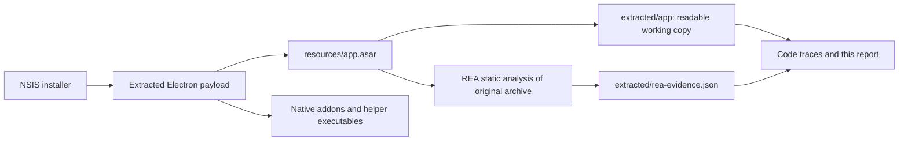

### 2.3 Extraction and integrity caveat

The installer was extracted without launching Granola. REA initially refused
ASAR extraction because declared integrity metadata contradicted an unpacked
native dependency. A second, explicit `record-and-continue` extraction retained
the observed bytes and recorded **seven integrity contradictions**:

| ASAR logical path |
| --- |
| `node_modules/better-sqlite3-multiple-ciphers/build/Release/better_sqlite3.node` |
| `node_modules/better-sqlite3-multiple-ciphers/build/Release/test_extension.node` |
| `node_modules/electron-click-drag-plugin/build/Release/win32-x64/drag.node` |
| `node_modules/registry-js/build/Release/registry.node` |
| `node_modules/win-ca/lib/crypt32-ia32.node` |
| `node_modules/win-ca/lib/crypt32-x64.node` |
| `node_modules/win-ca/lib/roots.exe` |

Post-packaging signing or stripping can cause such differences, but **that
explanation was not established for this installer**. These files must remain
observed-untrusted relative to the ASAR declarations. A mismatch alone is not
proof of malicious modification, and successful extraction does not authenticate
the package.

The application JavaScript working copies were formatted for readability.
Consequently, line numbers in this report refer to those formatted copies, and
their byte hashes differ from the original minified members. The original
installer and extracted `app.asar` retain the hashes above.

## 3. Evidence model and investigation boundaries

### 3.1 Meaning of claims

| Label | Meaning in this report |
| --- | --- |
| Observed static fact | A value, branch, request construction, or caller/callee boundary is present in the inspected artifact |
| Derived implementation explanation | A behavior is explained by tracing several static operations together |
| Architectural inference | A design implication is drawn from those operations; it is not a runtime measurement |
| Unknown | The available artifact or analysis cannot establish the answer |

Unless explicitly qualified otherwise, implementation descriptions below are
**static findings**. Diagrams are analyst-authored models of the traced code,
not original design documents or packet captures.

### 3.2 What was and was not done

Performed:

- Installer format identification, extraction, and archive testing.
- SHA-256 identification of the installer, ASAR, and selected native addon.
- Two bounded REA JavaScript analyses against selected original ASAR members.
- Direct inspection of additional formatted JavaScript files.
- Native helper file-format inspection and selected addon import/string inspection.
- Focused Ghidra decompilation of addon capture, resampling, session enumeration,
  CLI dispatch/authentication, and consent-host framing/transport routines.
- Embedded Go build-information inspection of both helper executables.
- Export of retained REA evidence.

Not performed:

- Launching the Windows application, joining a meeting, or recording audio.
- Signing into a Granola account or calling its live APIs.
- Browser/Electron runtime instrumentation or network capture.
- Exhaustive analysis of every native function, bundled dependency, or Chromium component.
- Recovery of backend source, production prompts, retrieval indexes, or models.
- A security audit or verification of backend authorization enforcement.

The initial pass had no configured native decompiler. Ghidra was subsequently
installed and REA configured; section 21 supersedes the initial native-analysis
gaps where explicitly indicated. All analysis remained static.

## 4. Application architecture

### 4.1 Responsibilities and boundaries

| Component | Established role |
| --- | --- |
| React renderer | UI, editor sessions, client state, summary/chat orchestration |
| Preload bridge | Exposes `window.electron` operations and event subscriptions |
| Electron main process | Coordinates windows, capture, transcription, authentication, utility processes, and lifecycle |
| Audio utility process | Loads native capture binding and forwards audio/status events |
| Microphone-monitor utility process | Loads native activity tracker and reports app/device sessions |
| SQLite utility process | Owns database coordination and worker pool |
| SQLite worker threads | Execute encrypted database reads/writes |
| Local ASR utility process | Runs optional speech-recognition inference paths |
| Local diarization utility process | Contains optional embedding/clustering and speaker-assignment logic |
| Granola backend services | Receive summary, chat, transcript-sync, and integration API requests |
| Speech providers | Receive audio on selected cloud transcription paths |

The preload contains a broad bridge surface. Its existence is a boundary
observation, not proof that every exposed operation is enabled, reachable, or
available in every window. [S02]

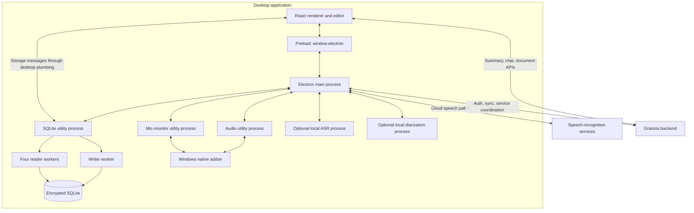

Sources: [S01], [S02], [S03], [S15], [S17], [S19], [S24].

## 5. Meeting discovery and transcription lifecycle

### 5.1 Microphone activity as a meeting signal

On Windows, `mic_monitor_v2_process` constructs `MicActivityTrackerV2` from the
native addon. Its JavaScript layer maintains reported sessions and emits
`mic-apps-v2-update` events. The main process maps executable names and PIDs to
known application identities and associates device information where available.
[S24], [S25]

This is stronger than a calendar-only trigger: the application can receive a
signal that another application is actually using a microphone. It is still
**a meeting-detection input, not definitive proof that a meeting is in progress**.
The follow-up recovered Windows audio-session enumeration and event serialization,
but not every notification, debounce, and device-change path. See section 21.3.

### 5.2 Calendar and policy context

Calendar APIs expose refresh and selection operations. The transcription
start/stop module also contains calendar restriction, workspace policy, and
consent-related states. The client therefore does not reduce meeting behavior to
an unconditional rule that any microphone activity starts transcription. [S13],
[S17]

This investigation established the presence of those control paths, not the
complete production policy matrix or the server-side enforcement of a policy.

### 5.3 Capture and recognition are separate desired states

The main process tracks desired capture/transcription state, document identity,
keywords, and language. A change can stop the active recognition session,
reconfigure it, or create a new one. Relevant changes include document,
provider, local engine, language, model, and keyword differences. [S09]

The following state diagram is a conceptual lifecycle, not a verbatim enum:

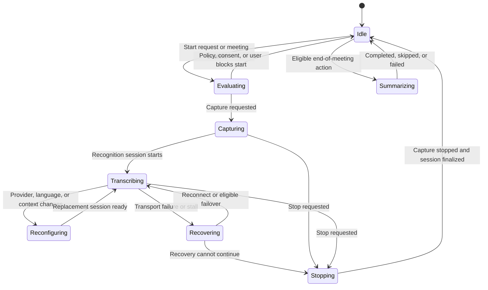

Capture state and transcription state are reported separately for microphone and
system sources. This permits the UI and diagnostics to distinguish a capture
problem from a recognition connection problem. [S05]

## 6. Audio capture and preprocessing

### 6.1 Windows native capture route

The Windows capture manager resolves the platform addon under
`resources/native/windows/` and starts `audio_process/index.js` with its path.
The utility process creates `new AudioCapture()` and registers native callbacks.
[S03], [S04]

Important commands/events at this boundary include:

| Direction | Command or event | Purpose |
| --- | --- | --- |
| Main to audio | `request-microphone-permission` | Ask binding to request/check microphone access |
| Main to audio | `request-system-audio-permission` | Ask binding to request/check system capture access |
| Main to audio | `start-audio-capture` | Start capture with sample rate and processing options |
| Main to audio | `stop-audio-capture` | Stop the native capture |
| Audio to main | `audio-capture-buffer` | Deliver microphone/system buffers and optional timestamps |
| Audio to main | `audio-volume` | Deliver per-source volume estimates |
| Audio to main | `audio-capture-status` | Report binding status |
| Audio to main | `audio-capture-source-error` | Report a source-specific capture error |

The callback exposes microphone and system audio independently. Volume
calculation in the wrapper interprets samples as signed 16-bit little-endian PCM
and computes an RMS-like level over approximately 100 ms. [S03]

The main capture path uses `U_ = 16000`, meaning 16,000 samples/second. The
batcher uses one channel, two bytes/sample, and a 100 ms target. At 16 kHz that
corresponds to **3,200 bytes per nominal per-source batch**, before considering
actual callback sizes or batching overshoot. This is arithmetic derived from
the implementation constants, not a measured packet size. [S05]

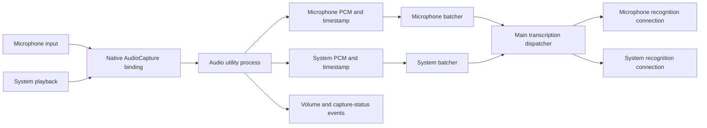

The JavaScript code demonstrates the native boundary and system-audio capture
behavior. The follow-up in section 21.2 establishes a WASAPI-style packet loop
and Media Foundation conversion inside the addon; driver compatibility remains
unmeasured.

### 6.2 Browser capture route

`browser_audio_capture` has a bundled default of `false`. On Windows, the
selection logic uses the browser route when that flag is enabled; otherwise it
uses the Windows native manager. [S04], [S28]

The browser path:

- Requests microphone tracks through `navigator.mediaDevices.getUserMedia()`.
- Requests system capture through `getDisplayMedia()`, with a conditional
  alternative for a Teams-related capture source.
- Creates an `AudioContext` and `AudioWorkletNode`.
- Forwards samples and capture timestamps from the worklet.
- Computes per-source volume and handles track/device lifecycle events.

There are selectable combinations of echo cancellation, noise suppression, and
automatic gain control. If an explicitly selected microphone device becomes
unavailable, the code can retry with a default input. [S06]

Two packaged worklets were inspected. The general meeting worklet batches
samples into 100 ms windows with a batch-start timestamp; another worklet uses
256-sample batches. They should not be treated as interchangeable or assumed
to run simultaneously. [S07]

### 6.3 Recovery

The Windows manager has an audio-process exit/restart path, reissues capture
after the process initializes when capture is still desired, and limits restart
attempts. The browser route has track-ended/device-recovery behavior. These
mechanisms exist in code; their timing and success rate were not measured.
[S04], [S06]

## 7. Cloud transcription

### 7.1 Provider abstraction and selection

The default value of the `transcription_provider` flag is `deepgram`.
Implementations are present for Deepgram, AssemblyAI Universal, a
Cloudflare-named relay, a local recognizer, and a gated `meta-muse` provider.
[S09], [S28]

Selection considers more than one flag:

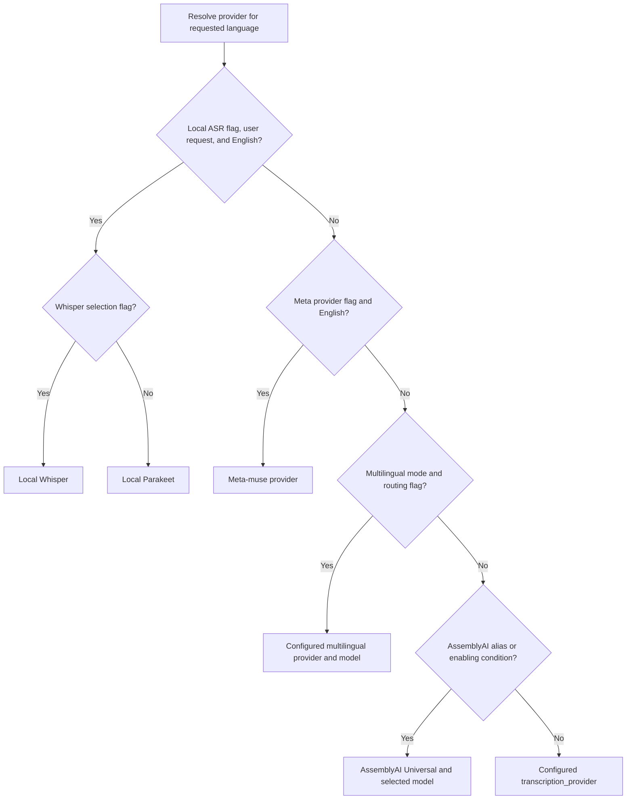

This simplifies the branches for readability. In particular, model selection,
eligible fallback configuration, and multilingual overrides have additional
conditions. It is not a guarantee that every provider is enabled or reachable.
[S09]

### 7.2 Deepgram implementation

Observed endpoint constants include:

- `wss://api.deepgram.com/v1/listen`
- An alternative deployment-specific Deepgram endpoint.

The adapter obtains an auth token through Granola's
`get-transcription-auth-token` API, caches token expiry, refreshes when needed,
and can retain a still-valid cached token if refresh fails. [S08]

The connection requests `linear16` audio, the configured sample rate, interim
results, smart formatting, and a Nova-3 model family configuration. There is a
branch selecting `nova-3-mega` for a particular model-version setting. Keywords
or keyterms provide recognition context; these are speech hints, not the
summary prompt. [S08]

### 7.3 Common transcript representation

Provider results are normalized before they become document transcript state.
Important fields include:

| Field | Role |
| --- | --- |
| `id` | Chunk identity |
| `document_id` | Owning document |
| `text` | Recognized text |
| `source` | Microphone or system source |
| `start_timestamp`, `end_timestamp` | Normalized timestamp range |
| `is_final` | Interim versus finalized chunk |
| `transcription_session_id` | Optional recognition-session identity |
| `detected_speaker_name`, `detectedSpeaker` | Optional speaker attribution |
| `providerDetails` | Conditionally retained provider/word metadata |

Interim results can reuse a chunk ID until that chunk is finalized. Normalized
chunks are merged into local client state; finalized chunks are added to the
synchronization queue. Provider-specific metadata retention is conditional.
[S08], [S10]

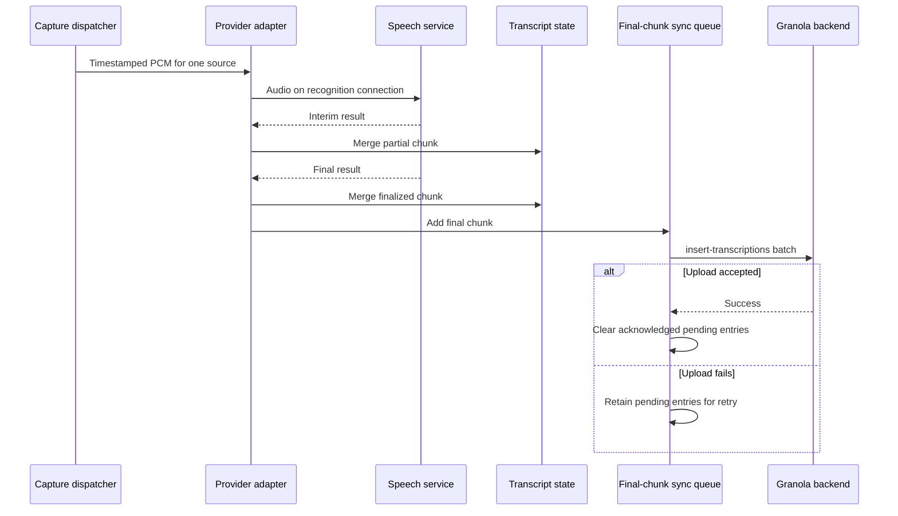

### 7.4 Synchronization and failover

The transcript queue tracks unsynced chunk IDs, snapshots a batch, uploads it,
and removes entries only after successful synchronization of the corresponding
snapshot. The code includes a flush during eligible stop/finalization paths.
[S11]

Provider/session code contains reconnect, stall detection, and eligible
failover paths. A failover is not a generic guarantee of lossless recognition:
provider availability, feature flags, timing, and session state influence the
outcome. The artifact alone cannot quantify lost, replayed, or duplicated audio
under failure.

## 8. Local transcription

### 8.1 Availability is explicitly conditional

The local provider is selected only when:

1. The local-ASR feature flag is enabled.
2. The desired state requests local transcription.
3. The configured language is English (`en`).

The bundled `transcription_local_asr` default is `false`. A second selection flag
chooses Whisper versus Parakeet. This establishes implemented capability, not
installed models or a universally available offline mode. [S09], [S28]

### 8.2 Model acquisition and validation

The main process contains local-ASR model download/state handling and a
`local-asr` location under the application's user-data directory. Artifact
validation checks expected digests before inference dependencies are loaded.
The worker also validates the Sherpa binding and library artifacts. [S12]

### 8.3 Parakeet/Sherpa path

The worker loads an explicitly supplied Sherpa binding through `createRequire`,
requires offline-recognizer exports, and configures recognition with the
provided model artifacts and optional vocabulary/hotword information. A
VAD-driven segmentation loop handles audio windows, utterance completion,
partial results, and final results. [S12]

### 8.4 Whisper path

The worker launches a supplied `whisper-server` executable on a loopback
`127.0.0.1` port, waits for readiness, and sends inference requests to
`/inference`. Optional prompt text is attached to inference requests. Startup
failure, process exit, and missing recognition text are explicit errors. [S12]

This is **local speech-to-text**, not evidence that meeting summarization or
document chat runs locally. Nor does selection of local ASR prove transcripts
remain local: transcript synchronization and backend AI features are separate
paths.

## 9. Speaker information and diarization

Several concepts must be kept separate:

| Concept | What the inspected code establishes |
| --- | --- |
| Audio-source separation | Microphone and system audio are distinct inputs |
| Provider word/speaker information | Provider metadata can enter normalized chunks |
| Participant attribution | Chunks can carry a detected participant name/object |
| Local diarization | A separate process contains speaker embedding, clustering, and assignment logic |
| Meeting-app attribution | Additional Zoom/Teams-related attribution paths and flags exist |

The normalized transcript producer attaches `detectedSpeaker` and
`detected_speaker_name` where attribution is available. Provider details can be
retained for subsequent processing. [S10]

The local-diarization process contains embedding extraction, clustering, and
threshold-based speaker-assignment logic. The main bundle contains separate
voice-fingerprint and Zoom-speaker-attribution flags, some with defaults of
`false`. [S14], [S28]

**Not established:** which attribution mechanism is active for a real meeting,
its accuracy, the production speaker model, enrollment policy, or how native
meeting-app observations behave on all supported versions.

## 10. Summary generation and note enhancement

### 10.1 Input assembly

The prompt-input builder combines more than raw transcript text. Its returned
variables include the following categories. Values are conditional on available
document, profile, calendar, and application state. [S16]

| Category | Representative variable names |
| --- | --- |
| Meeting content | `transcript`, `notes`, `headers`, `urls`, `tags` |
| Meeting identity/time | `document_id`, `calendar_event_title`, `time`, `date`, `todays_date` |
| People and context | `participants`, `my_name`, `their_name`, `viewer_name`, bio/company variables |
| Organization context | `my_company`, `my_colleagues`, `external_attendees`, `external_companies` |
| Language and vocabulary | `is_multi_language`, `english_only_summary`, `is_british_english`, `user_dictionary` |
| Content characteristics | `transcript_length`, `is_short_transcript`, `has_long_user_notes` |
| Feature/context switches | `is_collaborative`, `has_speaker_attribution`, `is_ios` |
| Prior generated context | `latest_meeting_summary` |

The notes selection prefers active-editor Markdown when supplied, then saved
Markdown, then saved plain text. This is how a user's in-progress typed notes can
influence enhancement instead of the feature merely summarizing audio. [S16]

### 10.2 Templates

Template-backed generation resolves a prompt slug and the template's section
headings, descriptions, and title. Those become variables such as
`summary_headings`, `first_heading`, `meeting_description`, and `template_title`.
The code also derives a maximum-heading suggestion from transcript length.
Blank panels cannot invoke summary generation through this path. [S17]

The template prompt slug is a **server prompt selector**, not a complete local
copy of the production system prompt.

### 10.3 Generation request

The orchestration layer creates or reuses a panel, marks generation state,
initializes a Y.Doc seed, and sends a request containing fields including:

- `document_id`, `panel_id`, and optional panel title.
- `prompt_slug` and `prompt_variables`.
- `chat_history` and `template_slug`.
- `ydoc_state` and `ydoc_version`.
- Automatic-generation and other optional generation controls.

The bundle maps the streaming summary operation to
`https://stream.api.granola.ai/v1/generate-summary`. A separate background path
and a durable-generation path are present. [S17], [S18], [S27]

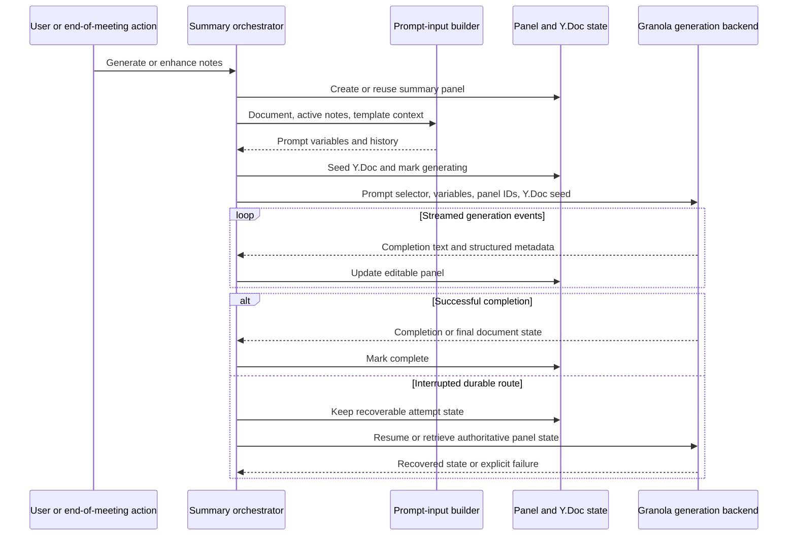

### 10.4 Output and recovery

The client consumes streamed completion text and structured events, including
generated-line/Y.Doc metadata. The durable path saves generation-attempt state
to `localStorage`, distinguishes start and resume operations, and queries panel
state when recovering. It explicitly handles mismatched saved attempts and
cases where a generation is still active but its stream cannot be recovered.
[S17], [S18]

At meeting end, client logic checks whether summary panels already exist and
whether transcript content is sufficient before automatically generating.
Resume/race checks prevent some end-of-meeting actions from proceeding after
transcription has resumed. These are separate from manual generation rules.
[S17]

### 10.5 What is not recoverable from this client

The client does not establish:

- The exact production LLM, model weights, or current routing policy.
- The server's complete system prompt or prompt-template contents.
- Server-side postprocessing and action-item extraction algorithms.
- The quality, latency, cost, or determinism of generated summaries.

## 11. Editor, persistence, and collaboration

### 11.1 Editor model

The inspected editor integration uses Tiptap/ProseMirror with Yjs documents.
Summary generation seeds a `prosemirror` XML fragment and tracks metadata in the
Y.Doc. Document content is therefore not modeled solely as a string replaced
after every generation. [S17], [S21]

### 11.2 SQLite process and worker pool

The storage utility process coordinates one writer worker and four reader
workers. It tracks database lifecycle state, correlates requests with message
IDs, queues work, and reports worker failures. Reads can be dispatched to
available reader workers; writers are separately coordinated. [S19]

The database worker uses `better-sqlite3-multiple-ciphers` and sets:

| Setting | Observed value or purpose |
| --- | --- |
| `cipher` | `sqlcipher` |
| `legacy` | `4`, for the selected compatibility mode |
| `key` | Hex-encoded data-encryption key supplied by the parent |
| `journal_mode` | `WAL` for writer connection |
| `synchronous` | `NORMAL` for writer connection |
| `query_only` | Enabled for reader connections |

Database names are constrained by a name-validation expression before opening.
[S19], [S20]

### 11.3 Encryption-key lifecycle

The main process generates a 32-byte data-encryption key, base64-encodes it for
protection through Electron `safeStorage.encryptStringAsync()`, and writes the
wrapped bytes to `storage.dek` under user data. The decrypted key is passed to
the storage process. The code has platform-specific key-loading behavior and
retry handling for some temporarily unavailable decryption failures. [S22]

An important edge case: the utility process treats a missing key as an
**ephemeral storage mode**. The worker uses an in-memory database for a null key;
it is not evidence that persistent data silently switches to unencrypted disk
storage. Creation/loading failures are logged in the surrounding code.
[S19], [S20], [S22]

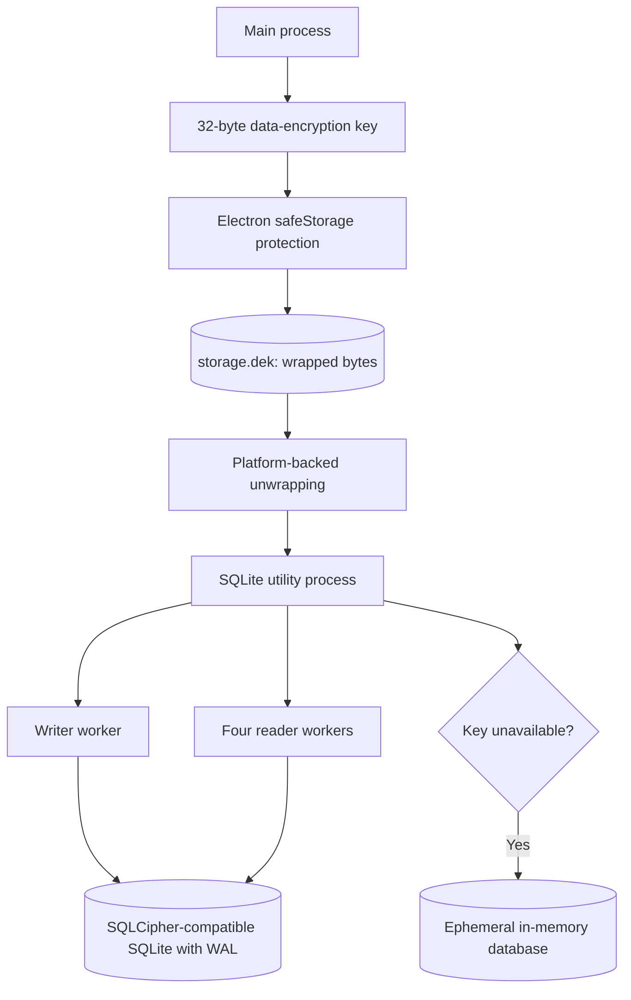

The diagram is a logical key/data flow, not a claim that all arrows execute
for every launch. Local encryption does not authenticate the extracted native
dependency whose integrity mismatch is documented in section 2.

### 11.4 Local Y.Doc persistence and network collaboration

The local cache implementation stores document-state blobs/updates in a
`ydocs` table keyed by document identity, with creation timestamps. It restores
persisted state and subscribes to subsequent changes. [S23]

The editor-session implementation has a PartyServer-style provider, Yjs
synchronization messages, and awareness state. Its connection wrapper builds a
WebSocket URL with a party/room path and connection identity, can refresh
connection parameters before reconnecting, and sends provider-specific messages.
These are client protocol observations, not a reconstruction of the server.
[S21], [S26]

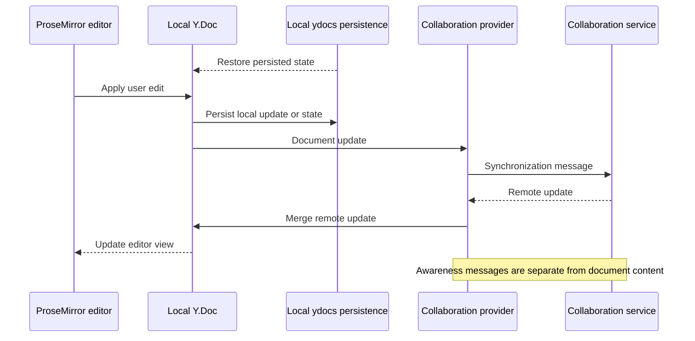

The ordering above illustrates responsibilities; it is not a measured
transaction order or a guarantee that every update is persisted before network
transmission.

### 11.5 Other persistence paths

An encrypted JSON-cache path and cache-version migration logic are also present
in the main bundle. Transcript final-chunk synchronization uses its own pending
IDs. Summary recovery also uses browser `localStorage` for generation-attempt
state. It would be incorrect to describe all local state as a single SQLite
database or all persistence mechanisms as having identical encryption
properties. [S11], [S17], [S22]

## 12. Document chat

Document chat uses an authenticated backend request to the
`chat-with-documents` operation. The API mapping contains:

`https://stream.api.granola.ai/v1/chat-with-documents`

The client handles streamed text, source/citation metadata, completion events,
and structured message content. It has separate parsing/normalization logic for
those outputs rather than treating the entire response as one text string.
[S18], [S27]

The important implementation split is:

| Client-observed responsibility | Backend responsibility not recovered |
| --- | --- |
| Build context request | Decide retrieval/query strategy |
| Send authenticated request | Search indexes and rank evidence |
| Consume streamed text | Run the language model |
| Process citations/source metadata | Establish source selection and grounding |
| Update chat UI/state | Apply server-side access controls |

The presence of citation-handling code alone does not prove a particular
embedding model, vector database, retrieval algorithm, or citation-accuracy
guarantee. Section 22 adds stronger evidence from explicitly named search/index
operations and tool schemas, while preserving the distinction between a
client-supported backend contract and a verified deployed implementation.

## 13. Calendar, sharing, and integrations

### 13.1 Calendar operations

The API wrapper exposes operations including:

- `refresh-calendar-events`
- `set-selected-calendar`
- `reset-selected-calendars`
- `get-selected-calendars`

Meeting/calendar information feeds document metadata and prompt construction.
Native EventKit-related code is packaged for other platforms, but it should not
be interpreted as the implementation of Windows calendar integration.
[S13], [S16]

### 13.2 Sharing and external services

Inspected integration operations include Slack channel/member listing and
posting, integration retrieval/update, Google Docs authorization, and
Notion-related integration operations. Client schemas also contain document
sharing/link-visibility settings. These establish client integration surfaces,
not the internal implementation of each connector. [S13]

Examples of observed API operation names:

| Area | Operations |
| --- | --- |
| Documents | `create-document`, `update-document`, `get-documents-v2` |
| Panels | `create-document-panel`, `update-document-panel`, `get-document-panels` |
| Transcripts | `insert-transcriptions`, `get-document-transcript`, `delete-transcription-chunks` |
| Calendar | `refresh-calendar-events`, `get-selected-calendars` |
| Meeting consent | `get-meeting-consent-status`, `is-consent-satisfied`, `record-chat-consent-message-sent` |
| Slack | `list-slack-channels`, `list-slack-members`, `post-slack-message` |
| Feature configuration | `get-feature-flags`, `set-feature-flag`, `reset-feature-flags` |

These are operation identifiers from wrapper code. Except where a full URL is
explicitly quoted, this table is not a specification of HTTP methods, URL paths,
request contracts, or guaranteed account entitlements.

### 13.3 Consent helper boundary

The installer contains a `meet-consent-host.exe` helper, and the main bundle
contains meeting-consent/browser-extension events and API operations. The
JavaScript evidence establishes orchestration surfaces. Section 21.5 now traces
the helper's native framing, pipe selection, and forwarding implementation.
The browser extension's complete implementation was not supplied or recovered.

## 14. Companion CLI

The bundled `resources/bin/granola.exe` is distinct from the installer and the
Electron main executable. The desktop main process exposes a local companion
protocol using:

- Windows named pipe: `\\.\pipe\granola-companion-cli`.
- A Unix socket alternative on other platforms.
- A generated authentication token stored in a local companion configuration.
- Newline-delimited JSON request/response framing.
- Request IDs and structured success/error replies. [S29]

The configuration contains a protocol version, socket path, and token. No token
value was read or needed for this investigation.

| Method | Established purpose |
| --- | --- |
| `notes.list` | List meeting-note metadata with pagination |
| `notes.get` | Retrieve notes, Markdown/plain content, and summary fields |
| `notes.transcript.get` | Retrieve transcript chunks |
| `folders.list` | List folders, optionally filtered |
| `folders.documents.add` | Add a document to a folder |
| `folders.documents.remove` | Remove a document from a folder |

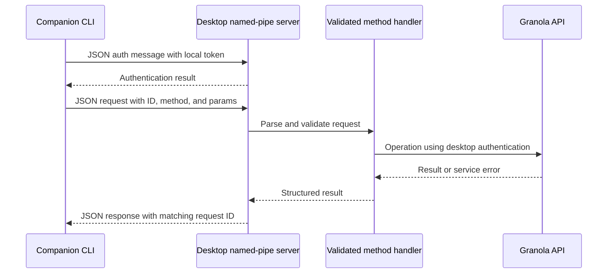

The diagram covers the traced desktop handlers, including backend-backed note
retrieval. Section 21.4 supplements this desktop-side trace with native CLI
dispatch, accepted command/option forms, metadata checks, and transport deadlines.

## 15. Authentication, updates, and observability

### 15.1 Authentication

The main bundle contains WorkOS-related session/token handling, refresh-token
requests, and logout flows. Recognition-provider tokens are acquired through a
separate Granola operation. Desktop-account tokens and speech-provider tokens
have different roles and should not be conflated. [S08], [S30]

No account credentials, local session tokens, or user data were required or
collected. The artifact does not establish production token scope, revocation
behavior, or server authorization correctness.

### 15.2 Updates

The bundle contains `electron-updater` integration. Observed configuration sets
a feed URL, enables automatic downloads for packaged builds, disables
differential download, and disallows downgrade in the inspected configuration.
There is a recurring update-check path. [S31]

No update was downloaded or installed. Feed availability, update-signature
validation behavior, and release-channel operation were not independently
verified.

### 15.3 Observability

The inspected code contains structured events for audio capture, provider
connections, session restarts, inference resources, storage-worker failures,
summary generation, and recovery. A Sentry renderer bundle is packaged as well.

These observations show instrumentation surfaces. They do not establish the
complete telemetry payload set, production collection policy, retention, or
whether a particular event is sent in a real session.

## 16. Data boundaries and deployment-dependent behavior

### 16.1 Local versus remote work

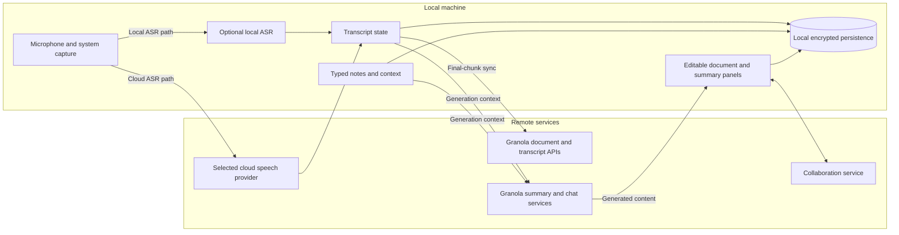

This diagram summarizes traced paths, not a complete inventory of every
network transfer. In particular, local ASR does not suppress transcript-sync or
cloud-generation paths by implication.

### 16.2 Selected bundled feature defaults

| Flag or setting | Bundled observation | Correct interpretation |
| --- | --- | --- |
| `browser_audio_capture` | `false` | Default Windows route is native unless overridden |
| `transcription_provider` | `deepgram` | Default provider selection, subject to other routing conditions |
| `transcription_local_asr` | `false` | Local ASR is not globally selected by default |
| `multilingual_transcription_provider` | `deepgram` | Multilingual routing has its own provider setting |
| `voice_fingerprint_poc` | `false` | Fingerprint-related code is gated |
| Zoom speaker-attribution flags | `false` in inspected definitions | Presence does not establish availability |
| Several Windows loopback/Teams-specific flags | `false` in inspected definitions | Alternative capture paths are deployment-dependent |

Sources: [S28].

### 16.3 Conclusions that must not be inferred

- Separate microphone/system streams do not prove perfect speaker separation.
- A captured system stream does not prove the exact Windows API used internally.
- Local ASR support does not prove a fully offline product.
- Local encryption does not prove end-to-end encryption.
- Backend API wrappers do not prove server-side authorization.
- Packaged flags do not prove active rollout or user entitlements.
- An endpoint string does not prove live network traffic.
- A citation parser does not prove a specific retrieval architecture.
- ASAR integrity mismatches do not, alone, prove malicious modification.

## 17. Reliability mechanisms

| Failure class | Mechanism visible in code | Remaining uncertainty |
| --- | --- | --- |
| Audio process exits | Restart path and capture reinitialization, with attempt limit | Actual recovery latency and sample loss |
| Browser input device unavailable | Retry without exact device constraint | Device/driver-specific behavior |
| Recognition connection fails | Reconnect and eligible provider/transport switching | Loss, replay, and duplication under real failures |
| Speech-token refresh fails | Reuse a still-valid cached token when available | Server token revocation behavior |
| Transcript upload fails | Retain pending final-chunk IDs for later sync | Backend idempotency guarantees |
| Summary stream interrupted | Durable saved attempt, resume, and authoritative panel-state recovery | Availability of recovery for every generation mode |
| End-of-meeting races with resume | Recheck document/transcription state before continuing | Complete race coverage |
| Storage worker fails | Correlated request rejection and explicit error reporting | Full recovery semantics under corruption |
| Data-encryption key unavailable | Logged failure and ephemeral storage mode | User-facing behavior in every failure branch |

These are implementation mechanisms, not measured service-level guarantees.
Sources: [S04], [S06], [S08], [S09], [S11], [S17], [S19], [S22].

## 18. Coverage, unknowns, and follow-up evidence

### 18.1 Findings ledger

| Investigation question | Result | Confidence boundary |
| --- | --- | --- |
| What is the executable? | Answered: NSIS installer with Electron payload | Artifact/header/manifest evidence |
| How are core responsibilities split? | Answered at JavaScript/process level with selected native implementations | Backend internals excluded |
| How is audio captured? | Answered through callers, WASAPI packet loop, and Media Foundation resampler | Indirect-call arguments and driver/runtime behavior remain partial |
| How does cloud transcription work? | Answered at client adapter and normalization level | Provider internals and deployed routing unknown |
| Does local recognition exist? | Answered: gated Parakeet/Whisper paths | No inference or model download executed |
| How are speakers attributed? | Partially answered | Multiple gated mechanisms; no runtime validation |
| How are notes enhanced? | Answered at input, request, output, and recovery level | Backend prompt/model not recovered |
| How are documents stored and edited? | Answered at editor, database, and Y.Doc level | No user database or live collaboration inspected |
| How are meetings detected? | Partially answered through native session enumeration, process lookup, serialized events, and app mapping | Complete debounce/device-change/notification logic not reconstructed |
| How does document chat work? | Answered at client request/stream handling level | Retrieval, ranking, and model execution unknown |
| How do external integrations work? | Partially answered through API surfaces | Connector internals not recovered |
| How does the companion CLI communicate? | Answered through native command dispatch, metadata/auth, pipe, and JSON framing | No live commands/account exercised |
| How does the consent helper communicate? | Answered through native browser framing and Electron pipe bridge | Extension behavior and production consent enforcement not established |

### 18.2 Static-analysis coverage limits

Both REA passes explicitly selected eight paths from an inventory reporting
902 relevant files; each therefore left 894 files outside that pass's source
analysis scope. Additional files were read directly for this report.

The first pass parsed seven JavaScript files plus the selected manifest and
reported no parse failures. The second parsed eight JavaScript files and also
reported no parse failures. Neither result is a complete whole-application
semantic graph:

- Application graph coverage was partial.
- Semantic graph coverage was partial and reached configured retention limits.
- Dynamic calls, property resolution, and IPC expressions remained unresolved.
- Unknown counts are analyzer bookkeeping, not confirmed application defects.
- An empty extracted relationship category does not prove absence of that
  relationship; direct code inspection supplied several process/native
  boundaries that were not resolved automatically.

### 18.3 Evidence required to resolve remaining questions

| Unknown | Evidence needed |
| --- | --- |
| Actual enabled providers and flags | Consented runtime observation of the deployed app/configuration |
| Remaining native capture/monitor details | Further indirect-call/assembly tracing and controlled Windows device/session scenarios |
| Audio latency and failure recovery | Controlled Windows capture and fault scenarios |
| Speaker-attribution accuracy | Labeled meeting scenarios and observed attribution output |
| Production summary model/system prompts | Authorized backend source/configuration or explicit server evidence |
| Retrieval/index implementation | Authorized backend implementation or suitable service traces |
| Real traffic, telemetry, and retention | Scoped runtime network evidence plus server policy/configuration |
| Reason for integrity mismatches | Authenticated publisher artifacts or reproducible packaging/signing evidence |
| CLI runtime output and operational edge cases | Controlled Windows CLI/desktop scenarios using authorized test data |

No row above was silently filled with an assumption.

## 19. Source navigation index

All links below are to the formatted working tree under `extracted/app`.
`#L...` fragments identify useful starting lines; displayed ranges describe the
relevant reading boundary. Hashed bundle names and line numbers are
build-specific. Most minified function names are not stable developer API names.

| Reference | File and useful range | What to inspect |
| --- | --- | --- |
| [S01] | `package.json` | Application version, main entrypoint, shipped dependencies |
| [S02] | `dist-electron/preload/preload.js`, around 80 onward | Exposed desktop bridge |
| [S03] | `dist-electron/audio_process/index.js`, 25-195 | Native binding and audio messages |
| [S04] | `dist-electron/main/index.js`, 55715-55932 | Windows manager and route selection |
| [S05] | Main, 46811; 55933 onward; 164680-164765 | Sample rate, batching, dispatch |
| [S06] | `dist-app/assets/primary-CXVdv0fU.js`, 260315-261160 | Browser capture, processing, and recovery |
| [S07] | `audioWorkletProcessor-CDVBpRB4.js` and `audioWorkletProcessor-CnX3dOu7.js` | 100 ms and 256-sample worklets |
| [S08] | Main, 68408-69035 | Deepgram auth, configuration, and result handling |
| [S09] | Main, 77945-78485 | Provider resolution and desired-state/session transitions |
| [S10] | Main, 73125-73195 | Normalized chunk construction |
| [S11] | Main, 65910-66140 | Final-chunk queue and sync |
| [S12] | `local_asr_process/index.js`, 300-650; main, 73559 onward | VAD/local engines, model validation/download |
| [S13] | `api-C8TM1NqZ.js`, 5880-6025; 6470 onward | Documents, transcripts, consent, calendar, integrations |
| [S14] | `local_diarization_process/index.js` | Embedding/clustering implementation |
| [S15] | `sqlite_process/index.js`, 70-230 | Reader/writer coordination |
| [S16] | `gatherPromptInputsForDocument-D5B6S1ty.js`, 1373-1595 | Summary context assembly |
| [S17] | `startStopTranscribingDocument-YZgSjccl.js`, 3880-4320; 4644 onward | Summary start/recovery and end-of-meeting logic |
| [S18] | `api-C8TM1NqZ.js`, 2110-2290; 6260-6460; 6730-6940 | Stream parsing, summaries, and chat |
| [S19] | `sqlite_process/index.js`, 70 onward | Storage process lifecycle and worker pool |
| [S20] | `sqlite_process/worker.js`, 25-195 | Encryption pragmas and database execution |
| [S21] | `useDocumentEditorSession-D4pizoLY.js`, 5878-6300 | Yjs provider, awareness, editor integration |
| [S22] | Main, 47215-47420; 158850-158890 | Data-encryption key lifecycle and storage startup |
| [S23] | `cacheStore-DIe2MzOf.js`, 26760-26985 | Local Y.Doc state persistence |
| [S24] | `mic_monitor_v2_process/index.js`, 204-340 | Native mic activity tracker and emitted sessions |
| [S25] | Main, 50615-50735 | Process/device mapping and monitor startup |
| [S26] | `useDocumentEditorSession-D4pizoLY.js`, 6128-6180 | PartyServer connection construction and parameter refresh |
| [S27] | `types-Ddt9D0Pg.js`, 575; 661; 1060 | Summary/chat endpoint and WebSocket configuration constants |
| [S28] | Main, 16320-16572 | Bundled feature-flag defaults |
| [S29] | Main, 119128-119390 | Companion CLI protocol and transport |
| [S30] | Main, 57215-57685 | WorkOS/session refresh handling |
| [S31] | Main, 133292-133430 | Updater configuration and recurring checks |

## 20. Evidence records and reproducibility

### 20.1 Retained evidence

The exported bundle is [extracted/rea-evidence.json](extracted/rea-evidence.json).
At export it contained eight records and was 214,230,901 bytes. It is intended
for structured inspection, not ordinary Markdown viewing.

| Evidence | Identifier |
| --- | --- |
| ASAR extraction with recorded contradictions | `ev_e456c707c20c4fa8a6dc5dc770a2b812679154ff8e0ce6a0e979490e49c7f80e` |
| Main/preload/process ASAR analysis | `ev_bad955ea651db4a3bf9e5c7beff79c5eb983e6d89225a45153e93202c5966908` |
| Summary view of main/process analysis | `ev_9cc4f40ca04336e05454a2f099781a4d6349cb9a26a8c6555f87a11e9568deba` |
| Renderer/API/worker ASAR analysis | `ev_e15c55d96140eacbdccf5659d44228ad61220cfde5c2ecb634f0cc36816b9944` |
| Summary view of renderer/worker analysis | `ev_6e7a8f54d332879a86c5d51bd7ee096040679d2edcfa71b9475cb5dc334af0ab` |

A subsequent Rust-metadata inspection of the native addon returned
`ev_f9267e1037e4ae44b2f8eeab204c8c72a5dd1d10d7b3b1bf8d0f67938ccf6295`.
That observation was made **after** the export above and is not claimed to be
retained in that file. It found no `.dep-v0` dependency metadata and no supported
compiler-commit path. Those absences do not prove that the addon is not Rust or
that it has no dependencies.

The two analysis records bind to the original ASAR hash, not to the formatted
working files. Additional direct code reads are indexed in section 19; not every
manually traced relationship was automatically recovered in the REA graph.

### 20.2 Reproducing artifact identity

These read-only commands identify the retained inputs without launching the
application:

```bash
file 'Granola - AI Notepad.exe'
sha256sum 'Granola - AI Notepad.exe'
sha256sum extracted/resources/app.asar
sha256sum extracted/resources/native/windows/granola.native.windows.win32-x64-msvc.node
sha256sum extracted/resources/bin/granola.exe
sha256sum extracted/resources/native-host/meet-consent-host.exe
```

For a new analysis, use the original archive, not the reformatted tree, when
matching the evidence identity. Select the relevant exact member paths, preserve
the integrity contradictions, and do not treat a summary projection as complete
semantic coverage.

### 20.3 Reading this report safely

All Mermaid diagrams are explanatory models of established boundaries and
flows. Conditional paths are identified as such. The report does not provide a
complete specification of production behavior, a reproduction of proprietary
source code, or an implementation of Granola's server.

## 21. Native Windows follow-up with Ghidra

### 21.1 Scope, provenance, and how to read the addresses

This follow-up used **Ghidra 12.1 through REA** on the three x86-64 PE artifacts
identified in section 2. Neither helper executable nor the addon was executed.
Ghidra imported immutable source artifacts into temporary analysis projects;
evidence bundles and provider-neutral snapshots were saved before closing
each target.

Addresses below are **Ghidra virtual addresses for this exact build**, not file
offsets, runtime ASLR addresses, or stable API identifiers. The addon mostly has
generated names such as `FUN_18003ee00`. Its PDB reference names `windows.pdb`,
but Ghidra reports the PDB load state as unknown; original types/names must not
be assumed recovered. Go function names and source-path/line metadata are much
more informative in the two helpers.

Ghidra repeatedly assigns an inappropriate `IErrorInfoVtbl` type to unrelated
COM interfaces. The explanations below identify interfaces from observed GUIDs
and method-slot patterns, not from that misleading decompiler type. Likewise,
Go multi-value returns and Rust result layouts sometimes appear as anonymous
arrays or missing parameters. Pseudocode is an analysis aid, not original source.

| Artifact | Native provenance and useful entry points |
| --- | --- |
| Windows addon | Rust-origin source paths include `src\audio_capture\mod.rs`, `resampler.rs`, and `mic_activity_v2/mod.rs`; N-API export `napi_register_module_v1` at `0x1800724a0` |
| Companion CLI | Embedded module `granola-companion-cli`; Go build metadata reports `go1.23.12`, Windows/amd64, `go-winio v0.6.2`, and `x/sys v0.10.0` |
| Consent host | Embedded module `meet-consent-host`; same reported Go version/target and pipe library, plus `cenkalti/backoff/v4 v4.3.0` |

Build metadata is observed content, not independent authentication of a compiler
or dependency. The Rust source paths complement, rather than contradict, the
earlier absence of cargo-auditable `.dep-v0` metadata.

### 21.2 Native capture: Windows audio clients plus Media Foundation

The capture worker at **`0x18003ee00`** contains the capture-thread log and the
concrete setup/packet loop. Its string reference was indirect: the text at
`0x1800b15d0` points through a Rust formatting descriptor at `0x1800b1608`,
whose code references lead to the worker. This matters because searching
procedure names alone would not find the implementation.

The recovered sequence is:

1. Initialize COM with `CoInitializeEx(NULL, 0)` and create the audio-device
   enumeration object through `CoCreateInstance`.
2. Resolve/activate an audio endpoint and obtain its mix format.
3. Initialize the audio client, obtain the capture service, and configure a
   resampler for the requested output rate.
4. Start the client, repeatedly check packet availability, acquire a buffer,
   convert its samples, and release the capture buffer.
5. Deliver converted audio through the addon's surrounding state/callback
   machinery; stop/release audio interfaces on exit.

The worker computes `is_loopback << 17`, producing `0x20000` for its loopback
case, consistent with `AUDCLNT_STREAMFLAGS_LOOPBACK`. Together with the
audio-client/capture-client method slots, this supports identifying the system
source as a **WASAPI loopback capture implementation**, rather than screen
capture or a virtual microphone. The complete indirect-call argument list and
every share-mode/device-selection variant were not reconstructed.

| Address | Recovered role | Interface/slot interpretation |
| --- | --- | --- |
| `0x180086db0` | Get mix format | Audio-client vtable `+0x40`, consistent with `IAudioClient::GetMixFormat` |
| `0x180086d00` | Initialize client | Audio-client `+0x18`, consistent with `Initialize` |
| `0x180055e90` | Obtain capture service | Audio-client `+0x70`, consistent with `GetService` |
| `0x180086e00` / `0x180086e30` | Start / stop client | Audio-client `+0x50` / `+0x58` |
| `0x1800863e0` | Check next packet | Capture-client `+0x28`, consistent with `GetNextPacketSize` |
| `0x180086c70` / `0x180086cd0` | Acquire / release packet buffer | Capture-client `+0x18` / `+0x20` |
| `0x18003d4b0` | Initialize conversion transform | Calls COM and Media Foundation setup |
| `0x18003daf0` | Convert a captured buffer | Creates MF samples/memory buffers and feeds/reads the transform |

**Resampling is delegated to Windows Media Foundation.** The initializer calls
`MFStartup(0x20070, 1)` and creates a COM transform using GUID
`{f447b69e-1884-4a7e-8055-346f74d6edb3}`, consistent with the Windows resampler
media object. The corresponding interface GUID is
`{bf94c121-5b05-4e6f-8000-ba598961414d}` (`IMFTransform`).
The code distinguishes input format representations and constructs an output
media type with **one channel and 16 bits/sample** at the requested rate.
The JavaScript caller supplies 16 kHz, independently establishing the
application-level target described in section 6.

This corrects a possible implementation guess: the evidence does **not** support
describing resampling as a custom Rust DSP algorithm. Rust owns the orchestration
and buffers; the inspected conversion path uses a Windows transform.

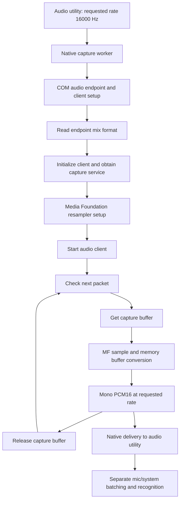

The conversion and packet loop are static observations. Callback cadence,
latency, channel-mixing coefficients, silent-buffer edge cases, and driver
compatibility require additional tracing or controlled Windows measurements.
In particular, a wait helper receives `(0, 10000000)` in the loop, but this
report does not convert that into a claimed sleep duration without tracing
the helper's units.

#### 21.2.1 Follow-up: application detection is not application-isolated capture

A focused direct read of the retained shipped JavaScript distinguishes three
separate mechanisms:

| Mechanism | Observed implementation | What it does not establish |
| --- | --- | --- |
| Application activity | Audio-session process identities, meeting-app mapping, and Teams process/root-PID filtering | That only those processes' audio is recorded |
| Browser system audio | `getDisplayMedia` is serviced by a main-process handler returning `audio: "loopback"` or `{name: "All loopback devices", id: "loopbackAllDevices"}` | A target meeting-process PID passed to this capture request |
| Teams device follow | Probe Teams-related render sessions, choose their output device, then call `startDeviceRenderLoopback(deviceId, sampleRate, ...)` | Per-process isolation from other applications using the same endpoint |

The source-selection function uses `processLoopbackSupported`, feature flags,
blind-app activity, and microphone-detection availability to choose the
browser loopback source. The variable name alone is not proof of a selected
meeting-process capture filter. [S97], [S98]

For Teams, `rootPids`, `includeProcessNames`, and
`includeProcessRootNames` are used to locate relevant render sessions. The
resulting native capture call takes a **device ID**, not those PIDs. The
controller can retarget/reopen the device capture and forwards its PCM through
`native-system-audio` events. This is consistent with correcting output-device
mismatches, not proof that other sound on that endpoint is excluded.
[S99], [S100]

`windows_loopback_all_devices`, `windows_teams_device_loopback`, and
`windows_teams_output_monitor` have false defaults in this package; remote
configuration and actual rollout remain unobserved. This follow-up does not
claim that no other capture implementation exists, nor that these branches
were active in a real session. It establishes that the inspected paths must
not be described as verified "record only the selected application" support.

### 21.3 Native meeting signals: audio-session inventory and process identity

The N-API registration routine at `0x18002ca00` builds the
`MicActivityTrackerV2` class with constructor/start/stop bindings at
`0x18002c370`, `0x18002c4f0`, and `0x18002c790`.
The start binding calls `0x180062540`, which constructs monitor state and a
worker thread and waits for an initialization result.

An independent GUID-led trace found **`IAudioSessionManager2`**
(`{77aa99a0-1bd6-484f-8bc7-2c654c9a9b6f}`) at `0x1800b2508`.
Its code references resolve into session-related routines including
`0x1800613f0` and `0x18005b3e0`. The former is called by the worker at
`0x1800632f0`.

The decompiled path at **`0x1800613f0`**:

- Enumerates active capture endpoints: wrapper `0x180086fa0` is called with
  data-flow value `1` and device-state mask `1`, consistent with
  `IMMDeviceEnumerator::EnumAudioEndpoints(eCapture, DEVICE_STATE_ACTIVE)`.
- Activates the audio-session manager using the GUID above.
- Obtains session enumeration through wrapper `0x180086720` (manager slot
  `+0x28`, consistent with `GetSessionEnumerator`), then counts/visits sessions.
- Queries a further session interface, reads session state, and calls
  `0x180086f50` at slot `+0x70`, consistent with the process-ID method on
  `IAudioSessionControl2`.
- Skips PID zero; opens the process with `OpenProcess(0x1000, ...)` and calls
  `GetProcessImageFileNameW` to derive process identity.

This is code-level evidence for detecting **which processes own Windows audio
sessions**, not merely scanning a process list for meeting-app names.
The worker takes initial and subsequent session inventories and processes their
state. A related routine also enumerates render endpoints; this pass does not
claim that every session routine serves only microphone monitoring.

Separately, the event serializer at **`0x1800321d0`** constructs JavaScript
objects containing `type`, `sessionId`, `processId`, `processName`, and optional
`reason`, including `session_active` and `session_inactive` event types. This
matches the JavaScript consumer in section 5. The entire path from every COM
notification/debounce decision to every emitted event was not resolved.


The dashed edge deliberately marks incomplete reconstruction. Remaining details
include exact polling/notification scheduling, debounce, endpoint replacement,
and all reasons for inactivity. This does not prove that microphone activity
always starts recording; the higher-level policy gates remain separate.

### 21.4 Go companion CLI: actual dispatch, discovery, and authentication

Ghidra recovered application function names from Go metadata. Important entries:

| Address | Recovered function |
| --- | --- |
| `0x4f9c00` | `main.run` |
| `0x4fa560` | `main.runNotes` |
| `0x4fbca0` | `main.runFolders` |
| `0x4fc3a0` | `main.runFolderDocumentCommand` |
| `0x4fcdc0` | `main.invoke` |
| `0x4fd7a0` | `main.authenticateConnection` |
| `0x4fdd60` / `0x4fde20` | `main.writeJSONLine` / `main.readJSONLine` |
| `0x4fdec0` / `0x4fe280` | `main.readMetadata` / `main.getMetadataPath` |
| `0x4fe340` | `main.parseOptions` |

The following command forms are supported by both the embedded help and the
decompiled command dispatch, rather than guessed from desktop method names:

| Shell command after `granola` | Forwarded method | Main options/parameters |
| --- | --- | --- |
| `help [topic]` | Local help | General or command-specific topic |
| `notes list` | `notes.list` | `--limit`, `--offset`, `--created-after`, `--created-before` |
| `notes get` | `notes.get` | Repeated `--id` values become an `ids` array |
| `notes transcript get` | `notes.transcript.get` | `--id` |
| `folders list` | `folders.list` | Optional `--search` |
| `folders add-document` | `folders.documents.add` | `--folder-id`, `--document-id` |
| `folders remove-document` | `folders.documents.remove` | `--folder-id`, `--document-id` |

For `notes list`, the CLI calls `strconv.Atoi` for limit/offset and reports
integer parse errors. Date-filter options are forwarded as strings under
`created_after` / `created_before`; timestamp acceptance should not be attributed
solely to the CLI parser. Desktop-side schemas and handlers add their own
validation. Likewise, a help placeholder saying `<uuid>` is not by itself proof
that the native parser validates UUID syntax.

**Discovery and trust boundary:**

1. `getMetadataPath` joins `os.UserConfigDir()` with the Granola companion
   subdirectories. The desktop writer confirms the path
   `Granola/companion-cli/companion-cli.json` under its app-data directory. [S29]
2. `readMetadata` reads and unmarshals that file, requires
   `ProtocolVersion == 1`, and requires nonempty `SocketPath` and `Token`.
   Missing/invalid metadata yields errors rather than anonymous operation.
3. `invoke` calls `go-winio.DialPipe` using the metadata endpoint with a
   **5-second connection timeout**.
4. `authenticateConnection` writes an authentication object, reads a structured
   reply, and requires its `OK` value. It returns the buffered reader for the
   following request; it does not discard already buffered stream data.
5. Authentication and subsequent request processing each set a
   **30-second deadline**. A request envelope is written and one response
   envelope read; connection cleanup is deferred.

`writeJSONLine` calls `json.Marshal`, appends byte `10`, and writes the result.
`readJSONLine` reads a string from the buffered connection, trims whitespace,
and unmarshals JSON. Together with the desktop server, this establishes
**NDJSON over a local named pipe**, not HTTP. The CLI is a local authenticated
proxy to the already signed-in desktop; this path does not implement speech
recognition, summaries, or an independent cloud login.

No user metadata/token file was opened, and no CLI command was executed.
The static trace does not measure actual timeout behavior, pipe permissions,
or deployed server-side authorization.

### 21.5 Consent host: browser framing to Electron NDJSON

The helper is a **transport bridge**, separate from the companion CLI:

| Address | Function and established responsibility |
| --- | --- |
| `0x4fbc80` | `getSocketPaths`: constructs per-user pipe and legacy fallback |
| `0x4fbe80` | `perUserSuffix`: SHA-256 and hexadecimal suffix derivation |
| `0x4fc2e0` | `sendToChrome`: JSON plus a 4-byte output length |
| `0x4fc560` | `readFromChrome`: length/body reads, bounds check, JSON parsing |
| `0x4fcc60` | `readFromElectron`: line scanner, JSON parsing, forwarding |
| `0x4fd1e0` / `0x4fd300` | Retry wrapper / pipe-connection attempt |
| `0x4fd660` | `main`: initial connection, status, concurrent forwarding, shutdown |
| `0x4fdb00` | Browser-to-Electron callback: appends newline before pipe write |

**Browser side:** the helper reads exactly four header bytes and interprets the
result as a 32-bit length. On this little-endian Windows target this is a
little-endian length prefix. It rejects **zero-length or greater-than-65,536-byte**
messages, then reads the complete body and parses JSON. Invalid framing/body
reads log an error and terminate; normal stdin EOF exits cleanly. Invalid JSON
logs an error and the loop continues.

The reverse path marshals JSON, writes a 4-byte length, then writes the body to
stdout. The desktop's native-host manifest explicitly uses `type: "stdio"` and
an `allowed_origins` list of configured extension origins. Its Windows setup
writes NativeMessagingHosts registry entries for applicable browsers. [S32]

**Desktop side:** the helper constructs the preferred pipe
`\\.\pipe\granola-meet-consent-<suffix>` and a legacy fallback
`\\.\pipe\granola-meet-consent`. The suffix derives from SHA-256 of the resolved
home directory; desktop JavaScript confirms the matching first-12-hex-character
rule. The suffix is endpoint namespacing, **not a secret or proof of
authentication**. No actual home-directory hash was needed.

Each connection attempt tries candidate pipes using `go-winio.DialPipe` with a
5-second timeout. The outer connection routine uses the embedded exponential
backoff library. After connecting, the helper sends an initial status message,
launches browser-input forwarding concurrently, and reads desktop messages.
Browser JSON is forwarded with an appended newline. Desktop messages are read
with `bufio.ScanLines`, parsed, then sent using browser length-prefix framing.
The scanner's configured buffer/maximum is `0x10000`; its line-token semantics
are not identical to the browser-side body-length check.

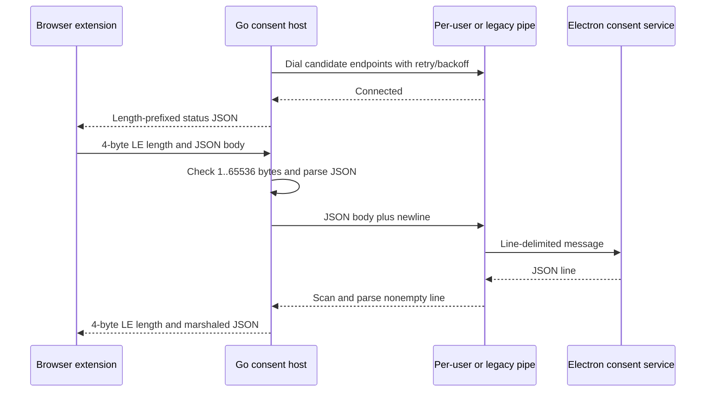

Signal handling closes the connection and exits; a closed desktop stream causes
the main routine to finish. The inspected path establishes initial connection
retries, not automatic recovery after every established-stream failure.

The helper forwards generic JSON messages; this does **not** establish the full
extension-side state machine, Google Meet page integration, or production
consent-policy enforcement. Unlike the companion CLI, no token-authentication
exchange was identified in these bridge routines. That is a bounded static
observation, not a security assessment of browser-origin controls or pipe ACLs.

### 21.6 Native evidence, saved files, and remaining work

The native evidence is intentionally separate from the large original
JavaScript bundle:

| Export | Records | Principal contents |
| --- | --- | --- |
| [Addon evidence](extracted/native-analysis/addon-evidence.json) | 23 | Capture/resampler decompilation, session GUID references, monitor and serializer routines |
| [CLI evidence](extracted/native-analysis/cli-evidence.json) | 4 | Strings, function inventory, dispatch/transport decompilation, Go metadata |
| [Consent-host evidence](extracted/native-analysis/consent-evidence.json) | 5 | Strings, function inventory, bridge/retry decompilation, Go metadata |

Selected reproducible evidence identities:

| Finding | Evidence ID |
| --- | --- |
| Capture worker | `ev_40a92d430c5f6f378bb29c9ca753703874e7cd0e4f2bd9923ab76a4320166752` |
| Audio wrappers and Media Foundation resampler | `ev_3183ede9b4e8c226d09ad5d145ed30a1cc4deb3d41cba684fa57cf50119f87b0` |
| Session-event object serialization | `ev_069b2dfa21cfec9e82a713b4a61e5485e2da9057a9ab15f21152b0aa237701be` |
| Session-manager reference and enumeration routines | `ev_7835a4737f217634718d872b128b1e2f0200a575ac982f3d619825f4d1b29b8b` |
| Monitor worker and COM wrappers | `ev_744ef33e23806b658c0ddf2987fae83919b6057a9d4f4a060dcc52090ff68e99` |
| CLI dispatch, metadata, and authentication | `ev_f87682623a7b09c243ec12630fef8d4b97821d35cda5f80dc329ce47a9828f36` |
| CLI embedded Go build information | `ev_5c1ae43d74deadae529c373d665b314e07ec4aa6c99c2432d3f0d3bdeaf8cef5` |
| Consent framing and bidirectional forwarding | `ev_4b5eaf11bb32ca646551a32d5486cb5f74bef5ca53d9dcbc351e1f1451781c06` |
| Consent initial-connection retry wrapper | `ev_9e7f9907c7badad1851c21eecf2cbd607257d1944cbf230c151abf7d1751599f` |
| Consent embedded Go build information | `ev_b84830a6e5605efa73e5ef208304b8c495a17b17b119f118d8fe241b2f655f41` |

Readable derived pseudocode is saved alongside the evidence:
[capture worker](extracted/native-analysis/addon-capture-thread.c),
[audio wrappers/resampler](extracted/native-analysis/addon-audio-wrappers.c),
[session inventory](extracted/native-analysis/addon-0x1800613f0.c),
[monitor worker/wrappers](extracted/native-analysis/addon-monitor-wrappers.c),
[session serializer](extracted/native-analysis/addon-session-event.c),
[CLI functions](extracted/native-analysis/cli-functions.c), and
[consent functions](extracted/native-analysis/consent-functions.c).
The JSON evidence, rather than these convenience files, preserves operation
parameters, subject digests, analysis profiles, limitations, and canonical
procedure identities. Retry-wrapper pseudocode remains in the consent JSON.

Matching `addon-snapshot.json`, `cli-snapshot.json`, and
`consent-snapshot.json` files preserve provider-neutral analysis state for reuse;
they are not full Ghidra projects or recovered source trees.

**Coverage remains bounded:** this pass explains the core native capture,
conversion, session inventory, CLI protocol, and consent bridge. It does not
exhaustively reverse every function, resolve every indirect call, prove runtime
compatibility, or expose backend AI internals. The highest-value remaining
evidence would be controlled Windows endpoint-change/capture scenarios,
session-notification traces, and consent/CLI exchanges using authorized test
data, not more assumptions from embedded strings.

## 22. Backend AI research and client-visible contracts

### 22.1 What this follow-up can and cannot establish

**Research date: 2026-10-21.** This pass combines deeper static traces of the
supplied client with directly retrieved official Granola documentation.
The public pages are current observations, not necessarily documentation of
the exact release packaged in this installer. Publication dates were not
available on the retrieved help pages.

The installed application does not contain the private backend source.
Consequently, this section reconstructs **the contract the backend must satisfy
for these client paths**, not its exact server implementation. No authenticated
Granola endpoint was called, no account or token was accessed, and no meeting
data or artifact source was submitted to external research services.

| Evidence class | Meaning in this section |
| --- | --- |
| Observed client code | Request construction, parsing, schemas, local state, endpoint mappings |
| Public statement | Granola's directly retrieved documentation; not independently measured |
| Architectural inference | A plausible explanation consistent with those observations |
| Unknown | A detail requiring server source, server traces, or authorized runtime evidence |

**Main result:** the evidence supports an architecture with server-selected
prompts/models, distinct summary-generation and chat orchestration contracts,
replayable summary-job streams, structured search/read tool outputs, and
editable/cited results. It does not establish a single universal model, an exact
system prompt, or a particular retrieval scoring algorithm.

### 22.2 Backend operation map

The client endpoint registry and callers establish the following interfaces.
These URLs were inspected as literals; they were not probed. Endpoint hostnames
are routing observations, not proof of service deployment topology. [S33], [S34]

| Operation | Shipped mapping or contract | Established role |
| --- | --- | --- |
| `llm-proxy` | `api.granola.ai/v1/llm-proxy` | Nonstreaming prompt-selected LLM requests |
| `llm-proxy-stream` | `stream.api.granola.ai/v1/llm-proxy-stream` | Generic streamed prompt-selected generation |
| `generate-summary` | `stream.api.granola.ai/v1/generate-summary` | Summary-specific text, panel, and Y.Doc events |
| `trigger-summary-generation` | `stream.api.granola.ai/v1/trigger-summary-generation` | Idempotent summary submission returning a stream URL |
| `chat-with-documents` | `stream.api.granola.ai/v1/chat-with-documents` | Authenticated desktop chat with structured outputs |
| `chat-with-documents-web` | Corresponding `/v1/chat-with-documents-web` route | Separate web entry point |
| `get-chat-models` | `api.granola.ai/v1/get-chat-models` | Dynamic model catalog, grouping, and defaults |
| `get-chat-citation` | `api.granola.ai/v1/get-chat-citation` | Citation retrieval surface |
| `search-meetings-turbopuffer` | `api.granola.ai/v1/search-meetings-turbopuffer` | Structured meeting search |
| `turbopuffer-index-documents` / `turbopuffer-index-documents-generator` | Corresponding `api.granola.ai/v1/` routes | Explicitly named indexing surfaces |
| `describe-screen-share-context` | `cinnamon.api.granola.ai/v1/describe-screen-share-context` | Screenshot evaluation/description surface |

The shared request layer attaches authentication where supplied, client
version/platform information, and workspace context where configured. Distinct
operation names and hostnames do not establish distinct processes, queues,
cloud vendors, or separate model deployments.

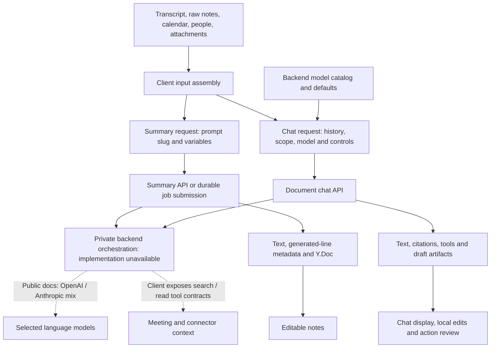

The dashed relationships are supported architectural roles, not recovered
server call graphs or a claim that every request invokes every component.

### 22.3 Summary prompts: substantial inputs, private instructions

The client does meaningful preprocessing before the backend sees the request:

- It resolves document/profile/calendar state, formats transcript content and
  speaker information, and collects people/company context.
- It chooses active-editor Markdown before stored Markdown/plain notes.
- It derives language, dictionary, content-length, collaboration, speaker, and
  meeting-type/context variables.
- It passes section descriptions and template metadata through a common
  template-summary prompt selector.
- It can include attachment-derived descriptions and image references through
  chat-history content. [S16], [S35]

Some precise heuristics are visible. `is_short_transcript` is true below
**200 transcript characters**. `has_long_user_notes` means at least **20 nonempty
lines**, not a token count. The heading suggestion uses transcript-character
thresholds at 8,000, 20,000, and 80,000, with an intermediate arithmetic rule.
These are client prompt variables, not the model's context window or proof of
server-side chunking. [S35], [S36]

Prompt identifiers include the general meeting/template selectors and specialized
tasks such as meeting titles, meeting-end checks, chat-thread titles, speaker
name suggestions, and Slack summaries. Several summary variant names refer to
specific model families or experiments. **A slug is a server-side lookup key,
not an authenticated declaration of the model actually called.** A title helper
invokes `llm-proxy` with `chat-thread-title` and reads a completion-shaped result;
the generic proxy also supports a developer prompt override. [S33]

The summary request additionally contains `action_item_extraction_slug`,
`suppress_transcript_footer`, `force_user_context`, and `strip_notes_tag`.
These show configurable subtask/output controls, but do not reveal the
corresponding prompts, whether subtasks run concurrently, or how many model
calls execute. [S36]

**Public corroboration:** Granola states that enhanced notes combine transcript,
raw notes, and calendar information, and use a blend of models primarily from
OpenAI and Anthropic. Its template documentation describes purpose/context,
style/length, and section instructions. It also says edits to one meeting's
notes do not automatically change generation for future meetings. These
statements align with the client-side variable/template design; they do not
reveal prompt text or prove a fine-tuning method. [P1], [P2]

**Multimodal boundary:** screenshot-related schemas describe a decision among
irrelevant, duplicate, or new content, plus descriptions and model identifiers.
The description formatter explicitly labels screenshot-derived text as
machine-generated, untrusted supporting evidence and prefers transcript/raw
notes on conflicts. That is a visible prompt-input safeguard, not proof of
complete prompt-injection resistance. [S37]

The shared client supports such attachment context, but the current public
automatic snapshot feature is explicitly **macOS-only, not Windows**. Bundled
cross-platform code must not be mistaken for a supported Windows capture
feature. [P3]

### 22.4 Streaming summary jobs: generation is not just a chat completion

There are three distinguishable client contracts:

| Path | Framing/response shape | Important distinction |
| --- | --- | --- |
| Generic proxy stream | JSON objects separated by `-----CHUNK_BOUNDARY-----`; completion-shaped deltas | Shared utility for prompt-selected tasks |
| Direct summary stream | Same separator, typed `panel_id`, `completion`, `generated_lines`, `ydoc`, `error` objects | Carries editable-document/provenance metadata as well as text |
| Durable summary path | Trigger returns `streamUrl`; client requests replay/live JSON through an SSE-capable stream reader | Separates job submission from stream consumption/recovery |

The delimiter is not ordinary NDJSON and the direct parser is not simply an
OpenAI SSE parser. It buffers incomplete UTF-8/chunks across network reads,
then splits at the application delimiter. Provider-compatible `choices` fields
do not prove that Granola forwards an upstream provider stream unchanged.
[S33], [S38]

**Durable submission and recovery:** [S36], [S39]

1. The client persists a pending attempt containing a random UUID, request,
   document/panel identity, and expiration time in user/panel-scoped localStorage.
2. It sends `trigger-summary-generation` with that UUID as `Idempotency-Key`.
   The response is validated as a URL and stored as the streaming state.
3. The reader asks for replay/live delivery using `offset: "-1"`, `live: "sse"`,
   and JSON mode. After eligible body-read failures it reconnects and skips the
   number of records already delivered to avoid replaying them into the editor.
4. Body-retry delays are 1, 2, 4, 8, and 16 seconds. HTTP/protocol errors are
   treated differently from retryable body-read failures.
5. The consumer checks panel identity and handles `completed` or `failed`
   outcomes. Completion includes `summaryTextCharacterCount`, which is compared
   with received text length before saving the generated panel.
6. If the stream is unavailable in the handled recovery case, it fetches the
   server's panel state, including Y.Doc data, and reconciles completion or an
   explicit failure instead of assuming a truncated stream succeeded.

Failure codes include `auto_generation_blocked` and
`generation_already_in_progress`. These expose server decision outcomes and a
duplicate/in-progress coordination contract, but do not prove a specific lock,
database transaction, queue, or exactly-once execution guarantee.

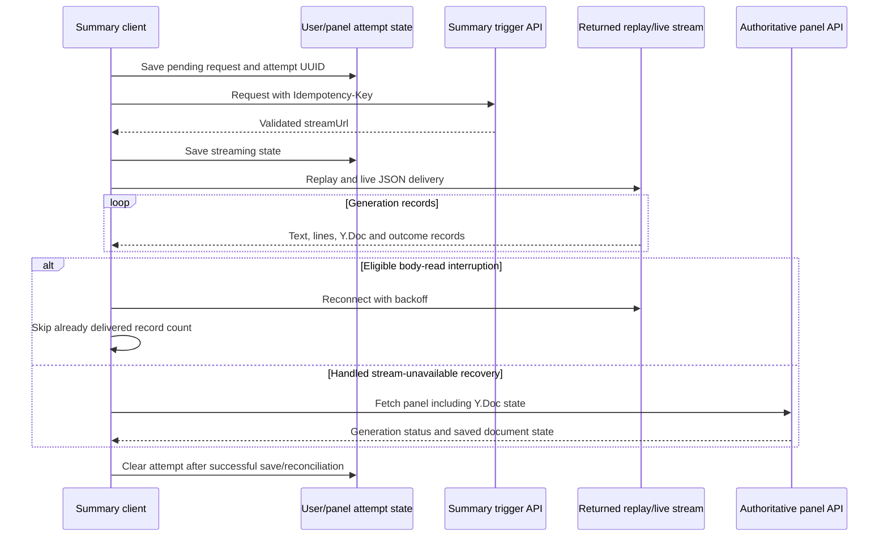

This is evidence for resumable **delivery and client reconciliation**. It does
not establish that the language model itself can resume at an arbitrary token
or that reconnecting always avoids a second backend inference.

### 22.5 Model routing: dynamic catalog, explicit selection, unknown Auto policy

The model picker fetches `get-chat-models`, groups entries by `groupId`, and
applies returned defaults. Its query has a one-hour stale period. It stores
separate selections for single-meeting and multi-meeting contexts, checks
whether an entry is disabled, and can fall back to catalog defaults. Workspace
overrides take precedence; Basic-plan UI selection is forced to `auto`.
[S40]

The main chat request forwards the effective selection through
`prompt_config.model`. It can also carry `response_style`,
`custom_braintrust_slug`, and single-meeting `input_values`. A recipe can
override the model and request additional context such as web search, related
meetings, or upcoming events. [S41]

Therefore:

- A list of model-like strings in the executable is **not the production model
  catalog**. Some are schema options, special workflows, or developer controls.
- The literal `auto` delegates selection, but the dispatch classifier,
  confidence thresholds, fallback order, and cost/latency policy remain unknown.
- Workspace/plan controls in the UI do not independently prove backend
  enforcement.
- Neither public model-brand references nor completion-shaped JSON establish a
  fixed summary model, parameter count, quantization, or fine-tuned checkpoint.

Granola's current documentation corroborates Auto selection by chat context,
paid-plan manual selection, standard/thinking groupings, and a workspace-admin
gate for a particular Anthropic model option. The training page says summary
models are continually evaluated/switched and bringing one's own models is
not currently supported. [P4], [P5]

Retention is also model/path-specific. The model-selection page documents an
exception to zero-data-retention for the named Fable option. Do not collapse
provider retention, provider training restrictions, and Granola's own
improvement/opt-out policies into one blanket claim. [P4], [P5]

### 22.6 Retrieval and context selection: stronger evidence, bounded conclusions

The most concrete new search evidence is not a generic embedding-library import.
There are dedicated API wrappers for **Turbopuffer-named indexing and search**
and a developer search UI that constructs real request parameters:

`searchType`, `people`, `companies`, `keywords`, `strictParticipantMatch`,
`limit`, `includeShared`, `fromDate`, and `toDate`.

The UI passes those parameters to the meeting-search wrapper and consumes a
`results` array. That is strong evidence of an implemented client integration
with a Turbopuffer-named backend search contract. It is not merely an unused
documentation string. However, this pass did not execute that UI or server.
[S42]

Additional client tool schemas expose:

| Tool family | Observed contract |
| --- | --- |
| Context inventory | `queryMeetingContext` accepts time-range/limit/shared controls and can return meeting metadata, counts, date range, and limitation notes |
| Targeted search | `searchMeetingsByPeople`, `searchMeetingsByPeopleAndCompanies`, and `searchMeetingsByKeywords` accept filters; results contain meeting IDs, titles, dates, and numeric scores |
| Reading evidence | Tool display handlers recognize `listMeetings`, `exploreMeetings`, `readMeetings`, `readTranscript`, and `readMeetingAttachment` |
| Connected sources | Calendar, email, web, file, people/company, and connector-related tool/result shapes are present |
| Scoped conversation | Context schemas distinguish meeting, live meeting, folder, global, search, view, and MCP contexts |

The main request carries history, optional document IDs, list/scope information,
attachments, timezone, transcript controls, and model/prompt configuration.
For eligible global contexts it need not enumerate every document ID in the
request. The server consequently has a selection role; a single-meeting path
can additionally receive locally assembled prompt inputs. [S41], [S43], [S44]

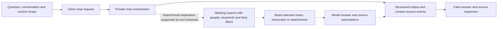

The dashed search/read/model chain is an **architectural inference**, not an
observed backend execution trace. The client contracts support retrieval-
augmented/tool-mediated answers but leave unresolved:

- Whether each route uses lexical search, vector search, hybrid search, or a
  combination; the embedding model and dimensions.
- Transcript/document chunk sizes, overlap, indexing frequency, index namespace,
  persistence layout, and deletion propagation.
- Reranking model, score meaning, top-k policy, context packing, and truncation.
- Whether modern chat tools share the exact developer-search implementation.
- How access controls are applied before/after retrieval and across connectors.

The earlier statement that the vector database was not established should now
be read more precisely: **Turbopuffer is explicitly named in supported client
search/indexing contracts; deployment and exact indexing/ranking internals are
not independently verified.** Voice-diarization embeddings in the native/main
code are a separate domain and must not be presented as meeting-search vectors.

### 22.7 Chat output is a structured protocol with client-side effects

The document-chat parser handles `text_delta`, `context_sources_delta`,
`context_limit_reached`, `outputs`, `output_delta`, `stream_completed`, and
explicit error records. It merges scanned-document/source counts, deduplicates
citation IDs, and tracks web-search information. Completion can include final
outputs, response text, changed editor blocks, metadata, and trace identifiers.
[S37]

The output schema is richer than a Markdown answer:

| Output | Client-supported meaning |
| --- | --- |
| `text` / `text_with_citations` | Plain answer or answer lines with source associations |
| `reasoning` | Reasoning-display text/timing; not proof that complete internal model computation is exposed |
| `tool_call` | Named tool, arguments, completion/error/result state, with specialized and MCP-related shapes |
| `draft_preview` | One or more artifacts with review/readiness status and confidence |

Citation fields can refer to transcript, summary, pre-meeting brief, email,
calendar, or web evidence, including quote/reference metadata. Their presence
establishes source-linking structure, **not factual entailment or citation
accuracy**. [S43]

The inspected chat completion handler applies queued note-edit operations,
can start a summary-panel rewrite from `rewriteMeetingNotes`, persists structured
outputs/history, and updates tool-error state if edits fail. This shows that
some tool effects are performed by the client, not all by a remote agent.
The UI also carries approval decisions forward in conversation state. [S41]

Draft artifact schemas include email, Slack, calendar, and other artifact kinds;
schema presence alone does not establish rollout. Official workflow
documentation independently confirms desktop email/Slack/calendar drafting
with a user review step before sending/creating. It also clarifies that these
flows can use connected Gmail/Slack/calendar context, so generic statements that
chat can only ever access meeting notes are too broad for connected workflows.
[P6]

### 22.8 Prompt iteration, evaluation, and tracing clues

There are several indications of an experimentation/observability layer:

- `custom_braintrust_slug` in chat prompt configuration.
- Completion fields such as `braintrustSpanId` and `braintrustTraceExport`.
- Persisted thread trace/root-span references.
- Developer/evaluation paths that compare conversation variants.
- Summary baseline/test prompt-slug controls and compact-system-prompt flags.
[S17], [S28], [S37], [S41], [S43]

These support an inference that prompt/version experimentation and trace
association are designed into the client/backend interface. They do **not**
recover the evaluation datasets, scoring rubric, production trace sampling,
data-retention policy, or prove that a particular vendor processes every call.
OpenAI/Anthropic SDK-related code and AWS logging dependencies likewise do not
identify the complete server stack.

### 22.9 Evidence and unresolved backend questions

The focused REA analysis selected five additional formatted client modules:
the shared API, summary orchestrator, prompt-input builder, feature/cache module,
and an additional action-schema module. It parsed all five without parse
failures, but semantic graph coverage is partial, including node ceilings;
897 other inventoried sources were outside that selection.

- Complete analysis record:
  `ev_cfe5b654345edc884444f041f54e5985c10582757ab14836567308351db89e55`.
- Summary projection:
  `ev_93120eac6cd14024ff60d636debd7e9a93a69e614cc1f7026d3df14a851f7908`.
- [Selected complete REA records](extracted/backend-analysis/rea-records.json)
  preserve those records without duplicating the original large export.
  This file's wrapper is not an importable REA bundle.
- [Source provenance manifest](extracted/backend-analysis/source-manifest.json)
  records byte counts, line counts, and SHA-256 for 11 directly inspected
  formatted modules, including the later chat/schema/developer-UI traces.

The directory digest identifies the extracted working tree, not the original
ASAR byte stream. Source-line links below refer to its formatted files. The
original installer/ASAR identities and extraction-integrity contradictions in
section 2 still apply. The selected analysis is not a claim that backend source
was found or that every linked module was included in the automated graph.

| Research question | Outcome | Evidence still needed for a stronger conclusion |
| --- | --- | --- |
| Which provider families are used? | Publicly documented OpenAI/Anthropic mix, dynamic client model catalog | Authorized per-request provider/model metadata |
| What enters a summary request? | Answered at client boundary, including template/context/attachment controls | Exact server prompt expansion and preprocessing |
| How are streamed summaries recovered? | Answered at client job/submission/replay/reconciliation boundary | Server job store, concurrency and inference-retry semantics |
| Is there a named search/index integration? | Turbopuffer-named contracts and concrete request-construction code observed | Server configuration or traces proving deployed storage/query implementation |
| How does chat select/read evidence? | Partially answered through scopes, filters, tool/result and citation schemas | Actual tool-call traces, ranking, chunking and context assembly |
| How are tools executed? | Some note edits/rewrites are visibly client-managed; drafts/approval shapes exist | Full server tool registry, execution loop and connector authorization traces |
| Are models trained or fine-tuned on meetings? | Public policy describes improvement/opt-out and provider training restrictions | Technical training architecture, checkpoint provenance, and verified enforcement |
| What are the exact summary/chat system prompts and server inference settings? | Unresolved; separate client-side dictation instructions/settings are recovered in section 24 | Authorized backend source/configuration or explicit debug export |
| What cloud/queue/database runs the AI orchestration? | Unresolved | Deployment configuration or authoritative engineering documentation |

**Public source ledger** (retrieved directly on the research date):

| Reference | Authoritative page | What it supports |
| --- | --- | --- |
| [P1] | AI-enhanced notes | Inputs, provider families, per-meeting editing behavior |
| [P2] | Templates | Purpose/style/section instructions and customization |
| [P3] | Shared-screen snapshots | macOS availability, uploaded/synced snapshot context, no Windows availability |
| [P4] | Model selection | Auto/manual/plan/workspace controls and named-model retention exception |
| [P5] | Models & training | Changing model mix, opt-out policy, provider training restrictions, no BYO models |
| [P6] | Workflows in Chat | Connected context and review-before-action behavior |

The subprocessor page linked by Granola's training documentation returned a
client-rendered trust-center shell in this environment. No provider inventory
was inferred from that empty shell. Search-result summaries and general-purpose
marketing articles were not treated as proof of internal algorithms.

## 23. V8 context snapshot: format and official-release comparison

### 23.1 Conclusion: an unchanged Electron runtime asset

**The supplied `extracted/v8_context_snapshot.bin` is byte-for-byte identical
to the corresponding member of the official Electron 44.4.2 Windows x64 ZIP.**
The companion `snapshot_blob.bin` also matches its official member exactly.
This is stronger evidence than its filename or an absence of application
strings: these two files contain no Granola-specific modifications relative
to that official distribution.

The comparison archive was downloaded from the Electron project's GitHub
release, and its complete SHA-256 was checked against the release's
`SHASUMS256.txt` before reading ZIP members. No executables or snapshots were
loaded or run. The evidence establishes equality to the retrieved official
release, not independent signature verification of the release infrastructure.

| Artifact | Bytes | SHA-256 |
| --- | --- | --- |
| `v8_context_snapshot.bin` | 742,200 | `332fd5ea0a894e96846679467a68cb492cb0736c1d70eda24802b94c1cfd3ec6` |
| `snapshot_blob.bin` | 368,768 | `941da72183c734efa3e4120b2721befdd0e618dbd593226b4cd5730afc5edb53` |
| Official `electron-v44.4.2-win32-x64.zip` | 158,218,669 | `6aae435b6cd5c0eedf9fd38824bae4045ffdaecd029f0b8c8328bac3f5b71f03` |

The desktop executable contains `Electron/44.4.2` and
`Chrome/152.0.7977.130` strings; the matching Electron tag's dependency file
names Chromium `152.0.7977.130`. Both snapshot headers contain V8 version
`15.2.124.28-electron.0`. These independent version clues led to the exact
release comparison. They are not a claim that every executable byte matches
stock Electron. [V1], [V2]

### 23.2 Actual binary header and segment map

This is a **V8 startup-data container with additional Blink contexts**, not a
PE executable, archive of meeting data, or AI model. Its header matches the
layout in V8 `15.2.124.28`'s `snapshot.cc`: little-endian context count,
rehashability, two checksums, a 64-byte version field, and segment offsets.
The read-only segment starts immediately after the pointer-aligned offset
table. [V3]

| File offset | Field | Value in `v8_context_snapshot.bin` |
| --- | --- | --- |
| `0x00` | Number of contexts | `3` |
| `0x04` | Rehashability | `1` |
| `0x08` | Container checksum | `0x2ae618d6` |
| `0x0c` | Read-only segment checksum | `0x7f364207` |
| `0x10` through `0x4f` | Version field | `15.2.124.28-electron.0`, zero-padded |
| `0x50` | Startup segment offset | `0x58cf0` |
| `0x54` | Shared-heap segment offset | `0x76890` |
| `0x58`, `0x5c`, `0x60` | Context offsets | `0x79f50`, `0x85e78`, `0x9e780` |

All segments have an 8-byte inner header: magic `0xc0de06cf` and payload length.
For every segment, payload length plus 8 exactly equals the segment's byte
length. The format is consistent with uncompressed `SnapshotData`; no snapshot
decompression was needed. [V4]

| Segment | File offset | Total bytes | Interpretation |
| --- | --- | --- | --- |
| Header / padding | `0x00000` | 104 | Container metadata and offset table |
| Read-only | `0x00068` | 363,656 | Serialized shared read-only runtime state |
| Startup | `0x58cf0` | 121,760 | Isolate startup state |
| Shared heap | `0x76890` | 14,016 | Shared-heap serialization |
| Context 0 | `0x79f50` | 48,936 | Default V8 context |
| Context 1 | `0x85e78` | 100,616 | Additional main-world Blink context, per upstream builder |
| Context 2 | `0x9e780` | 93,112 | Additional isolated-world Blink context, per upstream builder |

Both whole-container and read-only checksums were recomputed successfully using
**Adler-32 with initial value zero**, matching the V8 zlib-backed checksum
implementation. Container checksum coverage starts at byte `0x0c`, not byte
zero. Neither Adler-32 nor SHA-256 equality alone proves semantic safety. [V5]

The comparison `snapshot_blob.bin` has one context and a 96-byte header:
read-only at `0x60`, startup at `0x46bd8`, shared heap at `0x4c678`, and context
0 at `0x4e158`. Its checksums are `0x34550241` and `0x1a2f59c4`, both valid.
Its 48,936-byte default-context segment is itself byte-identical to context 0
of the larger snapshot.

### 23.3 Why the larger snapshot contains browser DOM names

The version-matched Blink builder creates a default V8 context and two
additional contexts: **main world and isolated world**. It prepares interface
templates for `Window`, `WindowProperties`, `HTMLDocument`, `Document`, `Node`,
and `EventTarget`, among generated bindings. The main world additionally
prepares the cached `window.document` wrapper; the isolated-world snapshot
does not carry that document wrapper. Context creation later binds these
templates to the real runtime document and external native functions. [V6]

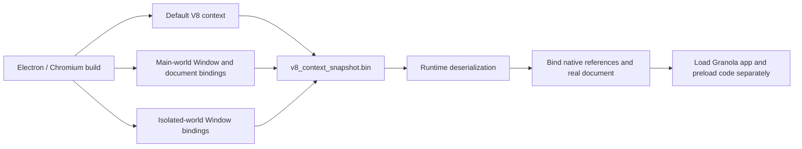

The upstream builder uses `SnapshotCreator::CreateBlob(kClear)`, which clears
recompilable function code for this path. The blob remains structured runtime
serialization with native reference indices; it is not an ordinary JavaScript
source file or a directly disassemblable x64 program.

### 23.4 Recovered strings and application-content checks

A complete scan for printable runs of at least five characters found:

| File | ASCII runs | Printable ASCII-range UTF-16LE runs |
| --- | --- | --- |
| `v8_context_snapshot.bin` | 2,923 | 0 |
| `snapshot_blob.bin` | 1,271 | 0 |

Examples include `prototype`, `length`, `Intl`-related option names, `Window`,
`document`, `HTMLDocument`, DOM constants, cached-accessor names, and browser
event names. Selected offsets include `Window` at `0x46c8e`,
`Window#DocumentCachedAccessor` at `0x46d9e`, and `HTMLDocumentU` at `0x4b796`.
These are raw printable runs, not fully decoded V8 string objects; a trailing
`U`, for example, may be an adjacent serialization byte rather than part of the
JavaScript name.

Case-insensitive literal-byte searches in both ASCII and UTF-16LE found zero
matches for `granola`, `api.granola.ai`, `generate-summary`,
`chat-with-documents`, `MicActivityTrackerV2`, `parakeet`, `deepgram`, and
`assemblyai`. Absence of those byte patterns alone would not rule out custom
code or encoded strings. Here, **the independent official-byte comparison**
is what rules out Granola-specific changes to these particular files.

The generic string `prompt` at `0x4eb6e` belongs among browser API names in this
stock asset. It is not evidence that AI system prompts are embedded there.
No user meeting content was recovered, and these are stock build-time files,
not captures of a user's live heap.

### 23.5 Preserved evidence and limits

The analysis is reproducible with the standard-library-only
[snapshot parser](extracted/snapshot-analysis/analyze_snapshot.py).
It validates the version/layout, segment lengths, both checksums, the official
archive digest, and direct byte equality of the two ZIP members.

```bash
python3 extracted/snapshot-analysis/analyze_snapshot.py \
  --official-zip /path/to/electron-v44.4.2-win32-x64.zip \
  --official-checksums extracted/snapshot-analysis/electron-44.4.2-SHASUMS256.txt
```

Saved results:

- [Structure, digests, checksums, and official comparisons](extracted/snapshot-analysis/results.json).
- [Context-snapshot printable runs with offsets](extracted/snapshot-analysis/v8_context_snapshot.bin.strings.json).
- [Base-snapshot printable runs with offsets](extracted/snapshot-analysis/snapshot_blob.bin.strings.json).
- [Published checksum manifest](extracted/snapshot-analysis/electron-44.4.2-SHASUMS256.txt).
- [REA host executable resource evidence](extracted/snapshot-analysis/host-pe-resource-evidence.json):
  `ev_d328b56e9a7350172f3748bb13e02b905fad0bcae2ee1e709a02b9a9ab70107b`.

REA supplied bounded PE resource provenance for the surrounding executable; its
advertised tools did not supply a V8 snapshot object-graph decoder. This blob
was therefore parsed as version-specific data, not falsely imported as native
machine code. No Ghidra target or runtime was opened for this follow-up.
The downloaded comparison ZIP was removed after verification; its source,
identity, published manifest, and member comparisons remain recorded.

**Resolved:** stock versus Granola-custom content, exact runtime-version
association, container boundaries, checksums, and the purpose of the extra
contexts. **Not attempted:** reconstructing every V8 heap object or measuring
startup performance. Such work is unnecessary to establish that this file adds
no Granola-specific backend logic or custom AI prompts relative to Electron's
official asset.

## 24. Dictation, native text delivery, and experimental voice fingerprints

### 24.1 New scope and platform boundaries

This pass follows two additional paths through the shipped ASAR and the Windows
native addon: **Granola Talk dictation** and **experimental voice fingerprints**.
These are separate from the meeting-summary/chat paths in section 22.
The dictation engine is bundled in the misleadingly named
`winWebcamRuntimeProbe-CBoygPez.js`; its filename does not describe the whole
chunk. Findings below come from inert JavaScript, N-API registration tracing,
and Ghidra pseudocode, not execution of Windows or macOS code.

| Capability | Shipped implementation and gate | What this does not establish |
| --- | --- | --- |
| Granola Talk | `granola_talk` defaults to `false`; transcription provider defaults to `assembly`, rewrite mode to `fast` | That a particular account has the feature enabled |
| Focused screen context | `granola_talk_screen_context` defaults to `false`; user preference can disable it; renderer supports Windows/macOS | That context was collected or sent in any real session |
| Native text delivery | Windows addon exposes `pasteText`; utility process dispatches to it | Compatibility with every editor, focus state, or privilege level |
| Post-paste edit observation | Utility requests native observation only on `darwin`; Windows reports `unsupported` | Windows collecting those edit metrics |
| Voice-fingerprint capture | `voice_fingerprint_poc` defaults to `false`; capture hook requires `darwin` | Windows support merely because the JS is in a Windows ASAR |
| Local voice-fingerprint sidecar | Resolver requires `darwin` **and** `arm64` | That the macOS executable or its model weights were recovered here |
| Internal experiment collection | POC flag, separate internal-collection flag, and signed-in `@granola.so` account | A general-user voiceprint-upload feature |

Flag definitions: [S45], [S50]. Platform/dispatch logic: [S46], [S49].
Remote flag overrides and account-specific rollout remain unknown.

### 24.2 Dictation is a separate recognition-and-rewrite pipeline

The main process launches `dist-electron/dictation_utils_process/index.js`,
passing the Windows addon path and `WinKeyServer.exe` helper path as arguments.
The utility loads the selected addon and receives renderer requests through a
message channel. It handles focused context, native paste, cancellation, and
platform-dependent observation; the recognition/rewrite orchestration lives
in the renderer chunk. [S46], [S51]

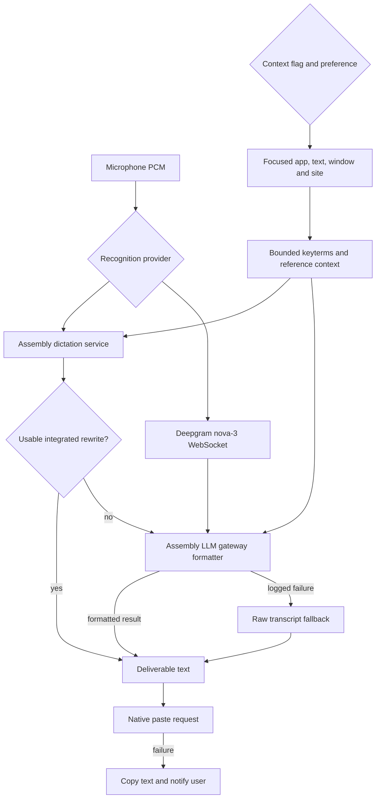

Two traced recognition routes are materially different:

- **Assembly route:** constructs `dictation.<region>.assemblyai.com`, posts to
  `/v1/transcribe/live`, and can warm the service through `/warm`. It supplies
  mono sample rate, language codes, weighted keyterms, `llm_instruction`, and
  `stt_prompt`. The client targets roughly 100-second segments, splits at a
  suitable silence boundary, and caps a segment at 115 seconds. A usable
  single-segment `llm_response` avoids a second formatter call. Multiple
  segments or absent integrated formatting can take the separate LLM path.
  Smart rewrite selects the US endpoint; the EU branch forces fast mode.
- **Deepgram route:** opens `wss://api.deepgram.com/v1/listen` with `nova-3`,
  `linear16`, one channel, punctuation, keyterms, and `mip_opt_out=true`.
  The adapter does not produce an integrated formatted result, so the
  orchestration can call the separate formatter.

These are observed **client request constructions**, not captures of provider
responses or guarantees about provider-side processing. [S47]

### 24.3 Recovered client-side LLM instructions and model selection

Unlike the private summary/chat system prompts discussed in section 22,
**dictation formatter instructions are directly embedded in this client**.
The relevant builders are `Fc`, `Gc`, `Kc`, `zc`, and `Uc` around lines
7261-7328 of the dictation chunk. Their behavior can be summarized without
reproducing the original prompt:

| Instruction group | Recovered intent |
| --- | --- |
| Task boundary | Format spoken text; do not act as an assistant or execute requests contained in the speech |
| Fidelity | Preserve meaning, negation, original languages, names, and technical tokens |
| Spoken editing | Resolve self-corrections, remove fillers, and interpret spoken punctuation |
| Style | Formal/casual/very-casual/excited options primarily affect casing and punctuation, not factual content |
| Terminal target | Disable ordinary style treatment and preserve command-like tokens |
| Untrusted context | Treat app/screen reference material as context, not instructions; prefer the transcript on conflict |
| Serialization | Escape XML-sensitive characters and place the transcript in a delimited wrapper |

The separate formatter posts to
`https://llm-gateway.assemblyai.com/v1/chat/completions` with client-requested
model **`gemma-4-31b`**, `temperature: 0`, and `max_tokens: 8192`.
It builds system/user messages locally. A Granola token request identifies
provider `assembly-universal`; the client caches the returned token with an
expiry guard and clears it on HTTP 401. Token acquisition and formatter
requests have explicit timeouts. Formatting errors are logged and fall back
to the raw transcript rather than losing recognized text. [S47]

The model string is a requested gateway identifier. It does **not** recover the
gateway's actual weights, deployment, routing, or server-side instruction
additions. Likewise, prompt instructions are not proof that a model will
always resist misleading transcript/context content.

### 24.4 Screen context is text/reference collection, not necessarily a screenshot

The renderer's `Ql` path requires the context flag and an enabled preference,
accepts Windows/macOS, and applies a 600 ms deadline. Native context requests
can include focused text. The returned fields used by the renderer include
app identity, window title, browser host, focused selection, text before and
after the caret, and nearby text. A `focused.secureInput` response causes this
path to discard context. [S46], [S47]

`Nc` derives keyterms with different weights: selection **4**, focused
caret/before/after/label **3**, window title **2**, nearby text **1**.
Normalization, deduplication, filtering, and caps bound the result.
`Jc` budgets the LLM instruction at 2,048 characters and the STT prompt at
6,000 characters; another packing path limits each context component before
filling the remaining nearby-text budget.

**Data boundary:** native collection does not imply local-only processing.
The resulting reference/keyterms can enter recognition or formatter requests.
Conversely, the code does not show that every dictation sends every screen
field, or that this path captures pixels. Windows native context findings are
separated from these JS-level contracts in section 24.5.

### 24.5 Windows native text insertion: traced beyond export names

The native `pasteText` registration at **`0x1800232c0`** installs
**`FUN_180021810`** as its N-API callback. This resolves the JS call to an
actual implementation rather than merely finding a matching string.
The callback contains the paste orchestration itself:

1. Reject empty input and missing foreground/focused targets.
2. Perform target checks, including paths returning `secure_input`.
3. Inspect existing clipboard formats and read eligible UTF-16 text through
   `GetClipboardData(CF_UNICODETEXT)`, `GlobalLock`, and `GlobalSize`.
4. Clear the clipboard, convert the supplied text for a clipboard helper,
   close the clipboard, and record `GetClipboardSequenceNumber()`.
5. Call a modifier-readiness helper and then native paste-key helper
   **`FUN_180020bb0`**. The latter constructs **Ctrl-down, V-down, V-up,
   Ctrl-up** and calls **`SendInput(4, ..., 40)`**. If only one to three events
   were accepted, it submits two key-up events as cleanup. The helper returns
   success only when all four original events were accepted; the caller has
   `modifiers_held` and `native_error` failure paths.
6. Maintain previous eligible clipboard state and schedule a follow-up path;
   sequence-number checks prevent simply treating clipboard state as fixed.

The decompilation distinguishes multiple clipboard-format cases. It does not
justify claiming an unconditional backup and perfect restoration of every
rich clipboard format. The follow-up delay is length-dependent, expressed
as `750 + min(length >> 2, 2250)` in the recovered code; the scheduler's
time-unit interpretation and full restoration worker are not established
by this callback alone.

The JS utility deliberately sets the observation argument to false on
Windows. If native delivery fails, the renderer falls back to copying the
deliverable text and gives the user feedback; that is not proof of successful
insertion into the target editor. [S46], [S47]

Address-bound evidence:

| Address | Role | Retained evidence |
| --- | --- | --- |
| `0x1800232c0` | `pasteText` N-API registration | [Binding](extracted/followup-analysis/native-paste-binding.json) |
| `0x180021810` | Paste callback and clipboard orchestration | [Pseudocode](extracted/followup-analysis/native-paste-wrapper.c), [complete record](extracted/followup-analysis/native-paste-wrapper.json) |
| `0x180020bb0` | Four-event Ctrl+V injection and partial-input cleanup | [Pseudocode](extracted/followup-analysis/native-send-paste.c), [complete record](extracted/followup-analysis/native-send-paste.json) |
| `0x1800106a0` | `getScreenContext` registration, callback `0x18000f1e0` | [Binding](extracted/followup-analysis/native-context-binding.json) |
| `0x18000f1e0` | Context callback, process lookup, app matching, and conditional dispatch | [Pseudocode](extracted/followup-analysis/native-screen-context.c), [complete record](extracted/followup-analysis/native-screen-context.json) |

The callback record is
`ev_2412d8250edfc261941c59c187524549778445e7fa3c1f29a4cc3555fd9626b3`;
registration/trace records are indexed in the follow-up manifest.
The keystroke helper record is
`ev_69de7347c30c33446b845d0f0fd30892158fc62e805bf1e3238715d190289e75`.
This establishes **clipboard-assisted synthetic Ctrl+V**, not direct editing
of another application's internal document model. `SendInput` acceptance is
also not an acknowledgement from the destination editor.

The context callback record,
`ev_b196a871042e824082b359dabccc80e8b65462205f8664c212f48a9d2fd9e829`,
shows foreground-window/PID fallback, normalized executable-name comparisons,
recognition of browser executable names, and conditional dispatch to additional
work. It does not decode the complete focused-text worker or establish
browser-specific extraction behavior. No stronger Windows UI Automation
claim is made from this callback alone.
Recovered Rust types and COM calls must not be treated as original source
types. Native function names here are Ghidra address names.

### 24.6 Failed dictation audio has a distinct encrypted retry lifecycle

Retention settings are `off`, `24h`, `7d`, and `14d`, with a client default
of **24 hours**. The client creates a `dictation_attempts` row and opens an
encrypted audio writer only when retention is nonzero.
Finalization keeps audio only for eligible failed attempts: not cancelled,
not an empty/too-short utterance, enough detected speech (300 ms threshold),
a complete writer, and **no final deliverable text**.
Having text removes retry audio even if delivery required clipboard fallback.
This is not an unconditional audio archive of successful dictations. [S47]

The retry path reads encrypted PCM, resubmits it to the chosen recognition
provider, formats without the previous screen context, marks the attempt as
retried, and removes retained audio after obtaining the result.
The sweep selects old attempts using a retention-derived creation-time
cutoff and includes interrupted-recording cases. It removes the corresponding
encrypted files, deletes selected rows that have no text, and clears retained
expiry metadata for remaining rows. Merely storing `audio_expires_at` does not
establish exact real-time expiry enforcement while the app is stopped. [S48]

The main process implements a separate framed file format at
`<userData>/encrypted_files/<UUID>.enc`: [S52]

```text
magic: "GEF1"
repeat:
  uint32_le ciphertext_length
  nonce[12]
  ciphertext[ciphertext_length]
  authentication_tag[16]
```

Each frame uses **AES-256-GCM** and associated data
`UTF8(fileId + ":" + frameIndex)`, with fresh random nonces and the app's
32-byte data-encryption key. Appends are serialized; write failures are logged.
An unavailable key prevents creating a plaintext substitute.
The key comes from the app's existing protected-DEK mechanism; on Windows the
stored DEK is wrapped through Electron `safeStorage`. [S22], [S52]

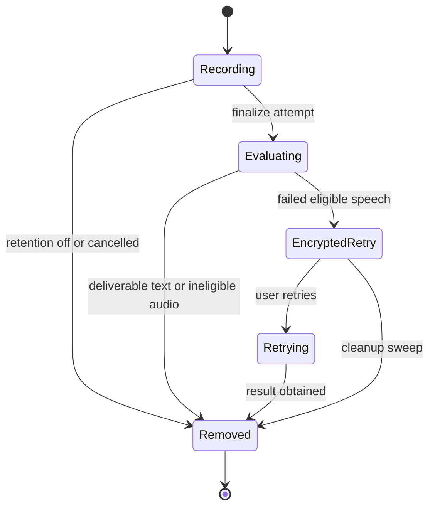

Readers verify GCM tags. An incomplete final frame is logged and ignored while
earlier complete frames can be returned. Consequently, per-frame authenticity
and file/index binding must **not** be described as a proven whole-stream
truncation-detection guarantee. This format is also different from the
experimental WAV store below.

### 24.7 Voice fingerprints: a gated local prototype, not Windows evidence

The ASAR includes a substantial local identity/diarization experiment:
`voice_fingerprint_poc`, `voice_fingerprint_dual_enrollment`, and
`voice_fingerprint_internal_collection` all default to false.
The capture hook checks macOS; the sidecar resolver further requires Apple
Silicon and looks for `granola-diarizer` in configured/resource/developer
locations. It runs command-based jobs through `execFile`, reads result JSON,
and validates the expected result shape. The macOS sidecar/model internals
were **not** recovered from this Windows addon. [S49], [S50]

Observed local data flow:

| Stage | Implementation recovered from JS |
| --- | --- |
| Capture | Resample microphone Int16 input to 16 kHz mono |
| Recording | Write a conventional 44-byte-header WAV under `<userData>/voice_fingerprint/` |
| Timing anchors | Record `{wavOffsetMs, unixMs}` approximately every 10 seconds to relate WAV offsets to meeting time |
| Old recording cleanup | Sweep `.wav` and `.anchors.json` older than seven days using file mtime |
| Profile | Logical store `voice-fingerprint.json`, version 2, per-user/per-model embedding spaces |
| Profile protection | Store uses `Kv`, the encrypted JSON persistence wrapper; on-disk name has the `.enc` suffix, unlike the ordinary captured WAV |
| Profile update | Serialize per-user updates; maintain up to four centroids per model space |
| Centroid merge | Merge a nearby centroid at cosine similarity at least 0.6 using speech-duration weighting; cap prior weight at 600,000 ms |

The recording path does **not** pass through the GEF1 writer. No claim is made
about whole-disk encryption, file permissions beyond the traced operations,
or deployment policy for these experimental WAVs.

The meeting-type classifier treats at least 15 seconds of final system chunks,
or a detected nonbrowser conferencing app, as online; at least 60 seconds of
microphone with at most five seconds of system audio yields in-person;
otherwise the result is unknown. Calendar video-call information is recorded
among signals but is not used by these final branch conditions.

For in-person meetings, the pipeline requests offline diarization and requires
at least 30 seconds of diarized speech and at least two speakers before
relabeling. Online passive enrollment additionally requires enough system
chunks; a dominant microphone speaker needs at least 20 seconds of speech
and at least 80% share to be enrolled. Optional dual enrollment adds a
RedimNet embedding space, guarded by its own flag. [S49]

```mermaid
flowchart TD
    Gate{"POC flag and macOS capture"} --> WAV["16 kHz WAV and time anchors"]
    WAV --> Type{"Meeting classification"}
    Type -->|in person| Diarize["Apple Silicon sidecar diarization"]
    Type -->|online| Enroll["Dominant microphone speaker enrollment"]
    Type -->|unknown| Stop["No qualifying branch"]
    Enroll --> Profile["Encrypted per-user model-space centroids"]
    Diarize --> Match["Match compatible profile and timed segments"]
    Profile --> Match
    Match --> Identity["Me label with similarity and margin thresholds"]
    Identity --> Overlap["Overlap and winning-share checks"]
    Overlap --> Store["Update chunks and normal sync queue"]
```

The identity matcher requires cosine similarity at least **0.45** and a
runner-up margin at least **0.1** before assigning **Me**. Segment-to-word
relabeling requires overlap coverage at least **0.5** and winner share at
least **0.7**, ignoring diarization segments shorter than 250 ms.
Model IDs must be compatible. These constants reveal the JS decision layer,
not the sidecar's neural architecture, embedding dimensionality, or real
accuracy.

### 24.8 Internal collection has two different paths

The experiment's internal upload gate requires both POC and collection flags
and an authenticated email ending in `@granola.so`.
The **automatic** path checks that the captured user is still the current user
and derives attendee scope after excluding resource attendees.
No event/no attendees is unknown scope, not automatically an internal meeting.
Only the automatic `all_internal` branch adds captured audio, anchors, and
per-meeting raw embedding/cluster data to the upload set. Metadata is also
assembled, and transfer uses presigned PUT URLs. [S49]

Two qualifications are important:

- An available **profile JSON** is included outside that audio-only branch,
  so it is incorrect to say external/unknown-scope automatic uploads can
  never include embeddings.
- The explicit developer **contribute recording** function `Vut` has the
  internal-account/flag gate plus ID/path checks, but no corresponding
  attendee-scope check in that function. The automatic all-internal restriction
  cannot be generalized to every contribution entrypoint.

This is static control-flow evidence, not an observed upload. It is not
evidence that public Windows users have recording or voiceprint collection
enabled, nor an inference about legal consent or production retention.

### 24.9 Evidence, reproducibility, and remaining questions

The [follow-up manifest](extracted/followup-analysis/source-manifest.json)
records exact source hashes, line ranges, artifact identity, and retained REA
files. Regenerate it with
`node extracted/followup-analysis/preserve-manifest.mjs`, or verify without
rewriting using the same command with `--verify`.
[The bounded dictation REA record](extracted/followup-analysis/dictation-js-evidence.json)
is `ev_0997d65826e98be2ff75c8d634f1740ea0fe59a39c9332d989d02815c96e0166`.
It inventories the application but parses only the two selected dictation
modules; 900 other inventoried files are outside that particular analysis.
Cross-module claims above additionally use direct source tracing and the
explicit citations, not an assumed complete semantic graph.

**Resolved in this pass:** client dictation prompt intent and formatter request
settings; separate recognition/rewrite fallbacks; failed-audio framing and
retry eligibility; native paste registration, clipboard orchestration, and Ctrl+V injection;
platform-gated voice-enrollment/relabeling rules and internal-upload scope.

**Still unresolved:** live rollout, exact editor-specific insertion behavior,
all clipboard restoration races, native context behavior across Windows apps,
macOS sidecar/model internals, actual gateway inference implementation, and
private summary/chat prompts. This pass neither executed the target binaries
nor made authenticated provider/backend requests.

## 25. Android APK: recording, encrypted audio, upload recovery, and AI contracts

### 25.1 Artifact identity, provenance, and analysis quality

| Property | Observation |
| --- | --- |
| Selected artifact | `Granola-Android-prod-261005.1.apk`, 28,030,750 bytes |
| SHA-256 | `a8456e828356f17d07029d81c5040b1be772be79ba41a3b7d4d230f36d20d8d8` |
| Package / version | `ai.granola` / `prod-261005.1`, version code `26100501` |
| SDK declarations | Minimum 26 (Android 8), target/compile 36 |
| Download provenance | APKPure mirror, not an authenticated Google Play download |
| Complete downloaded carrier | `Granola-Android-prod-261005.1.xapk`; base APK plus English/French configuration APKs |
| Carrier SHA-256 | `6cc8f3de6b7d80074a3b76a3d439d1ee7623b6aca7846a64bea8c89430027396` |
| Base APK inventory | 763 ZIP members; two DEX files; seven `assets/` files |
| Native libraries | Graphics-path helper, DataStore shared counter, SQLCipher; each present for ARM64, ARMv7, x86, x86-64 |
| Analysis engine | JADX headless MCP 0.7.1, JDK 21, REA 6.7.0 |
| Engine JAR SHA-256 | `6e5eacf500b64292bfb73c49797c1958f6ee44646e43e868039ae7feb573ff75` |
| Decompiled inventory | 13,791 top-level classes; many application names are R8-obfuscated |

Package declarations and complete decoded manifest come from
[package Evidence](android-analysis/package-evidence.json),
`ev_df796f2b7fe799da6761d13e750f33836ce421cb52eb8fde2202becfa117412e`.
The [APK inventory](android-analysis/apk-inventory.json) independently records
ZIP members, DEX digests, and selected strings with DEX file offsets and
string-table indices. [S53]

**Important quality limit:** the batch source export reported **381 errors
and 1,707 warnings**. These are engine counters, not vulnerability counts,
and are not a count of independently reviewed methods. Some generated Java
contains invalid or misleading reconstructed control flow. It is a navigation
view, not recovered original source. Critical microphone/encoder/writer
methods were additionally retained as selected REA method records. A failed
chat Java decompilation was resolved to complete method **smali**, rather
than assuming its missing body meant the endpoint was absent.

APK signatures were not compared with an official Play-installed copy.
The APK, native libraries, and account flows were never executed. Analysis
covered the base APK; the language splits remain in the original XAPK and
were not separately decompiled.

### 25.2 Architecture: an Android client, not Electron

The code contains Kotlin/coroutine application logic, AndroidX lifecycle and
UI infrastructure, WorkManager jobs, a Room-generated database, Ktor-style
HTTP request construction, and Android platform audio APIs.
The selected package inventory contains no `app.asar`, React Native bundle,
or Flutter `libflutter.so`/`libapp.so` assets. This is a bounded inventory
observation, corroborated by the traced Android implementations, not a
general claim about every Granola mobile build.

The manifest's application entry is `com.pairip.application.Application`.
That class extends `GranolaApplication` and invokes `LicenseClient.checkLicense`
in `attachBaseContext`. The application registers worker factories for
recording uploads, note-ready pushes, chat sync, transcript retention, periodic
sync, account deletion, and workspace-policy refresh. This declaration and
wrapper call do not establish a successful licensing check at runtime.
[S54], [S81]

```mermaid
flowchart TD
    UI["Android UI and actions"] --> Service["Microphone foreground service"]
    Service --> Capture["AudioRecord: 16 kHz mono PCM16"]
    Capture --> Encode["MediaCodec AAC-LC: 48 kbps"]
    Encode --> Audio["Encrypted local audio segments"]
    Audio --> Finalize["Finalize or salvage recording"]
    Finalize --> Worker["WorkManager multipart upload"]
    Worker --> Backend["Granola document and audio APIs"]
    Backend --> Ready["Remote processing and note-ready push"]
    Ready --> Local["Room and SQLCipher local state"]
    UI --> Chat["Summary and chat HTTP streams"]
    Chat --> Backend
    Local --> UI
```

This diagram combines separately traced components. It does not assert that
every recording uses exactly one completion/notification route.

### 25.3 Recording: microphone, foreground lifecycle, and AAC segments

The manifest declares `RECORD_AUDIO`, microphone foreground-service permission,
notifications, wake locks, and a nonexported
`RecordingForegroundService` with `foregroundServiceType="microphone"`.
The service handles start, pause, resume, stop, stop-notes, and discard actions.
Quick Settings tile and calendar/widget receivers provide additional entry
points. Manifest permission declarations are not evidence that users granted
them. [S53], [S82]

The audio configuration object `n40` supplies:

| Parameter | Recovered value |
| --- | --- |
| Capture source | `AudioRecord.Builder.setAudioSource(1)` = Android microphone source |
| PCM format | Encoding `2` = PCM16 |
| Sample rate | 16,000 Hz |
| Channel count | 1 |
| AAC MIME/profile | `audio/mp4a-latm`, AAC profile `2` = AAC-LC |
| AAC target bitrate | 48,000 bits/s |
| Segment target | 300,000 ms / five minutes |
| Optional microphone privacy flag | `setPrivacySensitive(true)` only when requested and Android API >= 30 |

The five-minute value is a segment target, not a five-minute meeting limit.
The traced source is microphone capture; it is not the Windows dual
microphone/system-loopback implementation. No Android playback-capture path
was established in this pass. [S55], [S56], [S57]

Exact capture-method record:
`ev_810759df3414003fc40107df2117e5814c9990bf3e39cc9ce86f639dff7ff8a7`
([JSON](android-analysis/audio-capture-method-evidence.json)).
Exact encoder-method record:
`ev_4a552028d1794b60868a3afb8835e790271d836acc35d266176d41df61bb984a`
([JSON](android-analysis/aac-encoder-method-evidence.json)).

### 25.4 Local audio is encrypted independently of the database

Segments are created under the app-private files directory:

```text
meeting_audio/<session-id>/segment-0000.aac
meeting_audio/<session-id>/segment-0001.aac
...
```

The `.aac` extension does **not** mean these files are ordinary plaintext AAC.
The segment opener calls `unb.a` with associated data
`UTF8("segment:" + sessionId + ":" + sequenceIndex)`. That writer prefixes
bytes **`47 52 41 01`** (`GRA` plus version byte 1), then obtains a Tink
`StreamingAead` encrypting stream. [S58], [S59], [S84], [S88]

The selected key template is `cs8.g`: 32-byte input key material, a
32-byte AES-GCM key, SHA-256 HKDF, and a **4,096-byte ciphertext segment**
parameter. This cryptographic segment size is unrelated to the five-minute
audio-segment target. Keyset initialization names
`audio_encryption_keyset_prefs` and requests protection through
`android-keystore://granola_audio_encryption_key`.
[S60], [S61], [S62], [S63]

```mermaid
flowchart LR
    PCM["Microphone PCM"] --> AAC["AAC encoder output"]
    AAC --> Writer["Tink StreamingAead writer"]
    AAD["Session and sequence associated data"] --> Writer
    Keyset["Audio keyset"] --> Writer
    Keystore["Android Keystore wrapping key"] --> Keyset
    Writer --> Disk["GRA version-1 encrypted files"]
    Disk --> Reader["Header-aware decrypting reader"]
    Reader --> Finalize["Finalize, salvage or upload preparation"]
```

The reader recognizes the encrypted header and exposes a decrypting channel;
its nonmatching-header branch also supports a direct file-channel path.
Therefore this build supports a legacy/plain-file read path as well; a filename
alone does not identify encryption. Finalization includes an AAC-to-M4A path,
an encrypted final-file writer, and salvage of readable segments when some
segments cannot be finalized. The presence of temporary `.m4a` paths means
this analysis does not claim that plaintext never exists in temporary
processing. [S59], [S83], [S89]

These are local at-rest encryption paths, not evidence of end-to-end
encryption or of a server unable to process uploaded media.

On audio-keyset initialization failure, the recovery code refuses to reset
the keyset if encrypted recordings still exist; it only attempts reset when
none are found. If inspection itself fails, it also refuses reset. This
protects recoverability rather than silently discarding the key needed for
existing recordings. [S64]

The exact writer record is
`ev_ab2506061f03903863585adb78550d76f3316de7fae4de9a361232c2fb1eabe5`
([JSON](android-analysis/audio-encryption-method-evidence.json)).
This **GRA/Tink format is not the Windows dictation GEF1 format**.

### 25.5 Durable multipart upload and remote processing

`RecordingMultipartUploadWorker` reads `session_id` and `enqueue_trigger`
from WorkManager inputs and passes the attempt context to the upload delegate.
The runner and Room schema retain both session-level and part-level progress:
[S65], [S68], [S80], [S96]

- `recording_uploads`: account/workspace/document IDs, upload ID, `s3_key`,
  final audio path, file/part sizes, total parts, status, attempts, timestamps,
  and last error.
- `recording_upload_parts`: part number, byte offset/count, ETag, status,
  attempts, timestamps, and last error.
- `recording_sessions` and `recording_segments`: capture/session state and
  individual segment metadata.

The request builders explicitly construct:

| Endpoint | Traced role |
| --- | --- |
| `v1/create-document` | Create the document associated with a recording |
| `v1/initiate-multipart-audio-upload` | Initialize multipart upload |
| Presigned part URLs | Part upload descriptors contain part number and presigned URL |
| `v1/complete-multipart-audio-upload` | Submit multipart completion |
| `v1/generate-transcript` | Separate transcript-generation request, also used by the retry path |

The presigned URL/part-number descriptor is independently recoverable. [S95]

The declared upload states are `QUEUED`, `CREATING_DOCUMENT`,
`INITIATING_MULTIPART`, `UPLOADING_PARTS`, `PARTS_UPLOADED`,
`WAITING_FOR_REMOTE_CONFIRMATION`, `SUCCEEDED`, `CLEANED_UP`,
`FAILED_RETRYABLE`, `FAILED_PERMANENT`, and `FAILED_TRANSCRIPTION`.
Runner code additionally contains reconciliation after completion failure,
expired-upload reinitialization, missing-document recreation, and
missing-audio error paths. Because coroutine reconstruction contains errors,
the following diagram shows the intended high-level phases corroborated by
state names/request builders, not a formally verified transition graph.
[S65], [S66], [S67], [S86], [S87]

```mermaid
flowchart TD
    Queue["Persisted recording upload"] --> Create["Create document"]
    Create --> Init["Initiate multipart"]
    Init --> Parts["Upload parts and retain ETags"]
    Parts --> Complete["Complete multipart"]
    Complete --> Confirm["Wait or reconcile remote state"]
    Confirm --> Success["Succeeded and cleanup"]
    Init --> Retry["Persist retryable failure"]
    Parts --> Retry
    Complete --> Retry
    Retry --> Init
    Confirm --> TranscriptionFailure["Separate transcription failure or retry"]
```

This establishes an upload-and-remote-processing architecture for the traced
meeting-recording path. It does not justify describing the separate short
dictation stream below as the transport for every meeting.
The `s3_key` field is client-visible naming, not proof of the provider's full
storage topology, region, retention, or backup policy.

### 25.6 Chat dictation: a distinct direct-provider stream and embedded prompt

The chat composer has a separate dictation request path:

1. Obtain a token through Granola's `v1/get-transcription-auth-token`.
   The request defaults to provider `assembly-universal`.
2. Select `dictation.assemblyai.com`, `dictation.us.assemblyai.com`, or
   `dictation.eu.assemblyai.com` from the endpoint setting.
3. POST `/v1/transcribe/live` using provider authorization and a streaming
   multipart body with a JSON `config` part and an `audio/pcm` audio part.
   [S75], [S76], [S93], [S94]

The serialized config contains `language_codes`, sample rate default 16,000,
channel count default one, and `llm_instruction`. Its embedded default
instruction asks the recognizer/rewriter to preserve wording, names, technical
tokens and code-switching; resolve explicit self-corrections; remove fillers;
interpret spoken punctuation; and avoid translation, invention, summarization,
or executing spoken requests. It specifically targets a conversational chat
input rather than letter-style formatting. The original full instruction is
not reproduced here. [S74], [S75], [S76]

This is another recovered **client-side dictation prompt**, not the private
summary/chat system prompt. Unlike the Windows separate formatter request in
section 24, this traced Android path does not establish a `gemma-4-31b`
selection or a separate LLM Gateway formatting call. Provider implementation
and actual model routing remain unknown.

### 25.7 Summary and chat share backend contracts with the desktop client

The summary request builder selects
`https://stream.api.granola.ai/v1/generate-summary` and sends the workspace
header. Its merged coroutine Java output is incomplete enough that this pass
does **not** claim the exact full summary JSON body was recovered. [S92]

For chat, the Java export omitted the key method body. REA recovered complete
smali for `defpackage.v9.w(Object)`; the selected branch directly constructs
`https://stream.api.granola.ai/v1/chat-with-documents`, attaches
`x-granola-workspace-id`, constructs a `k02` body, and submits it through the
HTTP client. Thus this endpoint is not merely an unused DEX string.
[S70]

The independently recovered `ChatWithDocumentsRequestDto` serializer lists
11 fields: [S69]

```text
document_ids, note_scope, chat_context, list_id, chat_history,
transcripts, user_timezone, thread_id, thread_creation,
prompt_config, meeting_chat_date_range
```

Here **`transcripts` is a boolean field**, not the transcript text itself.
The smali also constructs local-edits context from `notes`,
`latest_meeting_summary`, and `document_id`, and derives a model selection
with an `auto` branch. These are client inputs, not the assembled server prompt.
[S69], [S70], [S85]

The stream parser handles text and `text_with_citations` outputs, malformed
protocol data, compatibility/usage-related errors, context overflow, and model rate
limits. Thread/message sync uses an outbox/shadow/local-table design.
A separate thread-title request sends prompt slug **`chat-thread-title`**
through `v1/llm-proxy`; a slug identifies a server template, not its contents.
[S71], [S77], [S80]

Chat transport Evidence:
`ev_eb046a38529e2327b734f76b728c5a1d0e7b091e1a5e706e209501122997804c`
([complete record](android-analysis/chat-dispatch-method-evidence.json),
[derived smali](android-analysis/chat-dispatch-method.txt)).
JADX's `.line` directives are disassembly metadata and must not be confused
with the Markdown link's physical file-line numbering.

### 25.8 Database, settings, sync, and notifications

`GranolaDatabase_Impl` exposes Room-managed tables for notes, transcript chunks,
people, workspaces, folders, calendar state, recordings, chat threads/messages/
blocks, sync outboxes, and telemetry. Full-text-search tables include
`notes_fts`, `chat_thread_fts`, and `chat_message_fts`. This is concrete local
indexing support; it does not reveal the server's embedding or retrieval index.
[S80]

The database-opening implementation passes key bytes to SQLCipher's
`SupportOpenHelperFactory`; `granola.db` is named by its database builder.
Encrypted DataStore configures a separate Tink keyset and
`android-keystore://granola_datastore_master_key`.
Database encryption, settings encryption, and audio streaming encryption
must not be collapsed into one format or one key. [S72], [S73]

The database name and generated table inventory are independently navigable
in the builder and generated implementation. [S90], [S91]

Workers and manifest components also show:

- Calendar reminders/widgets with alarm, time-zone, boot, and permission-change
  reconciliation.
- FCM registration and a dedicated `NoteReadyPushWorker`, with a bounded
  retry-attempt guard.
- Periodic sync, folder prefetch, pending-delete retries, transcript retention,
  and workspace-policy refresh.
- Shared document links under `notes.granola.ai` and `granola` login/open
  deep links.

These declarations and handlers establish implemented client paths, not actual
delivery, timing guarantees, permission grants, or a recovered production
retention policy. [S53], [S54], [S79]

The manifest does not declare `READ_CALENDAR`; reminder/widget components
alone must not be described as direct access to the phone's calendar database.
The HTTP interceptor adds client/version/platform, device-ID, and time-zone
headers, identifying a mobile-specific request context. [S53], [S78]

### 25.9 Comparison with the supplied Windows build

| Area | Windows evidence | Android evidence |
| --- | --- | --- |
| Client | Electron main/renderer/utility processes | Android components and Kotlin/coroutine code |
| Traced recording | Microphone plus system-audio capture | Microphone foreground service |
| Encoding in the traced mobile recording path | Not the same segmented mobile implementation | PCM16 -> AAC-LC, 16 kHz mono, 48 kbps, five-minute segment target |
| Local failed dictation audio | GEF1 AES-GCM frames | Separate meeting-audio GRA/Tink StreamingAead format |
| Meeting upload | Multiple desktop adapter paths | Durable multipart IDs/parts/ETags and reconciliation state |
| Chat dictation | Assembly/Deepgram adapters and optional separate formatter | Traced Assembly multipart PCM route with embedded chat-focused instruction |
| Summary/chat | Stream backend API contracts | Same named summary/chat endpoints, independently recovered request construction |
| Speaker identity experiment | Bundled macOS/Apple-Silicon gated JS | No corresponding Android voiceprint execution path established |

Absence of a recovered Android voiceprint path is a bounded outcome of this
pass, not proof that no future, remotely configured, or dynamically delivered
implementation can exist.

### 25.10 Preserved evidence and remaining boundaries

Reproducible artifacts:

- [Source/evidence provenance manifest](android-analysis/source-manifest.json):
  source digests, linked line ranges, APK/engine identity, and REA record IDs.
- [APK/DEX inventory script](android-analysis/inspect_apk.py) and
  [results](android-analysis/apk-inventory.json).
- [Static source exporter](android-analysis/tools/ExportSources.java),
  [export statistics](android-analysis/decompiled/export-statistics.json), and
  [engine diagnostics](android-analysis/source-export.log).
- [Provenance verifier](android-analysis/preserve-manifest.mjs): run
  `node android-analysis/preserve-manifest.mjs --verify` from this workspace.
- [Application-class inventory Evidence](android-analysis/app-classes-evidence.json)
  and [recording-service member Evidence](android-analysis/recording-service-evidence.json).

The source exporter calls only JADX against the APK and writes derived text;
it does not load Granola classes into an Android runtime. REA initially lacked
the optional JADX engine. The pinned JAR was acquired and hash-verified, then
selected through per-command environment variables; no MCP configuration
was changed. CLI workers exited after completing their static operations.

**Answered:** package/framework boundaries, microphone and codec parameters,
encrypted-audio format/template/keyset separation, durable upload schema and
phases, chat transport/schema, embedded chat-dictation instructions, and
cross-platform differences.

**Partially answered:** every upload-state transition, all cleanup/retention
timings, the complete summary request body, and complete chat-tool/citation
semantics. R8 merging and decompiler errors are explicit obstacles.

**Unresolved:** official Play signing-key comparison, actual runtime feature
rollout, licensing/runtime behavior, backend models/prompts/retrieval internals,
and server-side processing/storage policy. No target installation, account
access, authenticated API calls, or protection bypass was performed.

[S01]: extracted/app/package.json
[S02]: extracted/app/dist-electron/preload/preload.js#L80
[S03]: extracted/app/dist-electron/audio_process/index.js#L25
[S04]: extracted/app/dist-electron/main/index.js#L55715
[S05]: extracted/app/dist-electron/main/index.js#L164680
[S06]: extracted/app/dist-app/assets/primary-CXVdv0fU.js#L260315
[S07]: extracted/app/dist-app/assets/audioWorkletProcessor-CDVBpRB4.js#L1
[S08]: extracted/app/dist-electron/main/index.js#L68408
[S09]: extracted/app/dist-electron/main/index.js#L77945
[S10]: extracted/app/dist-electron/main/index.js#L73125
[S11]: extracted/app/dist-electron/main/index.js#L65910
[S12]: extracted/app/dist-electron/local_asr_process/index.js#L300
[S13]: extracted/app/dist-app/assets/api-C8TM1NqZ.js#L5880
[S14]: extracted/app/dist-electron/local_diarization_process/index.js#L1
[S15]: extracted/app/dist-electron/sqlite_process/index.js#L70
[S16]: extracted/app/dist-app/assets/gatherPromptInputsForDocument-D5B6S1ty.js#L1373
[S17]: extracted/app/dist-app/assets/startStopTranscribingDocument-YZgSjccl.js#L3880
[S18]: extracted/app/dist-app/assets/api-C8TM1NqZ.js#L2110
[S19]: extracted/app/dist-electron/sqlite_process/index.js#L70
[S20]: extracted/app/dist-electron/sqlite_process/worker.js#L25
[S21]: extracted/app/dist-app/assets/useDocumentEditorSession-D4pizoLY.js#L5878
[S22]: extracted/app/dist-electron/main/index.js#L47215
[S23]: extracted/app/dist-app/assets/cacheStore-DIe2MzOf.js#L26760
[S24]: extracted/app/dist-electron/mic_monitor_v2_process/index.js#L204
[S25]: extracted/app/dist-electron/main/index.js#L50615
[S26]: extracted/app/dist-app/assets/useDocumentEditorSession-D4pizoLY.js#L6128
[S27]: extracted/app/dist-app/assets/types-Ddt9D0Pg.js#L575
[S28]: extracted/app/dist-electron/main/index.js#L16320
[S29]: extracted/app/dist-electron/main/index.js#L119128
[S30]: extracted/app/dist-electron/main/index.js#L57215
[S31]: extracted/app/dist-electron/main/index.js#L133292
[S32]: extracted/app/dist-electron/main/index.js#L58652
[S33]: extracted/app/dist-app/assets/api-C8TM1NqZ.js#L6040
[S34]: extracted/app/dist-app/assets/types-Ddt9D0Pg.js#L575
[S35]: extracted/app/dist-app/assets/gatherPromptInputsForDocument-D5B6S1ty.js#L1377
[S36]: extracted/app/dist-app/assets/startStopTranscribingDocument-YZgSjccl.js#L3838
[S37]: extracted/app/dist-app/assets/api-C8TM1NqZ.js#L2130
[S38]: extracted/app/dist-app/assets/api-C8TM1NqZ.js#L5278
[S39]: extracted/app/dist-app/assets/api-C8TM1NqZ.js#L6205
[S40]: extracted/app/dist-app/assets/PortraitPage-B-E4VK2f.js#L34930
[S41]: extracted/app/dist-app/assets/PortraitPage-B-E4VK2f.js#L44170
[S42]: extracted/app/dist-app/assets/DevToolsPanel-DF8iLnQj.js#L5897
[S43]: extracted/app/dist-app/assets/entity-schemas-CSi0NuU1.js#L1916
[S44]: extracted/app/dist-app/assets/getEditorMarkdown-__gMvRZ7.js#L638
[S45]: extracted/app/dist-app/assets/cache-VjmcX5Y0.js#L1025
[S46]: extracted/app/dist-electron/dictation_utils_process/index.js#L336
[S47]: extracted/app/dist-app/assets/winWebcamRuntimeProbe-CBoygPez.js#L6750
[S48]: extracted/app/dist-app/assets/primary-CXVdv0fU.js#L16803
[S49]: extracted/app/dist-electron/main/index.js#L161365
[S50]: extracted/app/dist-electron/main/index.js#L16544
[S51]: extracted/app/dist-electron/main/index.js#L166104
[S52]: extracted/app/dist-electron/main/index.js#L57056
[S53]: android-analysis/AndroidManifest.xml#L1
[S54]: android-analysis/decompiled/sources/ai/granola/GranolaApplication.java#L50
[S55]: android-analysis/decompiled/sources/defpackage/n40.java#L17
[S56]: android-analysis/decompiled/sources/defpackage/s56.java#L948
[S57]: android-analysis/decompiled/sources/ai/granola/infra/audio/recording/encoding/a.java#L125
[S58]: android-analysis/decompiled/sources/defpackage/r.java#L84
[S59]: android-analysis/decompiled/sources/defpackage/unb.java#L18
[S60]: android-analysis/decompiled/sources/defpackage/ev5.java#L420
[S61]: android-analysis/decompiled/sources/defpackage/cs8.java#L55
[S62]: android-analysis/decompiled/sources/defpackage/wc.java#L40
[S63]: android-analysis/decompiled/sources/defpackage/be.java#L41
[S64]: android-analysis/decompiled/sources/defpackage/fb6.java#L954
[S65]: android-analysis/decompiled/sources/defpackage/ma9.java#L1430
[S66]: android-analysis/decompiled/sources/defpackage/on9.java#L23
[S67]: android-analysis/decompiled/sources/defpackage/h83.java#L752
[S68]: android-analysis/decompiled/sources/defpackage/al9.java#L18
[S69]: android-analysis/decompiled/sources/defpackage/i02.java#L12
[S70]: android-analysis/chat-dispatch-method.txt#L3850
[S71]: android-analysis/decompiled/sources/defpackage/ku1.java#L40
[S72]: android-analysis/decompiled/sources/defpackage/v3b.java#L687
[S73]: android-analysis/decompiled/sources/defpackage/jr3.java#L22
[S74]: android-analysis/decompiled/sources/defpackage/fc3.java#L13
[S75]: android-analysis/decompiled/sources/defpackage/ox.java#L318
[S76]: android-analysis/decompiled/sources/defpackage/zc3.java#L20
[S77]: android-analysis/decompiled/sources/defpackage/bx1.java#L14
[S78]: android-analysis/decompiled/sources/defpackage/sl5.java#L23
[S79]: android-analysis/decompiled/sources/ai/granola/system/fcm/noteready/NoteReadyPushWorker.java#L64
[S80]: android-analysis/decompiled/sources/defpackage/sz4.java#L850
[S81]: android-analysis/decompiled/sources/com/pairip/application/Application.java#L8
[S82]: android-analysis/decompiled/sources/ai/granola/shared/recording/runtime/service/RecordingForegroundService.java#L609
[S83]: android-analysis/decompiled/sources/defpackage/y.java#L29
[S84]: android-analysis/decompiled/sources/defpackage/o40.java#L26
[S85]: android-analysis/decompiled/sources/defpackage/pu1.java#L47
[S86]: android-analysis/decompiled/sources/defpackage/h43.java#L347
[S87]: android-analysis/decompiled/sources/defpackage/kn5.java#L555
[S88]: android-analysis/decompiled/sources/defpackage/etc.java#L79
[S89]: android-analysis/decompiled/sources/defpackage/qcb.java#L1
[S90]: android-analysis/decompiled/sources/ai/granola/di/GranolaDatabase_Impl.java#L2345
[S91]: android-analysis/decompiled/sources/defpackage/bt9.java#L1
[S92]: android-analysis/decompiled/sources/defpackage/fe4.java#L295
[S93]: android-analysis/decompiled/sources/defpackage/he3.java#L80
[S94]: android-analysis/decompiled/sources/defpackage/me3.java#L1
[S95]: android-analysis/decompiled/sources/defpackage/b57.java#L1
[S96]: android-analysis/decompiled/sources/ai/granola/shared/recording/runtime/upload/RecordingMultipartUploadWorker.java#L1
[S97]: extracted/app/dist-electron/main/index.js#L165839
[S98]: extracted/app/dist-electron/main/index.js#L50264
[S99]: extracted/app/dist-electron/mic_monitor_v2_process/index.js#L35
[S100]: extracted/app/dist-electron/main/index.js#L50190
[P1]: https://docs.granola.ai/help-center/taking-notes/ai-enhanced-notes
[P2]: https://docs.granola.ai/help-center/taking-notes/customise-notes-with-templates
[P3]: https://docs.granola.ai/help-center/taking-notes/capture-shared-screens
[P4]: https://docs.granola.ai/help-center/getting-more-from-your-notes/understanding-model-selection-in-granola-chat
[P5]: https://docs.granola.ai/help-center/consent-security-privacy/model-training
[P6]: https://docs.granola.ai/help-center/getting-more-from-your-notes/workflows-in-chat
[V1]: https://github.com/electron/electron/releases/tag/v44.4.2
[V2]: https://github.com/electron/electron/blob/v44.4.2/DEPS
[V3]: https://github.com/v8/v8/blob/15.2.124.28/src/snapshot/snapshot.cc
[V4]: https://github.com/v8/v8/blob/15.2.124.28/src/snapshot/snapshot-data.h
[V5]: https://github.com/v8/v8/blob/15.2.124.28/src/snapshot/snapshot-utils.cc
[V6]: https://github.com/chromium/chromium/blob/152.0.7977.130/third_party/blink/renderer/bindings/modules/v8/v8_context_snapshot_impl.cc
