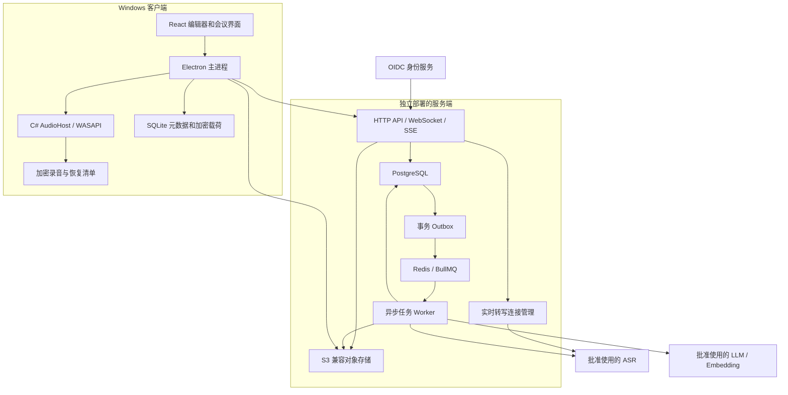
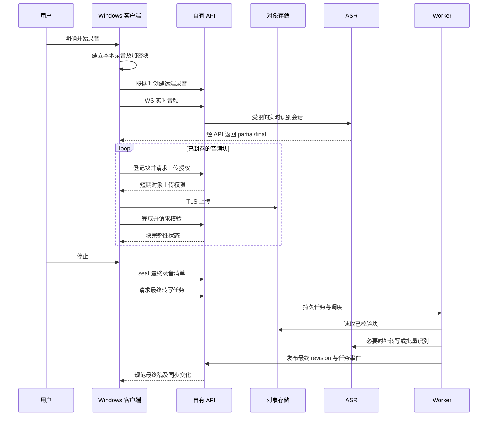
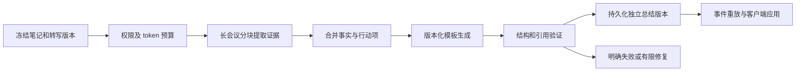
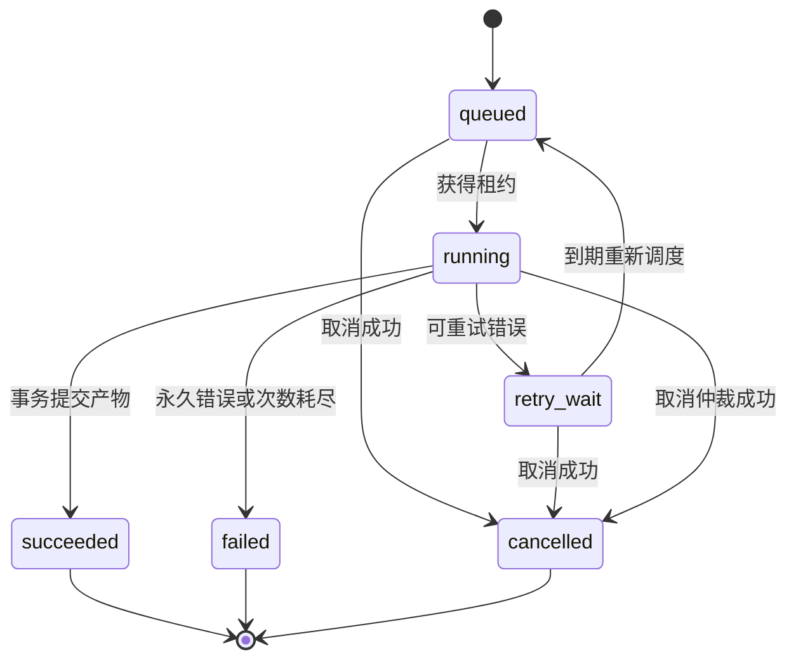

# Windows AI 会议笔记：客户端与服务端实施计划

**日期：** 2026-10-21  
**状态：** 实现与开发预览验收进行中，尚未完成生产发布验收。本文中的指标是验收目标，不是已测结果。

**目标：** 独立实现一个可自部署的 Windows AI 会议笔记产品，而不是重新打包 Granola。

## 1. 设计依据与边界

此前的静态分析给出了值得参考的职责划分：

| 已观察到的设计 | 本项目采用的思路 | 依据 |
| --- | --- | --- |
| Windows 麦克风和系统声音捕获、重采样 | 将音频采集隔离到 Windows 子进程 | [原生分析](GRANOLA-REVERSE-ENGINEERING.md#21-native-windows-follow-up-with-ghidra) |
| 转写、笔记、总结是不同的数据和任务 | 独立版本、状态、重试和展示 | [核心功能分析](GRANOLA-REVERSE-ENGINEERING.md#1-executive-summary) |
| 总结/聊天需要流式响应及任务恢复 | 持久任务、事件重放、结果快照 | [客户端可见 AI 合约](GRANOLA-REVERSE-ENGINEERING.md#22-backend-ai-research-and-client-visible-contracts) |
| Android 保存加密录音和分片上传状态 | 本地录音优先落盘，上传可恢复 | [Android 分析](GRANOLA-REVERSE-ENGINEERING.md#25-android-apk-recording-encrypted-audio-upload-recovery-and-ai-contracts) |

**下文的服务器、数据库、接口、提示词、检索算法和部署方式均为本次自主设计，不能视作 Granola 的真实实现。**

不复制原应用代码、图标、品牌或完整界面；不调用其私有接口，不复用其登录令牌，不绕过授权。新产品使用自己的服务地址和合法配置的模型服务。

本文最初作为设计计划交付；当前实现、开发预览及尚未通过的真实签名、部署、实机和质量门禁以 README 的相应说明为准。不把合成验收当作生产验收，不使用真实会议数据进行未经批准的外部 AI 调用。

## 2. 产品范围与默认假设

### 2.1 默认使用形态

- Windows 11 x64 优先；ARM64、其他操作系统和旧系统兼容性后置。
- 首先服务个人或小团队，但从第一版就具备用户、工作区和资源权限边界。
- 客户端离线时仍可录音、写笔记、保存；云端转写、总结和问答需要联网。
- 首个可发布版本使用云 ASR/LLM；完全离线 AI 是后续可选能力，不作为 MVP 承诺。
- 后端可部署到自有 Linux 服务器。优先一个地区、一个 PostgreSQL、一个对象存储，不先做多地区分布式系统。
- 模型服务商、地区和模型 ID 在 P0 验证后锁定；不是设计阶段就假定所有供应商接口兼容。

### 2.2 首版必须完成

| 功能 | 首版范围 |
| --- | --- |
| 录音 | 用户主动开始；麦克风、系统声音可分别开关；暂停、继续、停止 |
| 转写 | 联网实时预览；停止后得到规范最终稿；断网录音支持恢复后补转写 |
| 笔记 | 自动保存、基础富文本、会议标题、标签、手工修改转写 |
| 总结 | 会议概览、要点、决定、行动项；可选模板；流式预览和重试 |
| 问答 | 针对当前会议，回答附可定位的证据引用 |
| 本地与同步 | 本地草稿、加密内容、持久上传任务；同账号设备间最终同步 |
| 导出 | Markdown、纯文本；时间戳及引用可选 |
| 设置 | 音频设备、服务地址、录音保留策略、模型能力与错误状态 |

首版不包含声纹身份识别、自动加入会议的机器人、自动录制、截图理解、付费计费、任意工具执行、实时多人编辑。日历、跨会议 RAG、团队分享属于后续阶段。

## 3. 总体架构与技术决策



架构图中的对象存储直传由 API 签发短期权限，不是公开存储桶。
第一阶段 API 和实时转写管理器是同一服务内模块；Worker 为独立进程。

| 层 | 首选方案 | 选择理由与限制 |
| --- | --- | --- |
| 桌面壳 | Electron + TypeScript | 便于编辑器、流式界面和跨进程隔离；接受其内存成本 |
| UI | React + TipTap/ProseMirror | 基础编辑与结构化笔记；第一版不引入协同 CRDT |
| Windows 音频 | C#、受支持的 .NET LTS、NAudio/WASAPI | 降低 Windows 音频开发成本；须实机验证格式转换和设备行为 |
| 本地状态 | SQLite + 应用层密文载荷 | 不把普通 SQLite 误称为整库加密；敏感字段不进入明文索引 |
| 服务端 | TypeScript + Fastify 模块化单体 | 与客户端共享协议，先不引入大量微服务 |
| 持久数据 | PostgreSQL | 关系、版本、权限、任务、事件统一管理 |
| 检索扩展 | pgvector + PostgreSQL 文本检索 | 跨会议检索阶段启用；第一版当前会议问答可直接取上下文 |
| 任务队列 | BullMQ + Redis | 提供调度，不作为任务状态的唯一真相 |
| 音频存储 | S3 兼容接口 | 开发环境用兼容实现；生产选择支持所需校验和加密的服务 |
| 身份 | 标准 OIDC Authorization Code + PKCE | 桌面公共客户端不内置 client secret |
| 测试 | Vitest、Playwright、.NET 测试项目 | 单元、协议、集成及 Windows 实机测试分层 |
| 部署 | Docker Compose 起步 | 单机可复现；有容量证据后才拆服务或迁移 Kubernetes |

实现时锁定具体版本、依赖许可和供应链清单。若 P0 证明某个库不满足音频或打包要求，先记录替代决策，再进入依赖该方案的阶段。

CI 与受保护签名候选中的外部 Actions 已固定到核对过的 upstream release 完整 commit，并改用原生 Node 24 runtime，不再依赖 Node 20 强制兼容。Checkout 不保留 Git 凭据，Node setup 不启用隐式包管理缓存，上传显式保留已有命名 ZIP 格式。Dependabot 每周仅汇总一组 Actions 更新供审查，不自动合并或绕过精确源码 Checks；签名环境、main 限制、手动触发和默认关闭的 activation 验收不变，此配置不代替真实签名/部署/物理设备门禁。

## 4. Windows 客户端设计

### 4.1 进程职责与安全边界

| 进程 | 职责 | 禁止事项 |
| --- | --- | --- |
| Renderer | 显示、编辑、用户交互 | 不持有模型密钥、刷新令牌，不直接读磁盘或访问原生 API |
| Main | 账户、网络、SQLite、同步、导出、上传调度 | 不执行 Renderer 提供的任意命令/文件路径 |
| AudioHost | 设备枚举、双路捕获、格式转换、录音加解密、恢复 | 不持有服务端登录令牌或模型密钥 |

Renderer 使用 sandbox、`contextIsolation`，关闭 Node integration；preload 只暴露类型化、逐项校验的 IPC。生产页面使用严格 CSP，外链交由系统浏览器，禁止未批准导航。

AudioHost 是当前用户权限的子进程，不安装系统服务、不要求管理员。Main 通过继承的 stdio 通道交换带类型和长度上限的控制/音频帧，日志只走 stderr，避免与数据混流；不开放公网或任意本地用户可连接的监听端口。

协议带 `protocol_version`、`request_id`、`recording_id`，限制消息大小与允许操作。Main 只启动随安装包发布的 AudioHost。父进程退出或控制通道 EOF 时，AudioHost 停止捕获、封存恢复清单并退出。

### 4.2 音频路径

1. 独立捕获 microphone 和 render-loopback，不要求安装虚拟声卡。
2. 保留设备原始时钟信息，转换为每路 16 kHz、单声道 PCM16；以 50 ms 为网络帧目标。
3. 两路都以统一单调时钟定位，保留 track ID、源帧序号、采样位置和设备切换事件。
4. 采集回调只入有界队列，编码、加密、磁盘和网络在回调之外处理。
5. 实时 ASR 根据供应商能力使用独立会话或真正的多通道输入，不把立体声、多通道识别和说话人分离混为一谈。
6. 长时钟漂移通过采样位置和时钟映射校正；暂停、设备更换和休眠必须产生明确时间线事件，不能简单拼接后丢失间隔信息。

50 ms 的 PCM16 单声道帧约 1,600 字节；双路原始音频约 64,000 字节/秒，即每小时约 230 MB，未计文件/加密开销。首版先采用 PCM 作为内部基线，压缩编码在可靠性验证后引入。

**已知难点：** 扬声器外放时，远端声音可能同时进入麦克风和 loopback。耳机是首批验证场景；必须用外放样本验证重复转写和回声处理。若达不到门禁，界面明确标注外放限制，不能假装双路拼接已经解决回声。

采集归一化现复用每路固定 192,000 字节 PCM16 暂存，对应既有 converter 的 6 秒源缓冲上限，采集队列仍最多保留 5 秒源字节。自有源 packet、整个暂存容量及 converter/downmix scratch 在成功或转换、存储、live consumer 失败后清零；失败处理器不再复用，退出先关闭队列再清除未读 packet，竞态迟到且被拒绝的副本也清零。不改变封存采样、时钟或加密恢复语义，不声称清除 SDK 私有缓冲/DSP 状态、OS/设备内存或内存转储。当前捕获时间仍为共享单调回调时钟估算，不以此次内存生命周期修复冒充 WASAPI device/QPC 策略、一小时声学校准或 200 ms 漂移实机验收。

设备拔插时进入显式恢复状态；默认设备自动切换须由设置允许。不能把设备故障当作“正常静音”。ASR/网络故障不应停止本地捕获；磁盘故障则必须告警并安全停止或暂停，不能显示“录音已完整保存”。

#### 4.2.1 捕获范围：设备跟随不等于按应用隔离

根据[逆向报告第 21.2.1 节](GRANOLA-REVERSE-ENGINEERING.md#2121-follow-up-application-detection-is-not-application-isolated-capture)，参考客户端已核对的路径包含应用活动检测、Electron 系统 loopback，以及 Teams 输出设备跟随。Teams PID 用于查询音频会话和定位设备，最终调用的是 `startDeviceRenderLoopback(deviceId, sampleRate, ...)`；这些证据不能证明它只捕获指定应用。

本项目明确区分以下能力，不把第一种或第二种包装成第三种：

| 能力 | 实际捕获范围 | 本项目定位 |
| --- | --- | --- |
| 输出设备 loopback | 选定输出设备上的系统混音，可能包含通知、音乐和其他应用 | MVP 基线 |
| 跟随会议应用的输出设备 | 根据会议应用会话选择/切换设备，捕获范围仍是该设备的混音 | P0 评估的可选增强，不作为已实现能力 |
| 指定进程/进程树捕获 | 由受支持的进程级捕获机制筛选目标应用的播放音频 | 后续能力，需独立技术探针和验收后才开放 |

协议将 `capture_scope` 与 `device_selection_policy` 分开：首版 scope 为 `endpoint`；手选设备、默认设备及未来的应用设备跟随属于选择策略。只有实际验证进程隔离后才允许 `process_tree`。录音清单、track 元数据和切换事件记录实际 scope、输出设备及选择策略，不能只记录 UI 中的应用名。

若未来实现进程级捕获，需要验证系统版本、所选 C#/NAudio 封装或额外互操作支持、子进程及进程重启；不能假设普通 WASAPI loopback 已经具备这些能力。用户选择隔离模式后，失败时必须明确停止/提示，禁止静默扩大到整设备录音。

进程级播放捕获也不会自动隔离麦克风里的环境声音；验证播放隔离时需关闭麦克风或使用分离的测试轨道，避免把声学串音误判为 API 过滤失败。

### 4.3 本地录音、密钥和崩溃恢复

- AudioHost 按约 30 秒封存音频块，每块具有不可变 ID、track、采样区间、长度和校验信息；先临时写入，flush 后原子提交，再更新清单。
- 使用标准密码库的 AES-256-GCM，不实现自己的加密算法，也不兼容或复制原版 GRA/GEF1 格式。
- 每块独立随机数据密钥；块内若采用多帧加密，则使用唯一计数器 nonce，禁止同一密钥下 nonce 重用。AAD 绑定格式版本、块 ID、track、序号、采样区间和长度。
- 块结束记录经过认证并绑定总帧数；发现缺失/截断时标记为不完整，不能仅因前半段可解密就认为录音完整。
- AudioHost 使用 Windows DPAPI 包装录音密钥；Main 使用 Electron safeStorage/DPAPI 包装本地内容密钥和令牌，各自明确拥有的密钥域。
- 上传时由 AudioHost 按范围解密并通过 IPC 流给 Main；明文不经临时文件落盘。网络上传是 TLS 下的媒体明文，服务端可以处理，因此不宣称端到端加密。
- 首版上传对象为每路独立的 PCM16 WAV 块，AudioHost 输出可重现的完整 WAV 字节。清单区分本地密文文件校验与上传对象的明文大小/SHA-256；不能拿密文哈希校验解密后的上传对象。
- 启动恢复扫描已封存块、未完成清单和数据库任务；不能因为密钥不可用而自动重置密钥或删除尚未恢复的录音。
- 录音期间持续监测磁盘余量和积压；默认本地录音配额建议 5 GB，可配置，达到阈值前通知。

首版不提供跨机器复制 DPAPI 密钥的承诺；本地加密文件不是可直接迁移的备份。可另提供用户主动触发、明确风险提示的解密导出。

### 4.4 笔记、本地数据库和同步

本地 SQLite 保存对象 ID、版本、同步游标、任务状态以及密文载荷；标题、笔记正文、转写、摘要、消息等敏感内容以字段/载荷加密。文件权限、数据库 WAL、日志和备份同样不能意外写入这些内容的明文。

首版本地搜索只在解密后的内存数据中进行，不为便利而向 SQLite FTS 写入明文正文。若后续需要大型离线全文检索，再单独验证 SQLCipher 或其他受支持的加密索引方案。

用户修改先事务写入本地文档和 outbox，再异步发送服务器。使用 `client_mutation_id` 和服务端版本做幂等/乐观并发控制。多设备冲突返回 `409 revision_conflict`，保留双方版本供选择；不采用静默 last-write-wins。

服务端变化按工作区提供有序游标、删除墓碑和权限撤销通知。客户端落库后再推进游标。游标过期需要重新拉取快照，并保留尚未提交的本地修改。

工作区变更游标在事务内通过工作区行锁分配，并与业务修改一同提交；不能直接把可能乱序提交的数据库 sequence 当作安全同步水位，否则客户端可能漏掉后提交的小序号变更。

撤销权限不能让客户端读取新内容；联网后清除相应缓存。但不能保证擦除已导出内容或从未再次联网的设备数据。

### 4.5 页面和主要用户流程

页面包括会议列表、录音工作台、会议详情、问答侧栏、任务/同步中心、设置。录音工作台始终显示录音指示、已保存时长、两路电平、网络/识别状态及停止按钮。

开始录音前显示实际捕获范围与输出设备。设备级模式明确提示“可能录到该设备上其他应用的声音”；设备跟随模式也不能标成“仅录 Teams”等隔离承诺。

用户可不录音而只写笔记；服务不可用时编辑器仍可用。总结生成到单独的版本/草稿区，不能覆盖用户正在编辑的笔记；用户明确应用后才进入自己的文档版本。

## 5. 服务端模块与持久数据

### 5.1 模块化单体

| 模块 | 职责 |
| --- | --- |
| Identity / Workspace | 验证身份、成员关系、设备、资源权限 |
| Meetings / Notes | 会议元数据、笔记版本、导出 |
| Recording / Upload | 录音清单、上传授权、完整性校验、孤儿上传清理 |
| Transcription | 实时会话、批量转写、版本归一化 |
| AI Orchestrator | 提示词版本、上下文快照、模型适配、配额、结构化结果 |
| Search / Chat | 授权检索、当前会议问答、引用验证、会话历史 |
| Jobs / Events / Sync | 持久任务、事件重放、事务 outbox、同步游标 |
| Retention / Audit | 数据保留、删除任务、必要的无正文审计事件 |

API 处理短请求与连接，Worker 处理长任务。供应商调用通过服务端适配器，不把供应商协议直接暴露为公共产品 API。

### 5.2 核心数据模型

全部业务资源使用不可预测 ID；有 `workspace_id` 不代表该工作区所有人自动有权读取。

| 表/实体 | 关键字段与约束 |
| --- | --- |
| `users`, `identities` | 内部用户 ID、OIDC issuer + subject 唯一映射 |
| `workspaces`, `memberships` | 工作区、角色、成员状态 |
| `documents`, `document_acl` | owner、visibility、revision、deleted_at；默认 private |
| `note_versions` | document_id、revision、结构化内容、作者、基准版本 |
| `recordings`, `recording_tracks` | document_id、设备/track、时间映射、封存与完整性状态 |
| `audio_chunks`, `upload_parts` | chunk_id、对象 key、大小、SHA-256、采样范围、上传状态、ETag |
| `transcript_revisions`, `transcript_segments` | 来源、epoch、track、稳定段 ID、时间范围、partial/final、置信信息 |
| `transcript_edits` | 人工修订与基准转写版本；不能被后续 ASR 静默覆盖 |
| `summary_runs`, `summary_blocks` | 输入快照、模板/模型/提示词版本、状态、结构化输出、引用 |
| `chat_threads`, `chat_messages`, `chat_citations` | 线程、输入快照、生成任务、消息和引用版本 |
| `jobs`, `job_events`, `outbox` | 幂等键、状态、lease/fencing token、重试、递增事件序号 |
| `sync_changes` | 持久化工作区提交序号、对象版本和变更类型 |
| `usage_reservations`, `usage_ledger` | 预算预留、实际用量、结算和幂等记账 |
| `deletion_tasks`, `audit_events` | 删除进度、到期时间、无会议正文的必要审计信息 |

所有子表通过父资源关系验证同租户约束，禁止靠客户端提供的 workspace ID 拼接资源。需要跨表引用时使用可约束的复合键或等效约束，避免跨工作区对象关联。

PostgreSQL 是任务状态与产物的事实来源；Redis 队列只是可重建的调度层。对象存储不可公开列举，key 由服务器生成，不能由客户端任意指定。

### 5.3 版本与来源规则

总结/问答任务固定 `note_revision`、`transcript_revision`、检索结果版本、模板版本和模型配置版本。生成期间发生编辑，只标记当前任务输入已过时，不在中途悄悄替换上下文。

实时转写和批量转写是不同 revision。批量最终稿不能追加成第二份重复内容，也不能覆盖用户修订；存在人工编辑时展示可比较的新底稿，按明确规则重新关联修订。

引用至少保存 document ID、不可变 revision、segment/block ID、可选字符范围与时间范围。正常内容更新后仍能定位旧版本；资源删除或权限撤销后，引用读取必须失败，不保留可绕过删除的正文副本。

## 6. API、事件与错误合约

所有下列路由均为新产品自有 API，使用 `/v1`；不是对 Granola 的兼容接口。OpenAPI/JSON Schema 与客户端类型从同一协议包生成。

### 6.1 HTTP 与连接接口

| 方法 | 路径 | 语义 |
| --- | --- | --- |
| GET | `/v1/me`, `/v1/workspaces` | 身份及有权访问的工作区 |
| POST / GET | `/v1/documents` | 创建、分页查询有权限的文档 |
| GET / PATCH / DELETE | `/v1/documents/{id}` | 读取、带版本修改、逻辑删除并安排清理 |
| PUT | `/v1/documents/{id}/notes` | 提交带基准 revision 的笔记版本 |
| POST | `/v1/documents/{id}/recordings` | 创建录音及获授权的 tracks |
| POST | `/v1/recordings/{id}/chunks` | 登记不可变块及大小/校验/采样范围 |
| POST | `/v1/audio-chunks/{id}/upload` | 初始化单对象 PUT 或该块的 multipart 上传 |
| POST | `/v1/audio-chunks/{id}/parts:sign` | 续签属于该上传的指定 part |
| POST | `/v1/audio-chunks/{id}/complete` | 校验完成对象，幂等提交块状态 |
| POST | `/v1/recordings/{id}/seal` | 提交最终 track 清单和结束位置，冻结录音结构 |
| POST | `/v1/recordings/{id}/finalize-transcript` | 在录音及必需块可用后，幂等发起最终稿任务 |
| WS | `/v1/recordings/{id}/live` | 双向实时音频和识别事件 |
| GET | `/v1/documents/{id}/transcript` | 获取指定或最新规范转写版本 |
| POST | `/v1/documents/{id}/summary-runs` | 创建总结任务，返回 job/run ID |
| POST | `/v1/chat/threads`, `/v1/chat/threads/{id}/messages` | 创建会话与问答任务 |
| GET | `/v1/jobs/{id}` | 读取状态及已授权的最终结果 |
| GET | `/v1/jobs/{id}/events` | SSE 订阅或按事件 ID 重放 |
| POST | `/v1/jobs/{id}/cancel` | 请求取消；结果包含是否已到终态 |
| GET | `/v1/sync/changes?cursor=...` | 当前用户可见的增量变化与撤销 |
| GET | `/v1/models`, `/v1/templates` | 当前部署允许使用的能力目录 |

超过默认 16 MiB 阈值的大块使用 multipart；短块默认单次 PUT，避免把整场会议做成一个不可变更的大文件。multipart 的 part 必须满足所选存储的最小分片限制；默认目标 8 MiB，最后一片允许较小，具体兼容性在 P0 校验。

ETag 只作为上传协议字段，不当作 SHA-256。服务端验证对象大小/校验和；存储不支持所需校验时由验证任务读取计算，在验证完成前不把对象视为可处理。

### 6.2 公共请求规则

- 创建任务/录音/块等写操作使用 `Idempotency-Key`，键绑定用户、路由、父资源及请求摘要；相同键不同载荷返回冲突。
- 修改正文使用 revision/`If-Match`，服务端事务检查，不只依赖 UI 避免并发。
- HTTP、WS、SSE、对象授权都重新检查资源权限；不能因为 ID 已知或请求在同一工作区就放行。
- 长连接在发布正文前检查当前授权；资源删除、撤权和会话失效主动终止订阅。token 到期需刷新并重连，不把首次握手成功当作永久权限。
- 错误统一为 `code`、安全可展示的 `message`、`retryable`、`request_id` 和必要的冲突版本；不返回密钥或供应商内部调试正文。
- 超时、配额不足、鉴权失败、版本冲突、对象校验失败、供应商不可用必须区分，不能统一变成空总结。

典型错误码：`revision_conflict`、`upload_expired`、`checksum_mismatch`、`recording_incomplete`、`provider_unavailable`、`quota_exceeded`、`context_too_large`、`event_cursor_expired`。

### 6.3 实时转写协议

WebSocket 由 Main 建立，使用 Authorization header，不在 URL 放令牌。建连时检查 recording 所属关系、允许的 track、并发和预算。

音频帧包含 `recording_id`、`track_id`、`capture_epoch`、`seq`、`sample_start`、`sample_count`、格式版本及 PCM。服务端拒绝异常长度、越界时间范围、未知 track 和不受支持的格式。

识别事件区分 `transcript.partial` 与 `transcript.final`，包含 provider epoch、稳定段 ID 和时间范围；partial 可替换，final 的后续修订必须产生明确版本。

`received_seq` 仅表示实时通道已接收，**不表示录音已经持久保存**。客户端只在块上传并经服务端校验完成后，依据保留策略安排本地清理。

断线后重连可能需要创建新的 provider 会话；通过捕获帧 ID 和已处理范围去重，不能承诺供应商会话无损续接。重连和识别间隙保留标记，最终稿由已持久化录音补齐。

客户端和服务端的实时内存缓冲均有上限，初始目标最多积压 5 秒。超限时明确暂停/关闭实时识别并记录缺口，让本地录音继续；不能无限堆积内存，也不能阻塞采集线程等待网络。

### 6.4 生成任务 SSE 与恢复

事件 envelope：`job_id`、单调 `seq`、`event_type`、`schema_version`、`created_at`、`payload`。事件类型包括：

```text
job.accepted
job.progress
output.delta
citation.added
output.completed
job.failed
job.cancelled
```

事件先持久化后发布；将短时间 token 合并为 delta，避免逐 token 写数据库。客户端用 `Last-Event-ID` 恢复，按 `(job_id, seq)` 去重；保留窗口过期则返回显式错误并提供已授权的任务快照，不无限重放。

SSE 断开只影响订阅，不自动取消作业。显式 cancel 才取消；取消与完成通过终态比较更新仲裁。供应商可能已产生的费用照实记账，不能保证取消会退回全部成本。

## 7. 录音、上传和最终稿流水线



离线开始录音时可先生成本地 UUID，恢复联网后幂等登记。没有可验证的远端完成状态时，不删除唯一的本地录音副本。

最终稿策略由所选 ASR 能力决定：实时 final 覆盖完整且质量通过验证时复用；存在缺口时补处理；首个实现可选择整段批量规范化以降低合并复杂度，但必须明确额外延迟与重复 ASR 成本。

录音清单为每路声明结束采样位置、预期块和已知 gap；seal 后不允许偷偷追加。缺块返回可修复状态，上传补齐后才能进入规范最终稿任务；确需部分恢复时须由用户明确接受不完整结果。

服务端按时间线拼接数据或向供应商提交多段任务，区分设备切换和暂停边界，不能直接连接 WAV 文件字节。临时解码文件放加密卷/受限目录，任务结束、失败及清理器均负责清除。

原生探针另增加显式 `--capture-clock wasapi_qpc_v1`（start 请求的可选 `capture_clock`），桌面及省略 profile 的原有 callback 后端保持默认。新路径使用公开 WASAPI packet API，把首帧 QPC 的 100 ns 单位映射到双路共享的单调 recording 原点，同时验证设备帧位置；暂停后的新 epoch 重新建立位置链。首包 discontinuity 仅定义新边界，不宣称补齐此前音频；后续 discontinuity、位置缺失/重复、时钟回退及 timestamp-error 都明确失败，不自动 reset、重连、回退或造样本，只有实际 SILENT packet 的帧才生成静音。原生指针在同一专用线程完成 copy/release，释放后才移交现有有界队列与清零路径；停止尾部排空有界，等待线程退出并报告不确定关闭，不能因一路清理失败跳过另一路。加密 capture.started 的 code 标记所选 profile。确定性时间映射、实际 packet 线程/lease、失败清理、加密 writer/live buffer 用例不代替真实设备、睡眠/蓝牙及一小时 200 ms 目标验收，新路径不默认开放。

该实验 profile 还把相邻 QPC 时间差与前一个 packet 的实际帧时长核对：以一个原始 source frame 加 100 ns QPC 量化误差作为保守拒绝预算，使用整数计算边界，不宣称这是 SDK 精度保证或设备漂移验收。即使设备帧位置连续，超出预算且未带标志的时间缺口/重叠也必须失败；每个非空 packet 另读取新鲜单调 observation，标称结束时间不能超过 observation 加同一预算。不 clamp、重定时或补造静音；已经合法排队的前缀仍可加密检查，但记录保持 failed 而不是 sealed，不把不确定区间写成媒体。违反 guard 的设备继续阻断实验路径，需真实调查而不是自动放宽阈值。

探针另提供固定一小时 `calibration-audio` 合成 WAV 与只读 `calibrate RECORDING_UUID`：在真实双路可接收同一信号的受控条件下，播放带静弱 carrier 和十三个带编号/校验 tone marker 的固定样本；分析仅接受 authenticated sealed、单一连续 `wasapi_qpc_v1` epoch，复用既有有界且完整校验的 WAV range，不导出录音明文文件或打印媒体/base64/设备名，并清零自有 range buffer。报告给出描述符指纹、缺失/重复/异常 marker、逐点双路偏移及相对首点的变化；按 chunk 已认证 clock endpoint 线性插值，不冒充逐采样硬件时钟。至少 3,550 秒媒体和 marker clock span、3,590 秒 capture span，以及含固定分析窗口 margin 的 200 ms sampled offset/change 检查全部满足才返回零状态；五分钟预算在 native 请求/range 之间核对。固定窗口 margin 不是任意声学/硬件精度保证，连续对齐及 production acceptance 始终为 false。真实一小时 capture build、声学连接、播放设置及设备矩阵仍须独立保存和人工验收；加速生成/解码测试不解除实机门禁，不默认启用实验后端。

实验采集现于设备启动前，为 AudioHost、AudioHost.Core、NAudio.Core 和 NAudio.Wasapi 四个固定组件文件检查其 managed module ID 与已加载 assembly 的一致性，计算完整有界文件的 SHA-256，并把组件及 canonical aggregate 写入加密时间线；无法确认身份则拒绝实验采集，默认 callback 后端不变。只读校准验证并报告该绑定，旧录音明确报告缺失，部分或错误绑定不能降级为旧格式；上传 seal 原样保留这些事件。此信息仅标识当时读取的组件文件，不证明 publisher、源码 commit 或完整进程/已加载代码，亦不持续锁定文件或覆盖 runtime/OS；对应 trust evaluation 始终为 false，不解除实机、签名或生产门禁。

## 8. AI 服务端设计

### 8.1 供应商适配与模型路由

统一定义 `RealtimeAsrProvider`、`BatchAsrProvider`、`GenerationProvider`、`EmbeddingProvider`，但能力必须显式声明：多通道、语言、流式、结构化输出、取消、区域、上下文长度和计费单位。

首版只做一套经过端到端验证的 ASR 和一套生成服务，不为了“支持全部供应商”扩张范围。模型目录由管理员配置，客户端不能注入任意 provider URL。密钥只存在服务端 secret store；生产不允许未认证用户配置出站地址。

实时预览另增加显式协商的 `segmented_20s_v1`：Main 先经认证读取有界模型能力，服务端在用量预留前拒绝不支持的 profile，将其绑定到持久配置版本并传给隔离 SDK，ready 必须精确回显。固定 Azure Time 分段采用 SDK 支持的最短 20 秒最大短句、500 ms 断句静音及 1000 ms 初始静音；25 秒逻辑媒体预算由 22 秒已提交未 final 音频、原 2500 ms native 缓冲和一个 500 ms Main read 构成。只有合法 final/NoMatch 的完整 100 ms replay chunk 释放额度；partial、传输写入及私有 continuation header 不算消费确认，不启用自动重连/重放。合法空 final 只显式丢弃临时假设；EOF 后超出输入的非语音尾部只作为无额度控制信号，不能捏造采样范围或计费 receipt。旧客户端及未协商会话仍保留原协议和限额。实际获准 Azure 合成英文流已覆盖 25.4 秒媒体、20.75 秒未 final 峰值及 8 秒纯静音；不替代真实设备、中文、长会议连续性、语义质量、容量和生产发行门禁。

受控 live probe 另支持与既有合同一致的 `--locale en-US|zh-CN`，默认英文；在读取配置或调用供应商前拒绝其他值，固定文本、TTS voice 和识别语言保持一致，不接受任意 SSML，也不自动回退语言或重试。成功只打印有界元数据并明确 `real_meeting_quality_evaluated=false`，失败区分输入、背压、结果、主题、静音和计量 receipt；主题失败仅显示计数、匹配布尔值和媒体时长，不输出识别正文。实际中文短句 4.05 秒和纯静音 8 秒已通过，但 24.45 秒中文长句虽收到 final，仍未通过原始专名检查；保留原 fixture 与严格断言，不能以接口成功冒充内容验收，中文长句及获准标注样本质量门禁继续阻断。

按任务类型选允许的模型；错误重试不得静默跨到未获同意的供应商或地区。供应商返回的 prompt/token 缓存和数据保留政策需要单独确认，产品不能只凭本地开关承诺外部服务不保留数据。

### 8.2 总结流水线



短会议可直接生成；长会议按 token 预算分块，初始建议每块约 1,000-2,000 tokens，少量重叠，阈值需基准测试。中间事实保留 segment IDs，减少多层总结丢掉证据的问题。

结构化输出至少包含 `overview`、`topics`、`decisions`、`action_items`、`open_questions` 和 `citations`。行动项的负责人、期限不能凭空补齐；没有证据时为 null/未明确。

提示词由我们编写并版本化：明确材料是不可信输入，只总结材料，不执行会议中包含的指令；区分说过的事实、提议与未决问题；遵循输出语言和引用要求。

服务器验证 schema、引用存在性、工作区/资源权限、引用版本、文本范围及时间边界。**引用能定位不等于语义被证据支持**，还需样本评估；不能把校验成功宣传为“零幻觉”。

模型输出不合规时只允许有限次数修复，超过限制明确失败。流式草稿与已提交结果分开，失败或取消时不把半截 JSON 当成有效总结。

### 8.3 当前会议问答与后续 RAG

MVP：当前会议材料能放入预算时直接使用完整授权上下文；过长时只检索该会议中的转写和笔记块。回答必须标注来源，证据不足时明确说明，不用模型常识冒充会议内容。

后续跨会议检索采用以下流程：

1. 从身份推导允许访问的文档集合、时间范围和显式筛选，不能信任模型或客户端自报 ACL。
2. 在数据库查询阶段同时约束 workspace、ACL、删除状态和内容版本，再做关键词/向量候选检索。
3. 使用多语言 embedding，配合适合中英文的关键词/子串策略；不能假定 PostgreSQL 默认英文分词可直接解决中文。
4. 用可解释的 RRF 等方式合并候选，按 token 预算补充相邻段和时间信息；reranker 作为后续优化。
5. 生成只读证据包；回答只能引用包内材料。初期不给 LLM 任意 SQL、HTTP、脚本或文件访问能力。
6. 返回引用时、下载引用材料时再次检查权限；候选内容进入模型前也要检查，不能“先跨租户搜完再隐藏链接”。

embedding 模型/维度/文本规范版本固定绑定索引版本。升级模型建新索引并回填，完成前不混用不兼容维度。删除/撤权后查询立即排除，异步物理清理不能成为越权窗口。

### 8.4 用量、预算和缓存

录音前/任务前估算并预留 ASR 时长或 token 预算；完成后按供应商实际用量结算。限制每用户实时连接数、并行任务数、单次时长、文件大小和最大输出 tokens。

缓存键绑定租户/权限域、输入 revision、prompt/template 版本、模型及生成参数。MVP 不做跨租户结果缓存，不缓存真实会议正文到公共日志或公共调试平台。

## 9. 后台任务、故障恢复与一致性



数据库提交业务记录、job 和 outbox 于同一事务。dispatcher 将 outbox 投递到 BullMQ；定期 reconciliation 找回未投递任务、失效租约和丢失队列项。整体按 **at-least-once** 设计，不宣称 exactly-once。

每次运行获得租约和递增 fencing token；续租失败或任务被删除/取消后，旧 worker 不能再提交产物。提交结果需比较输入版本、有效租约、终态和删除标志，并在事务中写事件。

外部供应商可能不支持幂等，也可能在 worker 崩溃后仍计费；本地幂等只能避免重复产物，不能无条件避免重复外部费用。保存 provider request ID，限制重试和预算，在支持时使用供应商幂等机制。

对 429、短暂网络和可恢复服务错误指数退避并加抖动；格式错误、越权、校验失败不盲目重试。用户能看到错误、剩余动作和人工重试入口。

桌面同步、已保存录音上传和总结/问题事件只读重连复用有界 equal jitter；现有解析后的 Retry-After 作为最小等待时间，其上仍保留随机分散，避免所有客户端同时重连。同步在会话内保留采样后的整数 deadline，上传将其持久化，保留原取消、工作区/租约 fencing、重试次数和本地指数退避上限；总结重连也遵守服务端等待下限。同步定时器提前唤醒时只重新调度剩余时间，不提前发请求或丢失自动恢复。永久错误仍暂停，未知供应商派发与可能已消费的轮换刷新不能因此自动重放。

Retry-After 支持秒数和 HTTP-date；历史 RFC 850 / asctime 格式统一按 UTC 解析，两位年份遵守 50 年窗口，闰秒归一到下一 UTC 秒界。保留已有数值格式兼容、300 秒上限和缺失/无效 429 的 30 秒默认等待；过期绝对日期不额外等待，仍遵守本地退避抖动，头部不能改变原错误的 retryable 或授权凭据/供应商重放。

PostgreSQL 连接池在原有 5 秒连接获取和 10 秒服务端语句超时之外，增加 15 秒客户端读取 deadline，避免已连接但回复不可达时无限等待。固定 pg 的 read-timeout 作为无敏感信息的可重试不可用错误处理；已知连接故障直接丢弃连接，不向不确定的查询或 COMMIT 后追加 ROLLBACK，不自动重试事务或假定已回滚。其他错误仍尝试 rollback，保留原错误及失败时的固定诊断，服务端语句取消不因此冒充网络故障。真实 loopback TCP 丢回复样机验证共享 readiness/liveness、新连接恢复、已提交 COMMIT 丢回复后的加密冻结重放与新编辑，以及 SIGTERM 后 API 自然物理退出；关闭中才发送响应头的回复显式关闭 keep-alive，正常请求仍保持连接，不强制中断正在处理的请求。不替代生产部署、真实网络、容量或 PITR 验收。

删除文档会设置 tombstone、撤销读取、取消相关任务，并推进工作区 generation/fence。删除期间旧 worker 输出不得把文档重新生成；清理器同时清除对象、派生索引、可重放事件正文和缓存。

已经签发的上传 URL 可能在删除后仍短暂有效；完成接口必须拒绝向已删除录音提交，清理器在最大签名有效期之后再次扫描孤儿对象，避免旧上传重新遗留媒体。

## 10. 身份、安全与数据保留

### 10.1 身份与授权

生产桌面登录采用系统浏览器 OIDC + PKCE，使用注册的回调与 state/nonce 校验。优先验证 loopback redirect，不能采用任何应用都能伪造的“URL 中带 token 即登录”方案。

API 验证 issuer、audience、签名算法、时间和 scopes；工作区成员及资源权限从服务端推导。短期 access token 配合可撤销会话/轮换刷新，刷新凭据仅 Main 可访问。

桌面验签密钥缓存自获取起最多十分钟，正常 token 刷新不延长期限，过期密钥不能作为故障回退继续验证新 token。轮换刷新先完成过期密钥预检，供应方在请求发出前不可用时保留原凭据及本地笔记；一旦请求可能已发送，继续要求重新登录，不重放可能已消费的刷新凭据。真实 loopback OIDC/RS256 与仅控制 Date 的到期用例覆盖缓存边界、退休密钥拒绝、预检故障及加密重启后的恢复；不代替真实生产身份服务验收，也不宣称即时撤销已签发的 access token。

本地开发的简化身份只允许显式开发模式和 loopback 绑定，生产启动检查拒绝启用。自部署可连接现有 OIDC，或单独部署标准身份服务；不自行开发密码和 MFA 系统。

RBAC 负责工作区能力，文档 ACL 决定具体内容可见性。PostgreSQL RLS 可作为第二道隔离，数据库访问层必须在事务中设置身份上下文，避免连接池残留会话变量导致串租户。

### 10.2 数据与出站访问

- 生产入口 HTTPS，内部数据连接加密；数据库/对象/备份配置静态加密。S3 兼容协议不自动代表底层已经加密。
- 上传签名限定对象、操作、有效期和可约束的大小/校验；过期续签重新鉴权。下载签名短期有效，但已发出的 URL 不能假定立即可撤销。
- 对删除/高度敏感场景采用授权代理下载，或明确接受短期签名 URL 的剩余有效窗口。
- 限制出站服务域名，不接受任意 `file_url` 拉取，避免把录音处理变成通用 URL 代理。
- 文件大小、解码时长、采样格式、上传量、解压/解码资源均有上限；媒体处理进程低权限、限 CPU/内存/时长。
- 日志默认不含音频、笔记、转写、提示词正文、令牌和签名 URL；记录 request/job IDs、耗时、错误类别和计量即可。

### 10.3 建议默认保留策略

| 数据 | 默认建议 | 删除/例外 |
| --- | --- | --- |
| 本地已上传且最终稿确认的原始录音 | 最多 7 天 | 用户可设更短；未完成上传的唯一副本不因普通缓存 TTL 静默删除，配额到限告警 |
| 服务端原始音频 | 最终稿确认后最多 7 天 | 更短工作区策略优先；处理未完成时不得悄悄无限延期，转为显式失败/到期状态 |
| 笔记、转写、总结、聊天 | 保留到用户删除或工作区策略到期 | 支持单独删除原始音频而保留文字 |
| 可重放任务事件 | 建议 7 天 | 最终结果另存；事件含正文时遵循资源删除 |
| 未完成 multipart / 无主块 | 建议 24 小时后清理 | 正在续租的活动上传除外，设绝对最长寿命 |
| 无正文审计日志 | 建议 30 天 | 按部署需要调整，不能借审计保留已删除正文 |
| 数据库/对象备份 | 建议最多 30 天 | 在线删除不等于备份立即物理清除，必须向用户披露 |

删除先立即禁止在线读取，再异步清除物理副本，给出可观测进度与重试。目标是普通在线数据 24 小时内清除，不宣称底层介质安全擦除。备份恢复后须重放独立保留的删除账本，账本保留至少覆盖最长备份期限和恢复窗口，不能把已经删除的数据重新上线。

## 11. 部署、运维与成本边界

### 11.1 三种环境

| 环境 | 组成 | 用途 |
| --- | --- | --- |
| 开发 | API、Worker、PostgreSQL、Redis、S3 兼容存储、合成样本/假模型 | 不依赖真实会议和外部付费调用即可跑通主流程 |
| 集成 | 上述服务 + 测试 OIDC + 专用模型项目 | 显式启用后验证真实供应商兼容性与成本 |
| 生产 | TLS 入口、API、Worker、持久数据库/对象、secret store、备份、OIDC | 录音和真实账号上线前完成权限与恢复验证 |

初期单机 Compose 足够做部署验证，但不是高可用方案。具体 CPU/内存/并发容量以负载测试决定；云 ASR/LLM 路径不要求服务器有 GPU，本地模型需要另做容量设计。

另提供显式 operator 控制的 `infra/compose/runtime.yml`，分别运行既有 API/Worker 镜像；只发布 loopback API 端口，强制 production/OIDC、非 root、只读 root、移除 capabilities/no-new-privileges 及非执行 tmpfs，分开公共/API/Worker 环境文件。外部 PostgreSQL、私有加密媒体、独立删除档案、OIDC 与 HTTPS/WSS 由部署方提供；启动不自动迁移、初始化档案、创建账号或声明恢复用量已核对。API 使用真实数据库 readiness，Worker 不伪造健康端点；Compose health 不等于自动重启，强制终止仍可能保留未知用量。真实 Compose 配置与隔离容器限制探针不等于生产部署、容量、告警或恢复验收。

数据库使用版本化迁移；部署前备份与演练，变更采用先兼容再切换。API/客户端版本有最小兼容窗口，不能通过强制升级打断正在录音的客户端。

已提供独立 opt-in 的物理 PITR 合成演练：自建两个私有 PostgreSQL 16 容器，以真实 `pg_basebackup` / `pg_verifybackup` 和归档 WAL 恢复到命名目标；旧数据库、既有容器和外部数据目录不作为恢复目标。备份及 WAL 以只读 volume 挂入全新数据目录，独立 S3 删除档案不随主库恢复。它补充已有逻辑备份和进程 crash 演练，不代替生产备份不可变性、媒体恢复、恢复授权、真实用量核对及 RPO/RTO 验收。

物理 PITR 演练另以三个全新私有媒体 bucket 验证合成音频独立备份、原对象丢失及恢复；删除档案独立保留且不复制。已验证媒体以过期保护的既有对象为受控前提，不签发再缩短活动上传授权。完整删除重放及已知零 provider 用量核对后，使用生产清理 claim/fence 原语与真实对象删除清除恢复的已删录音，并以 `Database.verifyRecordingMedia()` 验证保留块的不可变元数据及实际字节，然后才开放 HTTP；真实 owner 请求须可读保留录音且拒绝已删录音。严格无正文 v2 回执记录固定计数，旧 v1 仍明确未演练媒体恢复，不回填历史证据。此为未加密 loopback 合成恢复，不替代生产备份/加密媒体、不可变性、授权、真实账单及 RPO/RTO 验收。

已提供部署专用 `pnpm audio:verify`：在停止全部写入、完成独立删除重放及真实用量核对后，以单个只读 repeatable-read 数据库快照和有界对象读取，逐一验证仍保留且有权限的 verified chunk 之不可变描述绑定、对象关联、大小及 SHA-256。只输出无正文精确汇总，已知恢复隔离、缺失/损坏或元数据不一致直接失败，不重放、不修复、不派发 provider、不清除隔离。待上传、已删除/到期/撤权、孤儿对象及录音完整性不属于此汇总；该命令不强制停写，也不提供数据库/对象存储原子快照或生产恢复验收。

### 11.2 监控和容量

核心指标包括活跃录音连接、音频帧积压/缺口、上传校验失败、队列等待、租约失效、转写延迟、首 token 延迟、任务成功率、对象清理积压、ASR 分钟数、模型 tokens 和预算超支。

request ID 串联 API、job、worker 和 provider request，生产 trace 默认不采集正文。告警需要区分“录音未保存”“已保存但未识别”“总结失败”，避免所有故障只显示一个红点。

已接入有界、无正文的桌面交付观测：实时字幕、总结/问答预览和新获取的转写页分别记录 Main 校验接收与 renderer 展示机会确认。原生采样时钟通过定时读取的 IPC 往返区间映射，保留不确定性；旧 helper 明确协商降级，不伪造零延迟。两帧确认包含返回 Main 的 IPC，不等于物理屏幕显示、声学延迟或 provider 首 token；隐藏/折叠/过期/被替代的内容不计为已展示。完整生产告警、真实设备长时采集、质量评估和发布门禁仍需独立验证。

已提供仅部署 CLI 可读的 `pnpm task:outcomes`：复用同事务生命周期审计，分别统计最近 24 小时 job/chat 的成功、失败和取消终态进入次数；成功占比明确以成功加失败为分母，取消单列，空分母为 null。重试等待、重复/过期回调及回滚不计数，删除正文不抹掉窗口内结果。恢复到成功的同一任务会贡献两次终态，不能解释成唯一任务、provider 尝试或终生成功率。迁移 016 明确观测起点，普通重启不重置；已声明备份恢复或发现独立删除历史缺失时暂停报告，完整验证重放后开始新窗口，排除恢复历史和重放产生的取消，不替代独立用量核对。生产告警阈值、送达和负载证据仍是部署验收项。

月成本按录音小时、双路识别方式、最终稿重处理比例、模型输入输出 tokens、embedding、对象保留和流量计算。实时加批量可能重复计费，必须单独列项；没有选定供应商与样本前不承诺每小时价格。

运维任务结果另提供可选 `pnpm task:outcomes --by-kind`：迁移 017 在同一生命周期审计事务捕获固定 job kind，分别报告 summary、transcription、recording_transcription 及没有已捕获分类的 unclassified 历史，chat 仍独立。每组复用精确计数、非取消分母和空分母 null；旧聚合报告及 audit v1 形状保持不变。分类不依赖当前 job 是否保留或后来变更，不猜测历史、不重置覆盖起点，沿用只读 repeatable-read、完整恢复前暂停和验证重放后重建窗口。此输出支持区分转写/总结故障，不冒充未保存本地录音检测、供应商成功率、真实告警送达或生产容量验收。

### 11.3 发布和安装包

首批 Windows x64 构建采用独立 Windows CI runner；固定依赖和 AudioHost 发布产物。Electron、helper、原生依赖一起打包，并验证清洁 Windows 机器上的启动和录音。

生产安装包与更新产物签名，更新源校验签名/摘要，支持升级失败回退。证书采购/托管属于外部上线前置条件；未签名开发包不能宣称等价于正式发行。

已增加独立的 `pnpm desktop:package:signed` 候选构建路径：沿用现有应用身份与用户数据目录，重新编译桌面和自包含 helper，以 SHA-256 和时间戳强制签名，并用实际 Windows Authenticode 校验器对 installer、桌面和第一方 helper 模块逐个检查预置证书指纹和发布者；完整验证后才原子发布候选，失败不发布半成品。当前只支持目标 Windows 已信任证书的本地 PFX/P12，不支持硬件令牌、HSM 或云签名，不应导出供应商要求保存在硬件内的私钥。手动 `signed-release` 环境的候选 workflow 仅 main 可用，依赖安装阶段不接触签名秘密，临时证书有显式清理，只上传通过验证的安装包与公开摘要回执。回执固定标记未完成生产验收，不等同签名更新源；真实生产证书及匹配的签名集成、更新交付、清洁机器升级/回退和实机/质量/运维门禁仍需独立验收。

已增加隔离的 GitHub-hosted Windows 安装回归：实际执行当前用户 NSIS 安装，在含空格的安装目录中验证版本切换，保持加密草稿、文档 ID、DPAPI 密钥封装和合成未封存文件；升级后的新编辑必须跨兼容二进制回退保留，卸载不传保留数据覆盖参数，重装后仍可解密。升级样机仅改变版本元数据，代码和数据库模式相同，不等同未来模式降级、更新中断自动恢复、生产 CA/SmartScreen 信任或任意清洁机器验收；可信自动更新仍未开放。

更新信任边界已开始落地到现有自包含 helper：原生 WinVerifyTrust 检查撤销、下载文件策略、SHA-256 或更强的嵌入式签名与有效时间戳，再按独立证书指纹、发布者、产品及版本精确绑定；持只读文件句柄完成 SHA-512。桌面端再次核对预期大小/摘要并拒绝相同版本或降级，子进程限时、输出有界且不传递 AI/签名秘密；运行时不依赖 PowerShell。该原语不等同已完成更新源发布、下载安装、安全重启或升级失败恢复，生产更新仍保持关闭。

已增加共享更新协议及直连 HTTPS 下载服务：签名候选可通过公开构建变量 `WINDOWS_UPDATE_FEED_URL` 嵌入仅打包应用读取的信任策略，完整验证候选后才生成精确绑定安装包大小和 SHA-512 的可选 `windows-update.json`。下载拒绝 HTTP、重定向、凭据/查询令牌、非新版/非稳定 x64 版本、越界文件名、部分/压缩/长度不符响应；先用现有原生容量探针确认两倍安装包加 512 MiB 空间，再流式写入私有临时目录，原生验证通过才原子晋升，取消/失败仅清理本次自建目录。下载服务已接入手动操作界面，但未激活生产更新通道，安全安装/重启、失败恢复和真实发行验收仍未完成；缓存回执不能替代执行前重新验签。

已增加下载缓存重启恢复：最多扫描 128 项并受两分钟总限时约束，以当前打包信任策略和运行版本重建预期，忽略回执保存的签名身份和历史验证声明，重新原生验签后才返回新版候选。已有版本、验证成功候选之后的旧完整候选及超过 24 小时的已知临时布局可清理；近期未完成阶段、拒绝候选和未知内容分别保留并报告。恢复清理仅逐一删除已知普通文件，再删除空目录，不递归删除扫描发现的目录树或跟随链接。该能力仍属于下载恢复，不等同安装中断回退或完整生产更新。

更新下载及缓存恢复已改为独立的安装器原生验证模式：除既有签名身份、版本和摘要外，必须匹配签名覆盖的第一方 NSIS x64 InternalName 与绑定版本的 OriginalFilename，普通已签名应用即使所有产品和签名 pins 匹配也不能替代安装器。第一方 NSIS 头在编译时拒绝其他应用 ID、缺失或混合架构、外置下载包，并给卸载器设置不同角色；正确公开标记不替代可信签名，未签名第一方包仍拒绝。启用更新的签名候选在写出回执和 feed 前，额外使用新编译 helper 完成严格安装器验证；未配置更新的候选不声明该额外验收。普通 CI 通过真实编译策略样机、实际安装/卸载器元数据及有效签名非安装器拒绝覆盖边界，不安装测试 CA；通用已签名 runtime 的显式测试注入不等同生产第一方签名安装包成功验收，后者仍是发行门禁。

已接入独立的 Main 更新控制器和 About & updates 页面：仅打包信任策略能启用更新，缺失时显示关闭，策略无效时明确报错且不阻断笔记初始化。启动仅恢复本地下载缓存，HTTP 检查由用户手动触发；桥接层只允许状态读取、检查、下载和取消，不接收 renderer 指定的 feed、pins、版本或可执行路径，推送状态有严格验证和单调 revision，旧状态不能覆盖较新状态。取消等待底层清理完成后才释放单飞；普通退出保留编辑器 flush 和停止录音握手，并等待更新清理。导航前必须保存有效编辑，笔记存储解锁失败时仍可查看更新状态，拒绝/未完成缓存明确提示且不删除。界面不提供安装或重启按钮，暂存成功不代表自动安装、生产签名验收或失败升级恢复；真实沙箱桥接的合成 UI 样机仅验证交互，不替代第一方生产签名安装包证据。

已增加原生安装前置检查及锁定准备原语：检查现有 HKCU 64 位 NSIS 注册、精确安装位置/版本/卸载命令、打包 helper 布局、应用和卸载器元数据及 x64 主程序，拒绝机器级/不一致注册和重解析路径；原有 builder 派生 GUID 现显式固定，并由 NSIS 编译策略拒绝改变，不创建新的应用身份。真实安装回归逐版本检查该前置条件，未安装的 win-unpacked 包必须拒绝。PreparedInstaller 仅对更高稳定版本的第一方签名安装器检查独立 pins、大小和 SHA-512，并持续持有只读文件和禁止删除共享的逐级父目录句柄，供独立 worker 消除验签后路径替换窗口；该准备原语本身不执行安装器。内部通用签名 runtime 样机仅验证实际 Windows 共享锁、清理和拒绝路径，不等于生产第一方签名正例。桌面关闭、重启健康验证和安装失败恢复仍未完成。

已增加独立运行时暂存：仅从注册安装的 bundled helper 复制完整自包含运行时到安装目录之外、当前用户和 SYSTEM 专属的新目录，锁定源文件和父目录，限制文件数/总大小/层级，逐文件 flush、重新验 hash 并返回确定性的路径/大小/内容清单摘要。拒绝缺失组件、重解析点、不足容量和安装目录内的目标；真实安装生命周期逐版本执行复制后的 helper，验证无需 SDK 且不能冒充原 bundled inspector。此暂存步骤本身不启动 worker 或安装器，也不构成安装授权；桌面激活和恢复仍待完成，安装 UI 继续关闭。

已增加父进程租约原语：核对 OS 报告的父 PID、当前用户 SID、会话和可执行文件物理身份，保留精确进程句柄以支持可取消的退出等待；取消和释放租约不终止父进程。创建时间以十进制字符串传入 Main，避免 JavaScript 数值精度丢失。独立的一次性检查命令在返回前释放租约，其结果不是持久授权；worker 必须自行持有租约，并在 Main 专属管道上使用新生成的不可预测挑战完成 prepare/commit，不能只信任缓存 PID、创建时间或检查回执。应用退出集成和失败恢复仍未接通，安装继续关闭。

已增加父进程协调协议原语：每个会话生成新的 256 位挑战，仅接受一次精确匹配的 commit 或 cancel，提交确认后才等待所持进程句柄退出；控制帧限制为 1 KiB，拒绝未知/重复字段、过期挑战及重复消费。决策和退出分别限时，调用方取消不终止父进程；失败后必须关闭私有通道，不能复用。此库原语本身不启动 worker、不准备或执行安装器，也不证明安装器可信，不能据此开放安装。

已组合原生 `--apply-update` 独立 worker：仅经 Main 私有继承管道接收严格有界请求，重新锁定私有运行时并核对清单，只从原安装的固定打包策略读取信任 pins，检查真实 Main、注册及原应用签名，持有用户级单飞和严格第一方安装器租约。单次结果日志逐阶段 flush 并使用 write-through 原子替换，持久提交先于确认、安装意图先于启动；只有新鲜 commit 和所持父进程实际退出之后，才重新核对原打包策略、注册和签名并以无 shell 的当前用户静默 NSIS 命令启动。安装器启动后不因取消或超时终止它或提前释放文件租约；记录其 PID 与精确创建时间，退出码零后还须验证新注册及新主程序签名，才能记录 installed。installing 意图即使 started 为 false 仍可能已启动，不能据此自动重试；日志和保存的 PID 均不是新鲜进程授权或启动健康证明。Windows 编排样机使用真实进程、私有管道和文件锁，但安装服务显式合成；实际未签名安装仅证明入口拒绝及失败结果，不代替第一方签名正例。Main 尚需在进程加载前保护运行时路径，并接通编辑器/录音/后台/数据库关闭、重启健康和中断/兼容模式恢复；worker 加载后验 hash 不能修补加载前路径替换窗口。安装/重启界面继续关闭，真实签名更新仍是发行门禁。

已增加加载前运行时保护及 Main 专属客户端：bundled guardian 只向固定、当前用户和 SYSTEM 专属的 local-app-data 根目录暂存，报告 ready 前将已校验运行时文件和逐级目录句柄复制到所持精确 Main 进程中，禁止继承，不通过协议接受或暴露原始句柄值。guardian 意外退出也不会释放 Main 已持有的加载前锁；部分复制失败回收先前副本，正常 EOF 释放等待原生退出确认，崩溃或强制终止报告清理不确定并要求重启 Main。已经返回的租约不再因旧准备取消信号自动释放。实际安装探针将编译后的 workspace 客户端载入真实 Main，验证锁定和释放，此调试探针不等同正式激活接线。完整激活仍需在 worker 加载并确认持有自身租约前保留 guardian，之后完成关闭、重启健康和中断/兼容恢复；安装界面继续关闭。

已增加 Main 专属安装 worker 客户端：独占接管 guardian，保留加载前锁直至 worker 确认精确父进程和自身租约，再等待 guardian 正常释放；只接受候选安装器元数据，不接受调用方指定的信任 pins 或父进程身份。私有通道有累计字节及时间上限，仅用新鲜单次挑战，持久提交确认前不可交出 Main 退出权。取消、过期、通道异常或提交后 Main 未退出均中止所持 worker，退出未获确认时禁止重试。实际安装探针同时使用 guardian 和此客户端，要求未签名原应用被拒绝、记录失败结果并释放运行时锁；这是负例，不是签名安装正例。完整激活、后台及数据库关闭、重启健康和中断/兼容恢复仍未接通，安装界面继续关闭。

普通关闭窗口及退出应用已接入终止式关闭屏障：编辑器先完成一次保存，之后保持挂载但禁止交互，Main 封闭普通与更新 IPC，取消 workspace 活动并等待已接纳请求结束。数据库关闭前等待维护、下载、聊天/总结订阅、已退役的同步任务、录音及上传 helper 和保留期读取真正结束；丢弃 active 引用不等于任务已经结束。关闭失败保持只读，页内重试不向已 dispose 的 workspace 再次保存。这是最终资源关闭，不是可逆的更新准备暂停，也不授予安装或进程退出权；更新协调仍须组合此屏障与认证 worker，并补全启动门禁、健康和中断/兼容恢复，安装界面继续关闭。

打包应用的启动已在解锁内容密钥和打开 SQLite 之前接入独立的内核准入租约。原始 bundled helper 验证实际 Main 创建者，在 operation 锁下取得 startup 文件及祖先目录锁，将不可继承副本转移给 Main，并正常退出；Main 必须收到严格身份响应和成功退出后才继续。租约保持到 Main 真正退出，启动失败不在同一进程内重新打开数据库，也不启动更新缓存服务。无策略的未签名/未注册预览包仍可使用；带更新策略的包还必须通过注册安装及原始签名 pin 验证。worker 在认证父进程退出后取得同一 startup 租约，通过 `CreateProcessW` 的显式 handle list 将准入与已验证安装包文件/祖先租约原子继承给安装器；worker 崩溃不会提前释放这些边界，私有协议管道及其他可继承句柄不进入安装器。Windows 内核用例覆盖关闭全部 worker 本地副本后子进程继续持有锁、Main 所有权转移、退出码 259、目录替换、ACL/hard-link 拒绝及无关句柄排除；真实打包探针要求准入被占用时不创建内容密钥或数据库，释放外部租约后仍须新进程重开。这只完成活跃安装的互斥，不代表中断安装恢复、独立健康验证或签名正向安装验收已经完成，安装及重启入口仍关闭。

持久化恢复门禁已接到同一启动互斥内：staging 写入绑定 session 与 runtime manifest 的严格状态，worker 在全局 operation 锁下单次认领；`committed` / `installing` 意图 fence 先于对应 outcome、commit ACK 或进程创建落盘，后续失败不能擦除。共享状态写入使用当前用户/SYSTEM 专属 ACL、文件 flush 与 write-through 原子替换，mutable fence 不进入可执行 runtime 的不可变 hash/句柄租约。启动最多检查固定私有根下 128 个 session；未使用 staging、合法且尚未 commit 的准备/失败可继续，缺少旧格式 marker、损坏/矛盾记录、没有 outcome 的认领以及所有 commit 后状态（包括 `installed`）在打开内容密钥/SQLite 前阻断。保存的 PID、时间和成功 outcome 不构成健康授权，不自动删记录、重试安装或恢复旧快照。生产 activation 必须来自此固定根的真实物理父目录，任意其他目录的诊断 staging 不再能启动安装器。实际安装探针验证损坏或已 commit 记录会保持 key/数据库字节不变，恢复其合成 fixture 后旧失败 Main 仍不能重开，只能新进程重开。授权恢复、独立重启健康、软件协调接线及真实签名正向验收尚未完成，安装入口继续禁用。

已增加单次原生重启健康 receiver 原语，但尚未接到 activation：启动新 Main 前创建不可预测、当前用户专属的独占命名管道，使用 OS 返回的 pipe peer PID 对照 `CreateProcessW` 创建时保留的精确内核句柄，并检查该进程仍存活；不能用消息中的 PID/创建时间重新打开进程充当授权。新鲜挑战绑定 session、精确创建身份、目标版本及有界整数 schema 报告，1 KiB 严格帧拒绝未知/重复字段、旧挑战及复用。只有 owner 的持久化回调实际成功结束后才发送确认；超时、取消、通道故障或 Main 退出都关闭通道，不终止可能已经持有写入的新 Main，且须 drain 已接纳的持久化回调才返回。Windows 样机使用真正新启动的合成子进程及 OS peer 身份，不代替签名应用的正向健康验收。此 receiver 不授予数据库准入、不修改恢复 fence、不自行判定 schema 兼容；Main 对 worker/server 的认证、首次启动准入转移、健康状态持久授权及协调接线仍须完成，安装与重启入口继续关闭。

更新启用的签名候选已增加完整原生运行时来源绑定：official builder 的 `afterSign` 在依赖签名结束后，将有界、严格的版本/相对路径/长度/SHA-256 清单写入 `AudioHost.exe` 的 Win32 resource，再重新签名该 exe 并核对完整 payload；exe 本身由精确 pin 的可信、带时间戳 Authenticode 签名保护，不能用 unsigned sidecar/hash 自称授权。清单覆盖除 exe 本身以外的全部 runtime 文件，包括依赖与配置，拒绝未知/缺失/同长篡改、路径别名、重复/越界内容，验证期间保留文件和祖先目录锁。真正 installer worker 在准备安装器前必须验证原始版本的此签名 payload；state/outcome 两个 mutable 元数据不进入代码 inventory，但仍须独立完成严格恢复校验，绝不构成签名来源。候选晋升前使用已独立验签的打包 helper 再核对全量 runtime，成功才允许生成 receipt/feed 并记录 `runtime_provenance_verified=true`。实际 unsigned packaged 探针只修改临时完整拷贝，验证 exe resource 写入后仍能执行、未签名清单仍拒绝且原 bundle 不变；这不是第一方签名正例，也不授予首次数据库准入或恢复清理。Main 对真实 server/creator 的认证、准入转移和新鲜健康持久授权仍待组合，安装/重启保持禁用。

已增加内部原生 restart-server 租约原语：从已连接命名管道读取真实 Windows server PID，在检查 SID、会话、image 和创建身份之前仅打开一次该进程内核句柄；server 必须是所持新 Main 的真实、仍存活创建者，PID snapshot 前后同时核对两个精确句柄的存活状态。生产组合还要求真实 `AudioHost.exe` 位于固定私有 worker 根下，严格 session/state/outcome 与目标版本一致，并保留原版本完整 runtime 的第一方 pin 签名来源及不可变文件/祖先目录锁。成功后将连接、Main/server 进程租约和签名 runtime 一起持有；释放不终止任何进程，失败不消耗调用方的 Main/连接。真实 Windows 合成 server/child 覆盖错误创建者、自身/兄弟进程、退出、断线和释放；受信 Microsoft 样机也不能冒充第一方 worker。此原语尚未形成 Main bridge 或双通道新鲜挑战绑定，不转移数据库准入、不清除恢复 fence、不开放安装或重启；首次启动组合和真实签名正向验收仍待完成。

首次启动准入转移另增加内部原生子进程路径：worker 连续持有 exclusion 时以完全禁止句柄继承的方式创建新 Main，再直接向 `CreateProcessW` 保留的精确子进程句柄复制不可继承的准入句柄，不重新按 PID 打开；移交前失败回收已复制的目标句柄，移交后 Main 持有至物理退出。Windows 内核样机覆盖部分复制失败、已退出/已释放及借用进程拒绝、私有 pipe/无关文件不继承，以及新 Main 显式开启继承的后代仍不能延长准入寿命。安装器原有显式继承列表保持不变；此路径尚未与认证 first-start 协调接线，不授予健康或恢复清理。

已将双通道认证、首次数据库准入和健康持久化组合进独立 worker：新 Main 通过普通 Node health socket 收到新鲜挑战，原始 bundled native bridge 必须验证实际 Main 创建者、注册安装、必需的打包 pin 与完整目标 runtime，再在独占原生 auth pipe 上核对真实 server/creator 和原版本签名 runtime。worker 同时验证 bridge 是所持新 Main 的真实子进程及目标 bundled helper，将两个通道的 challenge 与独立 auth nonce 绑定，直接移交不可继承的 Main 生命周期准入；Main 必须等待严格绑定响应及 helper 成功物理退出，才解锁密钥/初始化 SQLite。私有 worker 请求保留原 Main 的 user-data 目录，不能静默改为默认 profile。Main 读取实际且受支持的初始化 schema，在后台协调器和可写窗口构造前报告健康；owner 先 flush healthy journal，再以独立用途的当前用户 DPAPI 将完整 outcome/session/runtime digest/精确 Main 身份/目标版本/schema 绑定为持久 resolution，之后才确认。Main 还要求严格确认及通道关闭；torn write、改写/复制 receipt context、丢失确认或断线不自动重试安装、不恢复备份、不杀死 Main。未解决的 commit fence 继续阻断，匹配密封 healthy resolution 才允许后续普通启动，已有 SQLite 兼容检查仍保护新编辑。DPAPI 是 Windows 账户内的持久上下文完整性，不宣称抵御同账户任意代码注入的进程内存证明。真实 Windows 样机验证实际双管道、创建关系、准入生命周期和持久顺序，但合成服务不代替第一方签名更新正例；正式 activation/终止关闭协调接线、已解决 session 的安全清理以及真实签名、部署、物理设备/质量和运行验收仍是未完成门禁，安装/重启 UI 继续禁用。

已增加只针对密封 healthy session 的有界保留与退休队列：在现有 native operation 锁下（普通启动同时持 admission）保留最新两个经 DPAPI 绑定 outcome 时间的健康记录，每次最多将四个较旧已解决 session 通过原始目录内核句柄原子移到同卷、当前用户/SYSTEM 专属的 `WindowsAINotes.RetiredUpdates`。原始 state/outcome 不改写，未解决、损坏或不明确记录绝不退休。新的 staging 写入有界纯文件索引；它只在 path/size/hash 聚合与现有密封 healthy receipt 的 runtime digest 完全一致时才可用于清理，不能自称来源、首次准入或安装授权。移动前保留严格原始健康上下文的退休 receipt，不能用名称或普通 JSON 删除安装 fence；旧健康记录缺失索引仍保留并明确提示 pending。启动门禁不执行递归删除/大文件 hash，Main 可写窗口建立后才启动真实 bundled 子 helper，每次最多清理两个退休 session；逐文件 hash 与原始删除句柄一致，拒绝额外文件、重解析、hard-link、别名及异常权限，最后才删除日志、索引和 receipt，部分清理及空最终目录可继续。队列最多 128，锁定/只读/损坏/满额都报告 pending，不自动丢弃不确定内容。终止式关闭取消并等待 helper 物理退出，所有报告只含计数、不含正文，也不授予数据库准入或 Main 退出权。尚未 commit 的遗留记录仍保留，恢复检查 UX 和正式 activation 协调及真实签名/部署/设备验收继续是门禁，安装与重启入口仍禁用。

已增加打包 Windows Main 的只读恢复检查及页内 UX：启动被阻断时仍可从错误页进入 About & updates，原始 bundled 子 helper 验证实际 Main 创建者，在 operation 与 cleanup 锁下只读取固定私有 active/retired 根中的严格元数据。每根最多检查 128 项并额外观察一项以明确报告越界，最多返回 32 个优先呈现的未解决/不可验证 session 摘要；不暴露路径、pins、原始进程句柄或正文。健康记录沿用 DPAPI 绑定校验，退休记录沿用保留的健康 receipt 及仍存在的原日志；未知、损坏、重放及 busy 均显式呈现，不伪装为空成功。检查不解锁内容密钥、不打开 SQLite、不 hash payload、不退休/删除记录、不解除 fence、不重试安装或恢复快照；已记录健康不代表当前 payload 完整性或数据库准入。刷新失败保留带时间戳的旧观察，不改变原本禁用、失败或已下载的更新状态，终止关闭取消并等待 helper 物理结束。正式 activation/退出权协调、授权恢复与第一方签名正向更新、部署/物理设备/质量和运行验收仍是门禁，安装与重启继续禁用。

Main 现已组合仅进程内可调用的 activation 协调器：只认领当前空闲且已验证的 ready 候选一次，不经 preload/renderer 传入路径或安装权限；先保护 runtime，再请求编辑器 flush，在可能很长的终止式后台/录音/helper/SQLite 排空期间保持 guardian，排空后才创建带新鲜决策期限的 worker。确认 guardian 实际释放后提交，不再夹杂异步关闭工作，立即将物理退出权交给该 worker；Electron 退出 API 返回 void 不算成功，若 Main 仍活着则等待 worker 失败并确认其实际停止后，才允许后续普通退出。三个退出路径都保留真实 worker，失败/过期的 release 撤销退出权限，取消不确定时不把 kill 请求当作已退出；普通退出封闭新的 worker 创建。任何失败都不重开已释放 workspace、不重试安装、不恢复快照或解除 fence。私有 Main 入口用于后续授权签名正例验收，并未接通 renderer 安装命令或开放安装/重启按钮；第一方签名正例、授权恢复以及部署/物理设备/质量和运行验收继续是发行门禁。

签名候选工作流现提供默认关闭的 `activation_acceptance`：只有受保护的 owner 授权签名步骤可构建同一精确源码的当前版本及下一稳定 patch，源 manifest 不改写，两个候选都必须完成真实时间戳、独立 pin、安装器角色及完整 runtime 来源验证。签名 PFX 与环境先清除，再在隔离托管 Windows 安装真实 base，把 upgrade 仅作为不可信 cache 输入交给实际打包 Main 重新验签，调用同一个已缓存 ASAR Main 私有无参入口，执行真实 flush/终止排空/guardian/新鲜 worker/commit/物理退出/安装/双通道首次健康。普通 outcome JSON 只作诊断，新的 Main 仅以精确创建身份、image 与保留的观察句柄请求普通窗口关闭，不用于安装/准入授权，也不强杀；随后普通启动目标版本，必须通过 Main 原生锁与 DPAPI 校验的只读检查确认对应健康 session，并验证原 profile、密钥封套、文档/标签/文本、partial recording 及升级后新编辑再次启动和卸载后的保留。正例只在全部步骤结束后生成公开 acceptance receipt，明确 `preseeded_cache`、同源兼容 patch 及 `production_accepted=false`，不冒充 HTTPS 交付、未来 schema 升级或整体生产验收。不确定 handoff 不重试安装、不 rollback、不删除进程/恢复记录；真实授权 signer 尚未提供，因此新增 harness 不等于已完成第一方签名正向执行，公开安装/重启入口继续关闭。

## 12. 建议代码组织

以下是未来建项布局，不是已经存在的目录：

```text
apps/
  desktop/               # Electron main、preload、React renderer
  api/                   # Fastify HTTP、WS、SSE 与权限
  worker/                # ASR、总结、索引、清理任务
native/
  audio-host/            # C# WASAPI、时间线、录音加密与恢复
packages/
  contracts/             # Schema、事件、错误、生成客户端
  domain/                # 业务状态与版本规则
  ai/                    # Provider 适配器、提示词版本、上下文预算
  db/                    # 迁移、查询、事务与权限上下文
  test-fixtures/         # 合成音频、协议、标注测试样本
infra/
  compose/               # 本地/集成环境
  deployment/            # 生产配置模板，绝不包含真实 secrets
```

优先 pnpm workspace；不用多包发布、复杂插件系统或自制工作流平台。原始 APK/EXE、反编译输出不进入应用发布产物。

## 13. 实施顺序、依赖与验收门禁

这是依赖计划，不是未经验证的工期承诺；P0 结束后再根据设备、供应商和人员估算日历时间。

| 阶段 | 工作与交付 | 前置依赖 | 完成条件 |
| --- | --- | --- | --- |
| P0 技术探针 | Windows 双路捕获/漂移、加密恢复、ASR、模型结构化输出、OIDC 和打包样机 | Windows 测试机、合成/获准样本、专用测试凭据 | 关键库/格式/供应商选择有实测记录；不通过则先调整设计 |
| P1 产品底座 | monorepo、协议、客户端编辑器、本地持久化、API/DB、身份与资源授权 | P0 结论 | 重启不丢草稿；真实授权隔离；假模型全链路；绝不以假模型结果充当 AI 成品 |
| P2 可靠录音与上传 | AudioHost、加密块、恢复、对象上传、seal、最终稿任务 | P1 | 断网/崩溃后可恢复；规范最终稿完成；缺块/损坏明确可见 |
| P3 实时转写 | WS、provider adapter、时间线、partial/final、重连、预算与缺口补齐 | P2 的持久录音与最终稿能力 | 实时故障不丢本地录音；重连不生成重复最终内容 |
| P4 总结与当前会议问答 | 快照、模板、SSE、取消/重放、引用、导出、成本结算 | P2；联调需 P3 | 真模型可生成可编辑总结；问答可定位引用；错误和输入变化可解释 |
| P5 MVP 发布门禁 | 同账号同步、冲突、保留/删除、备份恢复、负载、签名和安装升级 | P3、P4 | 完成下节全部首版门禁，未完成项明确阻止或限制发布 |
| P6 后续增强 | 日历授权、跨会议 RAG、团队分享、离线 ASR、ARM64 | P5；每项独立能力验证 | 分项验收，不把后续功能混入首版承诺 |

P1 内可并行开发桌面编辑器和服务端业务底座，前提是 contracts 已冻结到可用版本；P2 先做本地录音和批量最终稿，再加实时流，避免“界面看起来实时但没有可恢复录音”的假闭环。

### 13.1 P0 必须回答的问题

- NAudio/WASAPI 在目标设备上是否能同时捕获、转换格式并稳定运行一小时？NAudio 重采样方案是否满足漂移门禁？
- 耳机、外放、蓝牙配置切换时是否有重复/缺失？哪些场景必须标为暂不支持？
- 同一输出设备同时播放会议和非会议音频时，实际录到了哪些声音？应用设备跟随是否只是换设备？UI 与清单记录的捕获范围是否一致？
- 音频加密块能否在强制终止后恢复？如何识别中间块缺失和尾部截断？
- 候选 ASR 是否支持目标中文/英文、通道和时间戳？实时 final 是否足够作为最终稿，还是需要批量规范化？
- 候选 LLM 是否能输出目标 schema 和有效引用？长会议的预算、质量、延迟是多少？
- OIDC 的桌面回调、token audience、刷新和撤销是否贯通？
- Electron 与 AudioHost 能否在无开发环境的 Windows 机器上安装和运行？

任一项不通过都记录限制与替代路线，不靠后续 UI 把失败藏起来。

## 14. 测试矩阵与首版验收

| 范围 | 必测情形 | 验收目标 |
| --- | --- | --- |
| 音频 | 麦克风/loopback 单独与同时、耳机/外放/蓝牙、采样率不一致 | 已支持组合可正常录音；不支持组合有明确阻断/提示 |
| 捕获范围 | 会议/音乐同设备与不同设备、设备跟随；未来隔离模式另测子进程与重启 | 设备模式不误报应用隔离；隔离模式未验证不开放，失败不静默扩大范围 |
| 时间线 | 一小时双路、暂停、设备拔插、休眠 | 连续支持场景的校准样本双路对齐偏差目标不超过 200 ms；特殊事件可定位 |
| 本地恢复 | 强制终止、磁盘满、块损坏、密钥不可用 | 已确认封存的块可恢复；未封存尾部风险可解释；损坏不被静默当作完整 |
| 上传 | 断网、重复 complete、签名过期、乱序 part、校验失败 | 无重复对象提交；可恢复续传；无校验通过前的处理 |
| 识别 | 中英文、静音、噪声、重连、双路重复、配额耗尽 | partial/final 逻辑正确；无静默缺口；质量用获准标注样本评估 |
| 总结/聊天 | 空材料、长会议、无证据问题、恶意材料、无效 JSON | 不制造负责人/期限；失败可见；不执行材料里的指令；引用能定位 |
| 恢复 | Redis 重启、worker 被杀、租约过期、重复投递 | 不重复提交产物；可重建调度；旧 worker 不覆盖新结果 |
| 权限 | 跨用户/租户 ID、已撤销成员、SSE 重放、签名续签、检索 | 授权前不返回正文、不把越权内容送入模型 |
| 同步 | 多设备并发修改、游标过期、离线修改遇到删除 | 不静默覆盖；保留冲突；删除资源不能因旧 outbox 复活 |
| 删除 | 录音中/生成中删除、索引和缓存残留、恢复旧备份 | 立即禁止在线读取；清理可观测；删除账本阻止恢复复活 |
| 发布 | 清洁 Windows、升级/回退、helper 版本不兼容 | 安装可用、协议不兼容可诊断、升级不损坏未上传录音 |

自动化层次：协议/状态机单测、真实 PostgreSQL/Redis/对象存储集成测试、假模型确定性测试、获准样本的可选供应商测试、Windows UI 与真实音频测试。CI 不默认发送任何用户会议到外部服务。

首轮性能目标为受控环境下实时转写延迟可观察、生成首段延迟可观察、长任务不阻塞编辑器；具体 P95 数值在 P0 基准后设定。语义质量用人工标注集评估，不能以“接口返回 200”代替验收。

服务端 CI 另增加显式 opt-in 的受控合成并发验收：真实 loopback HTTP、PostgreSQL 及四个加密 SQLite 设备，在两个独立账号下验证 upstream 已提交后真正断开 response、冻结请求和客户端/API/pool 重启后的幂等重放、并发冲突及显式副本、跨账号拒绝，以及删除遇到离线修改和重启不能复活。128 请求/8 并发的独立 read burst 保留默认限流，必须观察正常读取和显式 429/Retry-After；正确性阶段使用新 API 实例，burst 后重启不冒充限流窗口到期或持续负载验收。只在检查和自有 schema/临时加密目录清理全部成功后生成固定无正文报告，记录样本数、最近秩 p50/p95/min/max、重启及一次丢失，明确同进程/event loop、loopback development auth、小合成样本与 `production_accepted=false`。不是 TLS/OIDC/供应商、独立服务吞吐或生产容量证明；实际部署 SLO、负载/restore 演练、告警阈值及送达仍为发行门禁。

Linux 集成测试另执行实际编译的 API/Worker 子进程，以真实 PostgreSQL schema 锁阻塞启动，再发送 SIGTERM，等待无正文 stopping 观察并解除锁，必须自然退出且不能之后发布 ready；停止中的 Worker 不继续验证 storage 或报告就绪。真实 SSE 在 SIGTERM/SIGINT 后排空；另在真实已提交 response 丢失后 SIGKILL 自有 API，重启新进程并重开加密 SQLite，冻结请求及更新输入必须不重复、不丢失。观察日志不等于物理退出证明，测试还等待 child close/退出状态；不调用 Azure，不冒充 PostgreSQL/power-loss 故障、运行中 Worker/provider 崩溃恢复或生产部署/restore 验收。

运行中 Worker 另增加真实进程恢复用例：实际编译的 Azure Worker 通过仅允许固定合成域名的 loopback CONNECT proxy 访问私有 HTTPS wire fixture，临时 TLS 证书只加入自有子进程信任，不关闭 TLS 或放宽 Azure origin 检查，不调用真实 Azure。确认持久 sending stage、未结算 usage 和默认 120 秒租约后，分别 SIGKILL 或 SIGSTOP；替代 Worker 必须等待真实租约到期，报告 summary_dispatch_unconfirmed，保留不确定预留且不能自动重发。经实际认证 API 显式确认新鲜 resume token 后，只允许一个替代请求；并发及完成后确认重放不能再次派发。合成 Azure SSE 只产生一个持久输出，冻结证据及手写笔记保持不变，只结算新请求；恢复旧 Worker 后，其真实终结观察必须为 fenced，不能改写新结果。供应商 deadline 为 90 秒，故此旧尝试不冒充“迟到成功模型输出”的 fencing 证明；测试证书更不是代码签名身份。清理等待所有自有进程物理关闭，再删除 schema 和私有 TLS 目录。此覆盖不替代真实供应商语义/计费、PostgreSQL/power-loss、生产 TLS/OIDC、容量或告警/restore 验收。

运行中取消和正常关闭另覆盖真实认证 API cancel、SIGTERM、SIGINT，在未收到 usage 和已收到合法合成 wire receipt 两种时序下分别执行。后者持有真实 usage-period 行锁，以自有 Worker 的 pg_stat_activity / pg_blocking_pids 锁等待确认结算已开始，不使用 sleep 或替换 provider。取消后的已知 receipt 必须仍被结算但不能发布输出；关闭必须等结算后自然零码退出，新 Worker 不得自动重发中断的总结。未收到 receipt 则保留不确定预留，所有路径保持原手写笔记。这是实际服务生命周期和合成协议记账覆盖，不是供应商账单或语义质量认证。

PostgreSQL 进程故障另增加显式 opt-in 的破坏性隔离演练：仅接受完整容器 ID、literal-loopback 映射、空的专属数据库/cluster、非自动删除的 PostgreSQL 16 容器及持久 Docker volume；拒绝共享数据、bind mount 和 tmpfs。正常 fsync/full-page-write/synchronous-commit 下，真实已提交 HTTP 回应丢失及加密 SQLite 新输入之后，以 SIGKILL 同时打断控制事务和真实 Worker 的锁等待，离线 pg_controldata 必须证实未正常关闭。原容器/volume 重启后 cluster 身份不变、postmaster 更新，已提交笔记保留、未提交控制行消失，原 API/Worker 进程不崩溃，冻结重放不重复且保留新输入。已修复 checked-out pg client 无 error listener 导致的未捕获异常、ROLLBACK 失败覆盖原错误，以及连接中断被返回为不可重试 500；故障连接显式丢弃，原错误保留，已知连接/关闭/容量故障返回无敏感信息的 retryable 503，不覆盖 domain/permanent/query/protocol 错误，不自动重试事务或假定不确定 COMMIT 已回滚。CI 只在其他数据库测试全部结束后单独运行此演练；它不冒充断电、存储故障、PITR restore 或生产部署/容量验收。

物理备份/PITR 演练另验证真实 SHA-256 manifest、PostgreSQL 完成归档标记、同一物理 cluster 的新 timeline，以及备份后/目标前的笔记版本保留、目标后版本排除。目标后的独立删除意图必须在 API 暴露前重放，旧幂等请求及新请求都不能复活已删 ID；真实 usage 预留和 API listen 在显式用量审查前拒绝。该合成样机不启动供应商，仅能据已核实的零请求提交本次零用量证明，不能用作生产计费核对。全部断言及自有容器、volume、bucket 清理成功后才写严格无正文报告，GitHub 执行绑定完整源码并明确 `production_accepted=false` / `media_restore=not_exercised`；服务端 CI 单独执行并上传命名 ZIP，不替代真实部署、生产备份/媒体恢复、RPO/RTO、签名、设备及质量门禁。

API 部署探针另分离进程存活与数据库就绪：兼容原 `/health` 数据库检查，新增无数据库依赖的 `/health/live`，各自保留每 IP 每分钟 120 次的独立预算，不占用普通 API 配额，也不因正常 API 饱和误报不健康。并发 readiness 只共享一个实际 SQL，不缓存成功或失败；真实 PostgreSQL SIGKILL 演练要求存活探针保持 200、就绪探针返回无敏感信息的可重试 503，恢复后原进程重新返回 200。启动迁移/独立删除档案准入和普通路由鉴权不变；这些是 API 探针，不是 Worker、Azure/storage 或生产发行认证。

请求预算准入已前移至身份验证之前：普通及未匹配路由（含未认证请求）共用每实例、每 IP 每分钟 120 次预算，超额返回标准可重试 429 / Retry-After，不再消耗身份数据库查询、OIDC 验签/JWKS 或正文解析资源。认证移至 preParsing，仍先于 JSON/音频正文解析，保持原始 payload、审计 actor、实时升级前置授权和精确公开探针白名单。真实 loopback JWKS / RS256 用例要求超额请求不取密钥、不查身份，而另一来源的合法请求仍可正常验证；不将本地测试密钥或单实例预算冒充生产身份/集群认证。

OIDC 远端密钥获取、网络中断、真实五秒超时及不可用密钥文档另返回 fail-closed 的可重试 503 identity_provider_unavailable，不再误报登录失效；仅记录固定错误码及生成的 request ID，不查身份、不授予 principal。保留 JOSE 缓存/cooldown、固定 HTTPS 配置和原验签/claims/scope 检查，新鲜缓存密钥在供应方故障时仍可验证；缺少或歧义匹配密钥及无效凭证仍为不可重试 401。实际 loopback HTTP/RS256 用例验证同一 API/resolver 从故障恢复，桌面账号和加密本地待发笔记保留、退避后自动同步，不因供应方暂时故障强制刷新登录。这不替代真实生产 OIDC/TLS 或外部发行门禁。

## 15. 风险、降级与启动条件

| 风险 | 策略与可接受降级 |
| --- | --- |
| Windows 音频是当前最大实机未知 | P0 最先验证；未通过的设备组合不列为支持 |
| 系统声音和麦克风回声导致重复 | 先保证耳机路径，实测外放回声处理；不自动等同于已解决 |
| 供应商协议/地区/计费不兼容 | 首版单一已验证适配器；更换须显式配置和验证 |
| 双路加批量带来额外费用 | 记录每路分钟数及重处理比例；预算预留、上限、用户提示 |
| 本地加密导致恢复复杂 | 各密钥域职责固定，DPAPI 失败拒绝自动重置；加密故障测试前置 |
| 同步与生成覆盖用户编辑 | 输入版本冻结、独立结果版本、冲突而非静默覆盖 |
| 长会议总结质量下降 | 分块提取保留证据；质量不达标时限制长度并明确说明 |
| 自部署配置错误泄露数据 | 安全默认值、生产启动检查、配置模板和备份/删除演练 |

进入实际开发前的外部前置条件：可使用的 Windows 测试机/CI、选择可接受的数据处理地区、ASR/LLM 测试账户、OIDC 部署方式。代码签名证书在正式发布前提供，不阻塞早期本地原型。

**推荐执行起点：先做 P0 的 Windows 音频与恢复探针，同时定义 contracts；不要先堆完整 UI，也不要先建立复杂云平台。**
