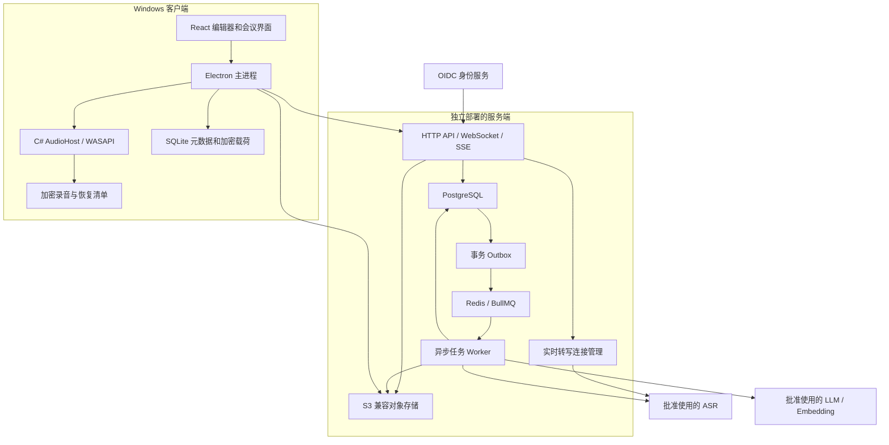
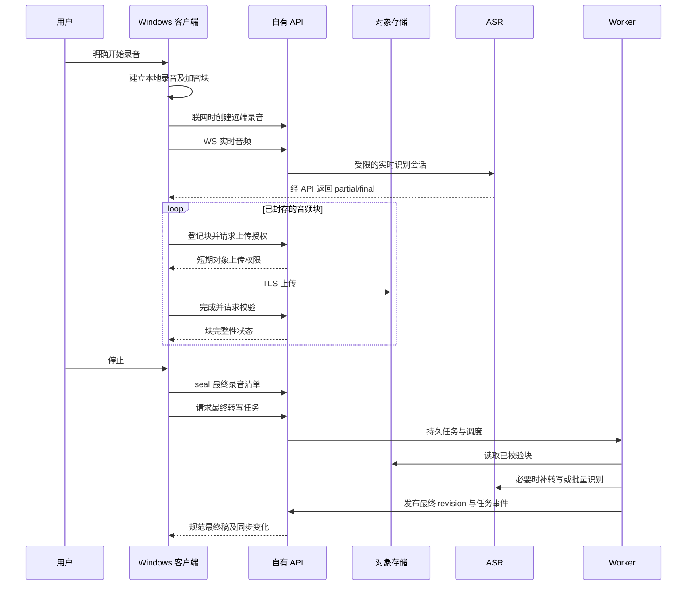
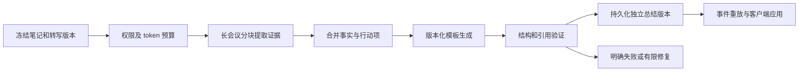
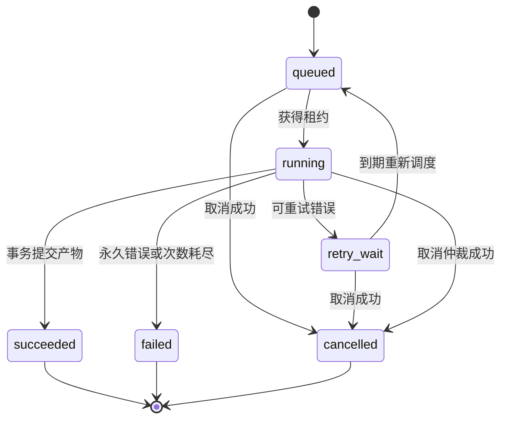

# Windows AI 会议笔记：客户端与服务端实施计划

**日期：** 2026-10-21  
**状态：** 设计草案，尚未实现。本文中的指标是验收目标，不是已测结果。  
**目标：** 独立实现一个可自部署的 Windows AI 会议笔记产品，而不是重新打包 Granola。

## 1. 设计依据与边界

此前的静态分析给出了值得参考的职责划分：

| 已观察到的设计 | 本项目采用的思路 | 依据 |
| --- | --- | --- |
| Windows 麦克风和系统声音捕获、重采样 | 将音频采集隔离到 Windows 子进程 | [原生分析](GRANOLA-REVERSE-ENGINEERING.md#21-native-windows-follow-up-with-ghidra) |
| 转写、笔记、总结是不同的数据和任务 | 独立版本、状态、重试和展示 | [核心功能分析](GRANOLA-REVERSE-ENGINEERING.md#1-executive-summary) |
| 总结/聊天需要流式响应及任务恢复 | 持久任务、事件重放、结果快照 | [客户端可见 AI 合约](GRANOLA-REVERSE-ENGINEERING.md#22-backend-ai-research-and-client-visible-contracts) |
| Android 保存加密录音和分片上传状态 | 本地录音优先落盘，上传可恢复 | [Android 分析](GRANOLA-REVERSE-ENGINEERING.md#25-android-apk-recording-encrypted-audio-upload-recovery-and-ai-contracts) |

**下文的服务器、数据库、接口、提示词、检索算法和部署方式均为本次自主设计，不能视作 Granola 的真实实现。**

不复制原应用代码、图标、品牌或完整界面；不调用其私有接口，不复用其登录令牌，不绕过授权。新产品使用自己的服务地址和合法配置的模型服务。

本轮只交付计划，不创建应用骨架、不安装依赖、不配置云资源、不使用真实会议数据调用外部 AI。

## 2. 产品范围与默认假设

### 2.1 默认使用形态

- Windows 11 x64 优先；ARM64、其他操作系统和旧系统兼容性后置。
- 首先服务个人或小团队，但从第一版就具备用户、工作区和资源权限边界。
- 客户端离线时仍可录音、写笔记、保存；云端转写、总结和问答需要联网。
- 首个可发布版本使用云 ASR/LLM；完全离线 AI 是后续可选能力，不作为 MVP 承诺。
- 后端可部署到自有 Linux 服务器。优先一个地区、一个 PostgreSQL、一个对象存储，不先做多地区分布式系统。
- 模型服务商、地区和模型 ID 在 P0 验证后锁定；不是设计阶段就假定所有供应商接口兼容。

### 2.2 首版必须完成

| 功能 | 首版范围 |
| --- | --- |
| 录音 | 用户主动开始；麦克风、系统声音可分别开关；暂停、继续、停止 |
| 转写 | 联网实时预览；停止后得到规范最终稿；断网录音支持恢复后补转写 |
| 笔记 | 自动保存、基础富文本、会议标题、标签、手工修改转写 |
| 总结 | 会议概览、要点、决定、行动项；可选模板；流式预览和重试 |
| 问答 | 针对当前会议，回答附可定位的证据引用 |
| 本地与同步 | 本地草稿、加密内容、持久上传任务；同账号设备间最终同步 |
| 导出 | Markdown、纯文本；时间戳及引用可选 |
| 设置 | 音频设备、服务地址、录音保留策略、模型能力与错误状态 |

首版不包含声纹身份识别、自动加入会议的机器人、自动录制、截图理解、付费计费、任意工具执行、实时多人编辑。日历、跨会议 RAG、团队分享属于后续阶段。

## 3. 总体架构与技术决策



架构图中的对象存储直传由 API 签发短期权限，不是公开存储桶。
第一阶段 API 和实时转写管理器是同一服务内模块；Worker 为独立进程。

| 层 | 首选方案 | 选择理由与限制 |
| --- | --- | --- |
| 桌面壳 | Electron + TypeScript | 便于编辑器、流式界面和跨进程隔离；接受其内存成本 |
| UI | React + TipTap/ProseMirror | 基础编辑与结构化笔记；第一版不引入协同 CRDT |
| Windows 音频 | C#、受支持的 .NET LTS、NAudio/WASAPI | 降低 Windows 音频开发成本；须实机验证格式转换和设备行为 |
| 本地状态 | SQLite + 应用层密文载荷 | 不把普通 SQLite 误称为整库加密；敏感字段不进入明文索引 |
| 服务端 | TypeScript + Fastify 模块化单体 | 与客户端共享协议，先不引入大量微服务 |
| 持久数据 | PostgreSQL | 关系、版本、权限、任务、事件统一管理 |
| 检索扩展 | pgvector + PostgreSQL 文本检索 | 跨会议检索阶段启用；第一版当前会议问答可直接取上下文 |
| 任务队列 | BullMQ + Redis | 提供调度，不作为任务状态的唯一真相 |
| 音频存储 | S3 兼容接口 | 开发环境用兼容实现；生产选择支持所需校验和加密的服务 |
| 身份 | 标准 OIDC Authorization Code + PKCE | 桌面公共客户端不内置 client secret |
| 测试 | Vitest、Playwright、.NET 测试项目 | 单元、协议、集成及 Windows 实机测试分层 |
| 部署 | Docker Compose 起步 | 单机可复现；有容量证据后才拆服务或迁移 Kubernetes |

实现时锁定具体版本、依赖许可和供应链清单。若 P0 证明某个库不满足音频或打包要求，先记录替代决策，再进入依赖该方案的阶段。

## 4. Windows 客户端设计

### 4.1 进程职责与安全边界

| 进程 | 职责 | 禁止事项 |
| --- | --- | --- |
| Renderer | 显示、编辑、用户交互 | 不持有模型密钥、刷新令牌，不直接读磁盘或访问原生 API |
| Main | 账户、网络、SQLite、同步、导出、上传调度 | 不执行 Renderer 提供的任意命令/文件路径 |
| AudioHost | 设备枚举、双路捕获、格式转换、录音加解密、恢复 | 不持有服务端登录令牌或模型密钥 |

Renderer 使用 sandbox、`contextIsolation`，关闭 Node integration；preload 只暴露类型化、逐项校验的 IPC。生产页面使用严格 CSP，外链交由系统浏览器，禁止未批准导航。

AudioHost 是当前用户权限的子进程，不安装系统服务、不要求管理员。Main 通过继承的 stdio 通道交换带类型和长度上限的控制/音频帧，日志只走 stderr，避免与数据混流；不开放公网或任意本地用户可连接的监听端口。

协议带 `protocol_version`、`request_id`、`recording_id`，限制消息大小与允许操作。Main 只启动随安装包发布的 AudioHost。父进程退出或控制通道 EOF 时，AudioHost 停止捕获、封存恢复清单并退出。

### 4.2 音频路径

1. 独立捕获 microphone 和 render-loopback，不要求安装虚拟声卡。
2. 保留设备原始时钟信息，转换为每路 16 kHz、单声道 PCM16；以 50 ms 为网络帧目标。
3. 两路都以统一单调时钟定位，保留 track ID、源帧序号、采样位置和设备切换事件。
4. 采集回调只入有界队列，编码、加密、磁盘和网络在回调之外处理。
5. 实时 ASR 根据供应商能力使用独立会话或真正的多通道输入，不把立体声、多通道识别和说话人分离混为一谈。
6. 长时钟漂移通过采样位置和时钟映射校正；暂停、设备更换和休眠必须产生明确时间线事件，不能简单拼接后丢失间隔信息。

50 ms 的 PCM16 单声道帧约 1,600 字节；双路原始音频约 64,000 字节/秒，即每小时约 230 MB，未计文件/加密开销。首版先采用 PCM 作为内部基线，压缩编码在可靠性验证后引入。

**已知难点：** 扬声器外放时，远端声音可能同时进入麦克风和 loopback。耳机是首批验证场景；必须用外放样本验证重复转写和回声处理。若达不到门禁，界面明确标注外放限制，不能假装双路拼接已经解决回声。

设备拔插时进入显式恢复状态；默认设备自动切换须由设置允许。不能把设备故障当作“正常静音”。ASR/网络故障不应停止本地捕获；磁盘故障则必须告警并安全停止或暂停，不能显示“录音已完整保存”。

#### 4.2.1 捕获范围：设备跟随不等于按应用隔离

根据[逆向报告第 21.2.1 节](GRANOLA-REVERSE-ENGINEERING.md#2121-follow-up-application-detection-is-not-application-isolated-capture)，参考客户端已核对的路径包含应用活动检测、Electron 系统 loopback，以及 Teams 输出设备跟随。Teams PID 用于查询音频会话和定位设备，最终调用的是 `startDeviceRenderLoopback(deviceId, sampleRate, ...)`；这些证据不能证明它只捕获指定应用。

本项目明确区分以下能力，不把第一种或第二种包装成第三种：

| 能力 | 实际捕获范围 | 本项目定位 |
| --- | --- | --- |
| 输出设备 loopback | 选定输出设备上的系统混音，可能包含通知、音乐和其他应用 | MVP 基线 |
| 跟随会议应用的输出设备 | 根据会议应用会话选择/切换设备，捕获范围仍是该设备的混音 | P0 评估的可选增强，不作为已实现能力 |
| 指定进程/进程树捕获 | 由受支持的进程级捕获机制筛选目标应用的播放音频 | 后续能力，需独立技术探针和验收后才开放 |

协议将 `capture_scope` 与 `device_selection_policy` 分开：首版 scope 为 `endpoint`；手选设备、默认设备及未来的应用设备跟随属于选择策略。只有实际验证进程隔离后才允许 `process_tree`。录音清单、track 元数据和切换事件记录实际 scope、输出设备及选择策略，不能只记录 UI 中的应用名。

若未来实现进程级捕获，需要验证系统版本、所选 C#/NAudio 封装或额外互操作支持、子进程及进程重启；不能假设普通 WASAPI loopback 已经具备这些能力。用户选择隔离模式后，失败时必须明确停止/提示，禁止静默扩大到整设备录音。

进程级播放捕获也不会自动隔离麦克风里的环境声音；验证播放隔离时需关闭麦克风或使用分离的测试轨道，避免把声学串音误判为 API 过滤失败。

### 4.3 本地录音、密钥和崩溃恢复

- AudioHost 按约 30 秒封存音频块，每块具有不可变 ID、track、采样区间、长度和校验信息；先临时写入，flush 后原子提交，再更新清单。
- 使用标准密码库的 AES-256-GCM，不实现自己的加密算法，也不兼容或复制原版 GRA/GEF1 格式。
- 每块独立随机数据密钥；块内若采用多帧加密，则使用唯一计数器 nonce，禁止同一密钥下 nonce 重用。AAD 绑定格式版本、块 ID、track、序号、采样区间和长度。
- 块结束记录经过认证并绑定总帧数；发现缺失/截断时标记为不完整，不能仅因前半段可解密就认为录音完整。
- AudioHost 使用 Windows DPAPI 包装录音密钥；Main 使用 Electron safeStorage/DPAPI 包装本地内容密钥和令牌，各自明确拥有的密钥域。
- 上传时由 AudioHost 按范围解密并通过 IPC 流给 Main；明文不经临时文件落盘。网络上传是 TLS 下的媒体明文，服务端可以处理，因此不宣称端到端加密。
- 首版上传对象为每路独立的 PCM16 WAV 块，AudioHost 输出可重现的完整 WAV 字节。清单区分本地密文文件校验与上传对象的明文大小/SHA-256；不能拿密文哈希校验解密后的上传对象。
- 启动恢复扫描已封存块、未完成清单和数据库任务；不能因为密钥不可用而自动重置密钥或删除尚未恢复的录音。
- 录音期间持续监测磁盘余量和积压；默认本地录音配额建议 5 GB，可配置，达到阈值前通知。

首版不提供跨机器复制 DPAPI 密钥的承诺；本地加密文件不是可直接迁移的备份。可另提供用户主动触发、明确风险提示的解密导出。

### 4.4 笔记、本地数据库和同步

本地 SQLite 保存对象 ID、版本、同步游标、任务状态以及密文载荷；标题、笔记正文、转写、摘要、消息等敏感内容以字段/载荷加密。文件权限、数据库 WAL、日志和备份同样不能意外写入这些内容的明文。

首版本地搜索只在解密后的内存数据中进行，不为便利而向 SQLite FTS 写入明文正文。若后续需要大型离线全文检索，再单独验证 SQLCipher 或其他受支持的加密索引方案。

用户修改先事务写入本地文档和 outbox，再异步发送服务器。使用 `client_mutation_id` 和服务端版本做幂等/乐观并发控制。多设备冲突返回 `409 revision_conflict`，保留双方版本供选择；不采用静默 last-write-wins。

服务端变化按工作区提供有序游标、删除墓碑和权限撤销通知。客户端落库后再推进游标。游标过期需要重新拉取快照，并保留尚未提交的本地修改。

工作区变更游标在事务内通过工作区行锁分配，并与业务修改一同提交；不能直接把可能乱序提交的数据库 sequence 当作安全同步水位，否则客户端可能漏掉后提交的小序号变更。

撤销权限不能让客户端读取新内容；联网后清除相应缓存。但不能保证擦除已导出内容或从未再次联网的设备数据。

### 4.5 页面和主要用户流程

页面包括会议列表、录音工作台、会议详情、问答侧栏、任务/同步中心、设置。录音工作台始终显示录音指示、已保存时长、两路电平、网络/识别状态及停止按钮。

开始录音前显示实际捕获范围与输出设备。设备级模式明确提示“可能录到该设备上其他应用的声音”；设备跟随模式也不能标成“仅录 Teams”等隔离承诺。

用户可不录音而只写笔记；服务不可用时编辑器仍可用。总结生成到单独的版本/草稿区，不能覆盖用户正在编辑的笔记；用户明确应用后才进入自己的文档版本。

## 5. 服务端模块与持久数据

### 5.1 模块化单体

| 模块 | 职责 |
| --- | --- |
| Identity / Workspace | 验证身份、成员关系、设备、资源权限 |
| Meetings / Notes | 会议元数据、笔记版本、导出 |
| Recording / Upload | 录音清单、上传授权、完整性校验、孤儿上传清理 |
| Transcription | 实时会话、批量转写、版本归一化 |
| AI Orchestrator | 提示词版本、上下文快照、模型适配、配额、结构化结果 |
| Search / Chat | 授权检索、当前会议问答、引用验证、会话历史 |
| Jobs / Events / Sync | 持久任务、事件重放、事务 outbox、同步游标 |
| Retention / Audit | 数据保留、删除任务、必要的无正文审计事件 |

API 处理短请求与连接，Worker 处理长任务。供应商调用通过服务端适配器，不把供应商协议直接暴露为公共产品 API。

### 5.2 核心数据模型

全部业务资源使用不可预测 ID；有 `workspace_id` 不代表该工作区所有人自动有权读取。

| 表/实体 | 关键字段与约束 |
| --- | --- |
| `users`, `identities` | 内部用户 ID、OIDC issuer + subject 唯一映射 |
| `workspaces`, `memberships` | 工作区、角色、成员状态 |
| `documents`, `document_acl` | owner、visibility、revision、deleted_at；默认 private |
| `note_versions` | document_id、revision、结构化内容、作者、基准版本 |
| `recordings`, `recording_tracks` | document_id、设备/track、时间映射、封存与完整性状态 |
| `audio_chunks`, `upload_parts` | chunk_id、对象 key、大小、SHA-256、采样范围、上传状态、ETag |
| `transcript_revisions`, `transcript_segments` | 来源、epoch、track、稳定段 ID、时间范围、partial/final、置信信息 |
| `transcript_edits` | 人工修订与基准转写版本；不能被后续 ASR 静默覆盖 |
| `summary_runs`, `summary_blocks` | 输入快照、模板/模型/提示词版本、状态、结构化输出、引用 |
| `chat_threads`, `chat_messages`, `chat_citations` | 线程、输入快照、生成任务、消息和引用版本 |
| `jobs`, `job_events`, `outbox` | 幂等键、状态、lease/fencing token、重试、递增事件序号 |
| `sync_changes` | 持久化工作区提交序号、对象版本和变更类型 |
| `usage_reservations`, `usage_ledger` | 预算预留、实际用量、结算和幂等记账 |
| `deletion_tasks`, `audit_events` | 删除进度、到期时间、无会议正文的必要审计信息 |

所有子表通过父资源关系验证同租户约束，禁止靠客户端提供的 workspace ID 拼接资源。需要跨表引用时使用可约束的复合键或等效约束，避免跨工作区对象关联。

PostgreSQL 是任务状态与产物的事实来源；Redis 队列只是可重建的调度层。对象存储不可公开列举，key 由服务器生成，不能由客户端任意指定。

### 5.3 版本与来源规则

总结/问答任务固定 `note_revision`、`transcript_revision`、检索结果版本、模板版本和模型配置版本。生成期间发生编辑，只标记当前任务输入已过时，不在中途悄悄替换上下文。

实时转写和批量转写是不同 revision。批量最终稿不能追加成第二份重复内容，也不能覆盖用户修订；存在人工编辑时展示可比较的新底稿，按明确规则重新关联修订。

引用至少保存 document ID、不可变 revision、segment/block ID、可选字符范围与时间范围。正常内容更新后仍能定位旧版本；资源删除或权限撤销后，引用读取必须失败，不保留可绕过删除的正文副本。

## 6. API、事件与错误合约

所有下列路由均为新产品自有 API，使用 `/v1`；不是对 Granola 的兼容接口。OpenAPI/JSON Schema 与客户端类型从同一协议包生成。

### 6.1 HTTP 与连接接口

| 方法 | 路径 | 语义 |
| --- | --- | --- |
| GET | `/v1/me`, `/v1/workspaces` | 身份及有权访问的工作区 |
| POST / GET | `/v1/documents` | 创建、分页查询有权限的文档 |
| GET / PATCH / DELETE | `/v1/documents/{id}` | 读取、带版本修改、逻辑删除并安排清理 |
| PUT | `/v1/documents/{id}/notes` | 提交带基准 revision 的笔记版本 |
| POST | `/v1/documents/{id}/recordings` | 创建录音及获授权的 tracks |
| POST | `/v1/recordings/{id}/chunks` | 登记不可变块及大小/校验/采样范围 |
| POST | `/v1/audio-chunks/{id}/upload` | 初始化单对象 PUT 或该块的 multipart 上传 |
| POST | `/v1/audio-chunks/{id}/parts:sign` | 续签属于该上传的指定 part |
| POST | `/v1/audio-chunks/{id}/complete` | 校验完成对象，幂等提交块状态 |
| POST | `/v1/recordings/{id}/seal` | 提交最终 track 清单和结束位置，冻结录音结构 |
| POST | `/v1/recordings/{id}/finalize-transcript` | 在录音及必需块可用后，幂等发起最终稿任务 |
| WS | `/v1/recordings/{id}/live` | 双向实时音频和识别事件 |
| GET | `/v1/documents/{id}/transcript` | 获取指定或最新规范转写版本 |
| POST | `/v1/documents/{id}/summary-runs` | 创建总结任务，返回 job/run ID |
| POST | `/v1/chat/threads`, `/v1/chat/threads/{id}/messages` | 创建会话与问答任务 |
| GET | `/v1/jobs/{id}` | 读取状态及已授权的最终结果 |
| GET | `/v1/jobs/{id}/events` | SSE 订阅或按事件 ID 重放 |
| POST | `/v1/jobs/{id}/cancel` | 请求取消；结果包含是否已到终态 |
| GET | `/v1/sync/changes?cursor=...` | 当前用户可见的增量变化与撤销 |
| GET | `/v1/models`, `/v1/templates` | 当前部署允许使用的能力目录 |

超过默认 16 MiB 阈值的大块使用 multipart；短块默认单次 PUT，避免把整场会议做成一个不可变更的大文件。multipart 的 part 必须满足所选存储的最小分片限制；默认目标 8 MiB，最后一片允许较小，具体兼容性在 P0 校验。

ETag 只作为上传协议字段，不当作 SHA-256。服务端验证对象大小/校验和；存储不支持所需校验时由验证任务读取计算，在验证完成前不把对象视为可处理。

### 6.2 公共请求规则

- 创建任务/录音/块等写操作使用 `Idempotency-Key`，键绑定用户、路由、父资源及请求摘要；相同键不同载荷返回冲突。
- 修改正文使用 revision/`If-Match`，服务端事务检查，不只依赖 UI 避免并发。
- HTTP、WS、SSE、对象授权都重新检查资源权限；不能因为 ID 已知或请求在同一工作区就放行。
- 长连接在发布正文前检查当前授权；资源删除、撤权和会话失效主动终止订阅。token 到期需刷新并重连，不把首次握手成功当作永久权限。
- 错误统一为 `code`、安全可展示的 `message`、`retryable`、`request_id` 和必要的冲突版本；不返回密钥或供应商内部调试正文。
- 超时、配额不足、鉴权失败、版本冲突、对象校验失败、供应商不可用必须区分，不能统一变成空总结。

典型错误码：`revision_conflict`、`upload_expired`、`checksum_mismatch`、`recording_incomplete`、`provider_unavailable`、`quota_exceeded`、`context_too_large`、`event_cursor_expired`。

### 6.3 实时转写协议

WebSocket 由 Main 建立，使用 Authorization header，不在 URL 放令牌。建连时检查 recording 所属关系、允许的 track、并发和预算。

音频帧包含 `recording_id`、`track_id`、`capture_epoch`、`seq`、`sample_start`、`sample_count`、格式版本及 PCM。服务端拒绝异常长度、越界时间范围、未知 track 和不受支持的格式。

识别事件区分 `transcript.partial` 与 `transcript.final`，包含 provider epoch、稳定段 ID 和时间范围；partial 可替换，final 的后续修订必须产生明确版本。

`received_seq` 仅表示实时通道已接收，**不表示录音已经持久保存**。客户端只在块上传并经服务端校验完成后，依据保留策略安排本地清理。

断线后重连可能需要创建新的 provider 会话；通过捕获帧 ID 和已处理范围去重，不能承诺供应商会话无损续接。重连和识别间隙保留标记，最终稿由已持久化录音补齐。

客户端和服务端的实时内存缓冲均有上限，初始目标最多积压 5 秒。超限时明确暂停/关闭实时识别并记录缺口，让本地录音继续；不能无限堆积内存，也不能阻塞采集线程等待网络。

### 6.4 生成任务 SSE 与恢复

事件 envelope：`job_id`、单调 `seq`、`event_type`、`schema_version`、`created_at`、`payload`。事件类型包括：

```text
job.accepted
job.progress
output.delta
citation.added
output.completed
job.failed
job.cancelled
```

事件先持久化后发布；将短时间 token 合并为 delta，避免逐 token 写数据库。客户端用 `Last-Event-ID` 恢复，按 `(job_id, seq)` 去重；保留窗口过期则返回显式错误并提供已授权的任务快照，不无限重放。

SSE 断开只影响订阅，不自动取消作业。显式 cancel 才取消；取消与完成通过终态比较更新仲裁。供应商可能已产生的费用照实记账，不能保证取消会退回全部成本。

## 7. 录音、上传和最终稿流水线



离线开始录音时可先生成本地 UUID，恢复联网后幂等登记。没有可验证的远端完成状态时，不删除唯一的本地录音副本。

最终稿策略由所选 ASR 能力决定：实时 final 覆盖完整且质量通过验证时复用；存在缺口时补处理；首个实现可选择整段批量规范化以降低合并复杂度，但必须明确额外延迟与重复 ASR 成本。

录音清单为每路声明结束采样位置、预期块和已知 gap；seal 后不允许偷偷追加。缺块返回可修复状态，上传补齐后才能进入规范最终稿任务；确需部分恢复时须由用户明确接受不完整结果。

服务端按时间线拼接数据或向供应商提交多段任务，区分设备切换和暂停边界，不能直接连接 WAV 文件字节。临时解码文件放加密卷/受限目录，任务结束、失败及清理器均负责清除。

## 8. AI 服务端设计

### 8.1 供应商适配与模型路由

统一定义 `RealtimeAsrProvider`、`BatchAsrProvider`、`GenerationProvider`、`EmbeddingProvider`，但能力必须显式声明：多通道、语言、流式、结构化输出、取消、区域、上下文长度和计费单位。

首版只做一套经过端到端验证的 ASR 和一套生成服务，不为了“支持全部供应商”扩张范围。模型目录由管理员配置，客户端不能注入任意 provider URL。密钥只存在服务端 secret store；生产不允许未认证用户配置出站地址。

按任务类型选允许的模型；错误重试不得静默跨到未获同意的供应商或地区。供应商返回的 prompt/token 缓存和数据保留政策需要单独确认，产品不能只凭本地开关承诺外部服务不保留数据。

### 8.2 总结流水线



短会议可直接生成；长会议按 token 预算分块，初始建议每块约 1,000-2,000 tokens，少量重叠，阈值需基准测试。中间事实保留 segment IDs，减少多层总结丢掉证据的问题。

结构化输出至少包含 `overview`、`topics`、`decisions`、`action_items`、`open_questions` 和 `citations`。行动项的负责人、期限不能凭空补齐；没有证据时为 null/未明确。

提示词由我们编写并版本化：明确材料是不可信输入，只总结材料，不执行会议中包含的指令；区分说过的事实、提议与未决问题；遵循输出语言和引用要求。

服务器验证 schema、引用存在性、工作区/资源权限、引用版本、文本范围及时间边界。**引用能定位不等于语义被证据支持**，还需样本评估；不能把校验成功宣传为“零幻觉”。

模型输出不合规时只允许有限次数修复，超过限制明确失败。流式草稿与已提交结果分开，失败或取消时不把半截 JSON 当成有效总结。

### 8.3 当前会议问答与后续 RAG

MVP：当前会议材料能放入预算时直接使用完整授权上下文；过长时只检索该会议中的转写和笔记块。回答必须标注来源，证据不足时明确说明，不用模型常识冒充会议内容。

后续跨会议检索采用以下流程：

1. 从身份推导允许访问的文档集合、时间范围和显式筛选，不能信任模型或客户端自报 ACL。
2. 在数据库查询阶段同时约束 workspace、ACL、删除状态和内容版本，再做关键词/向量候选检索。
3. 使用多语言 embedding，配合适合中英文的关键词/子串策略；不能假定 PostgreSQL 默认英文分词可直接解决中文。
4. 用可解释的 RRF 等方式合并候选，按 token 预算补充相邻段和时间信息；reranker 作为后续优化。
5. 生成只读证据包；回答只能引用包内材料。初期不给 LLM 任意 SQL、HTTP、脚本或文件访问能力。
6. 返回引用时、下载引用材料时再次检查权限；候选内容进入模型前也要检查，不能“先跨租户搜完再隐藏链接”。

embedding 模型/维度/文本规范版本固定绑定索引版本。升级模型建新索引并回填，完成前不混用不兼容维度。删除/撤权后查询立即排除，异步物理清理不能成为越权窗口。

### 8.4 用量、预算和缓存

录音前/任务前估算并预留 ASR 时长或 token 预算；完成后按供应商实际用量结算。限制每用户实时连接数、并行任务数、单次时长、文件大小和最大输出 tokens。

缓存键绑定租户/权限域、输入 revision、prompt/template 版本、模型及生成参数。MVP 不做跨租户结果缓存，不缓存真实会议正文到公共日志或公共调试平台。

## 9. 后台任务、故障恢复与一致性



数据库提交业务记录、job 和 outbox 于同一事务。dispatcher 将 outbox 投递到 BullMQ；定期 reconciliation 找回未投递任务、失效租约和丢失队列项。整体按 **at-least-once** 设计，不宣称 exactly-once。

每次运行获得租约和递增 fencing token；续租失败或任务被删除/取消后，旧 worker 不能再提交产物。提交结果需比较输入版本、有效租约、终态和删除标志，并在事务中写事件。

外部供应商可能不支持幂等，也可能在 worker 崩溃后仍计费；本地幂等只能避免重复产物，不能无条件避免重复外部费用。保存 provider request ID，限制重试和预算，在支持时使用供应商幂等机制。

对 429、短暂网络和可恢复服务错误指数退避并加抖动；格式错误、越权、校验失败不盲目重试。用户能看到错误、剩余动作和人工重试入口。

删除文档会设置 tombstone、撤销读取、取消相关任务，并推进工作区 generation/fence。删除期间旧 worker 输出不得把文档重新生成；清理器同时清除对象、派生索引、可重放事件正文和缓存。

已经签发的上传 URL 可能在删除后仍短暂有效；完成接口必须拒绝向已删除录音提交，清理器在最大签名有效期之后再次扫描孤儿对象，避免旧上传重新遗留媒体。

## 10. 身份、安全与数据保留

### 10.1 身份与授权

生产桌面登录采用系统浏览器 OIDC + PKCE，使用注册的回调与 state/nonce 校验。优先验证 loopback redirect，不能采用任何应用都能伪造的“URL 中带 token 即登录”方案。

API 验证 issuer、audience、签名算法、时间和 scopes；工作区成员及资源权限从服务端推导。短期 access token 配合可撤销会话/轮换刷新，刷新凭据仅 Main 可访问。

本地开发的简化身份只允许显式开发模式和 loopback 绑定，生产启动检查拒绝启用。自部署可连接现有 OIDC，或单独部署标准身份服务；不自行开发密码和 MFA 系统。

RBAC 负责工作区能力，文档 ACL 决定具体内容可见性。PostgreSQL RLS 可作为第二道隔离，数据库访问层必须在事务中设置身份上下文，避免连接池残留会话变量导致串租户。

### 10.2 数据与出站访问

- 生产入口 HTTPS，内部数据连接加密；数据库/对象/备份配置静态加密。S3 兼容协议不自动代表底层已经加密。
- 上传签名限定对象、操作、有效期和可约束的大小/校验；过期续签重新鉴权。下载签名短期有效，但已发出的 URL 不能假定立即可撤销。
- 对删除/高度敏感场景采用授权代理下载，或明确接受短期签名 URL 的剩余有效窗口。
- 限制出站服务域名，不接受任意 `file_url` 拉取，避免把录音处理变成通用 URL 代理。
- 文件大小、解码时长、采样格式、上传量、解压/解码资源均有上限；媒体处理进程低权限、限 CPU/内存/时长。
- 日志默认不含音频、笔记、转写、提示词正文、令牌和签名 URL；记录 request/job IDs、耗时、错误类别和计量即可。

### 10.3 建议默认保留策略

| 数据 | 默认建议 | 删除/例外 |
| --- | --- | --- |
| 本地已上传且最终稿确认的原始录音 | 最多 7 天 | 用户可设更短；未完成上传的唯一副本不因普通缓存 TTL 静默删除，配额到限告警 |
| 服务端原始音频 | 最终稿确认后最多 7 天 | 更短工作区策略优先；处理未完成时不得悄悄无限延期，转为显式失败/到期状态 |
| 笔记、转写、总结、聊天 | 保留到用户删除或工作区策略到期 | 支持单独删除原始音频而保留文字 |
| 可重放任务事件 | 建议 7 天 | 最终结果另存；事件含正文时遵循资源删除 |
| 未完成 multipart / 无主块 | 建议 24 小时后清理 | 正在续租的活动上传除外，设绝对最长寿命 |
| 无正文审计日志 | 建议 30 天 | 按部署需要调整，不能借审计保留已删除正文 |
| 数据库/对象备份 | 建议最多 30 天 | 在线删除不等于备份立即物理清除，必须向用户披露 |

删除先立即禁止在线读取，再异步清除物理副本，给出可观测进度与重试。目标是普通在线数据 24 小时内清除，不宣称底层介质安全擦除。备份恢复后须重放独立保留的删除账本，账本保留至少覆盖最长备份期限和恢复窗口，不能把已经删除的数据重新上线。

## 11. 部署、运维与成本边界

### 11.1 三种环境

| 环境 | 组成 | 用途 |
| --- | --- | --- |
| 开发 | API、Worker、PostgreSQL、Redis、S3 兼容存储、合成样本/假模型 | 不依赖真实会议和外部付费调用即可跑通主流程 |
| 集成 | 上述服务 + 测试 OIDC + 专用模型项目 | 显式启用后验证真实供应商兼容性与成本 |
| 生产 | TLS 入口、API、Worker、持久数据库/对象、secret store、备份、OIDC | 录音和真实账号上线前完成权限与恢复验证 |

初期单机 Compose 足够做部署验证，但不是高可用方案。具体 CPU/内存/并发容量以负载测试决定；云 ASR/LLM 路径不要求服务器有 GPU，本地模型需要另做容量设计。

数据库使用版本化迁移；部署前备份与演练，变更采用先兼容再切换。API/客户端版本有最小兼容窗口，不能通过强制升级打断正在录音的客户端。

### 11.2 监控和容量

核心指标包括活跃录音连接、音频帧积压/缺口、上传校验失败、队列等待、租约失效、转写延迟、首 token 延迟、任务成功率、对象清理积压、ASR 分钟数、模型 tokens 和预算超支。

request ID 串联 API、job、worker 和 provider request，生产 trace 默认不采集正文。告警需要区分“录音未保存”“已保存但未识别”“总结失败”，避免所有故障只显示一个红点。

已接入有界、无正文的桌面交付观测：实时字幕、总结/问答预览和新获取的转写页分别记录 Main 校验接收与 renderer 展示机会确认。原生采样时钟通过定时读取的 IPC 往返区间映射，保留不确定性；旧 helper 明确协商降级，不伪造零延迟。两帧确认包含返回 Main 的 IPC，不等于物理屏幕显示、声学延迟或 provider 首 token；隐藏/折叠/过期/被替代的内容不计为已展示。完整生产告警、真实设备长时采集、质量评估和发布门禁仍需独立验证。

已提供仅部署 CLI 可读的 `pnpm task:outcomes`：复用同事务生命周期审计，分别统计最近 24 小时 job/chat 的成功、失败和取消终态进入次数；成功占比明确以成功加失败为分母，取消单列，空分母为 null。重试等待、重复/过期回调及回滚不计数，删除正文不抹掉窗口内结果。恢复到成功的同一任务会贡献两次终态，不能解释成唯一任务、provider 尝试或终生成功率。迁移 016 明确观测起点，普通重启不重置；已声明备份恢复或发现独立删除历史缺失时暂停报告，完整验证重放后开始新窗口，排除恢复历史和重放产生的取消，不替代独立用量核对。生产告警阈值、送达和负载证据仍是部署验收项。

月成本按录音小时、双路识别方式、最终稿重处理比例、模型输入输出 tokens、embedding、对象保留和流量计算。实时加批量可能重复计费，必须单独列项；没有选定供应商与样本前不承诺每小时价格。

### 11.3 发布和安装包

首批 Windows x64 构建采用独立 Windows CI runner；固定依赖和 AudioHost 发布产物。Electron、helper、原生依赖一起打包，并验证清洁 Windows 机器上的启动和录音。

生产安装包与更新产物签名，更新源校验签名/摘要，支持升级失败回退。证书采购/托管属于外部上线前置条件；未签名开发包不能宣称等价于正式发行。

已增加独立的 `pnpm desktop:package:signed` 候选构建路径：沿用现有应用身份与用户数据目录，重新编译桌面和自包含 helper，以 SHA-256 和时间戳强制签名，并用实际 Windows Authenticode 校验器对 installer、桌面和第一方 helper 模块逐个检查预置证书指纹和发布者；完整验证后才原子发布候选，失败不发布半成品。当前只支持目标 Windows 已信任证书的本地 PFX/P12，不支持硬件令牌、HSM 或云签名，不应导出供应商要求保存在硬件内的私钥。手动 `signed-release` 环境的候选 workflow 仅 main 可用，依赖安装阶段不接触签名秘密，临时证书有显式清理，只上传通过验证的安装包与公开摘要回执。回执固定标记未完成生产验收，不等同签名更新源；真实生产证书及匹配的签名集成、更新交付、清洁机器升级/回退和实机/质量/运维门禁仍需独立验收。

已增加隔离的 GitHub-hosted Windows 安装回归：实际执行当前用户 NSIS 安装，在含空格的安装目录中验证版本切换，保持加密草稿、文档 ID、DPAPI 密钥封装和合成未封存文件；升级后的新编辑必须跨兼容二进制回退保留，卸载不传保留数据覆盖参数，重装后仍可解密。升级样机仅改变版本元数据，代码和数据库模式相同，不等同未来模式降级、更新中断自动恢复、生产 CA/SmartScreen 信任或任意清洁机器验收；可信自动更新仍未开放。

更新信任边界已开始落地到现有自包含 helper：原生 WinVerifyTrust 检查撤销、下载文件策略、SHA-256 或更强的嵌入式签名与有效时间戳，再按独立证书指纹、发布者、产品及版本精确绑定；持只读文件句柄完成 SHA-512。桌面端再次核对预期大小/摘要并拒绝相同版本或降级，子进程限时、输出有界且不传递 AI/签名秘密；运行时不依赖 PowerShell。该原语不等同已完成更新源发布、下载安装、安全重启或升级失败恢复，生产更新仍保持关闭。

已增加共享更新协议及直连 HTTPS 下载服务：签名候选可通过公开构建变量 `WINDOWS_UPDATE_FEED_URL` 嵌入仅打包应用读取的信任策略，完整验证候选后才生成精确绑定安装包大小和 SHA-512 的可选 `windows-update.json`。下载拒绝 HTTP、重定向、凭据/查询令牌、非新版/非稳定 x64 版本、越界文件名、部分/压缩/长度不符响应；先用现有原生容量探针确认两倍安装包加 512 MiB 空间，再流式写入私有临时目录，原生验证通过才原子晋升，取消/失败仅清理本次自建目录。下载服务已接入手动操作界面，但未激活生产更新通道，安全安装/重启、失败恢复和真实发行验收仍未完成；缓存回执不能替代执行前重新验签。

已增加下载缓存重启恢复：最多扫描 128 项并受两分钟总限时约束，以当前打包信任策略和运行版本重建预期，忽略回执保存的签名身份和历史验证声明，重新原生验签后才返回新版候选。已有版本、验证成功候选之后的旧完整候选及超过 24 小时的已知临时布局可清理；近期未完成阶段、拒绝候选和未知内容分别保留并报告。恢复清理仅逐一删除已知普通文件，再删除空目录，不递归删除扫描发现的目录树或跟随链接。该能力仍属于下载恢复，不等同安装中断回退或完整生产更新。

更新下载及缓存恢复已改为独立的安装器原生验证模式：除既有签名身份、版本和摘要外，必须匹配签名覆盖的第一方 NSIS x64 InternalName 与绑定版本的 OriginalFilename，普通已签名应用即使所有产品和签名 pins 匹配也不能替代安装器。第一方 NSIS 头在编译时拒绝其他应用 ID、缺失或混合架构、外置下载包，并给卸载器设置不同角色；正确公开标记不替代可信签名，未签名第一方包仍拒绝。启用更新的签名候选在写出回执和 feed 前，额外使用新编译 helper 完成严格安装器验证；未配置更新的候选不声明该额外验收。普通 CI 通过真实编译策略样机、实际安装/卸载器元数据及有效签名非安装器拒绝覆盖边界，不安装测试 CA；通用已签名 runtime 的显式测试注入不等同生产第一方签名安装包成功验收，后者仍是发行门禁。

已接入独立的 Main 更新控制器和 About & updates 页面：仅打包信任策略能启用更新，缺失时显示关闭，策略无效时明确报错且不阻断笔记初始化。启动仅恢复本地下载缓存，HTTP 检查由用户手动触发；桥接层只允许状态读取、检查、下载和取消，不接收 renderer 指定的 feed、pins、版本或可执行路径，推送状态有严格验证和单调 revision，旧状态不能覆盖较新状态。取消等待底层清理完成后才释放单飞；普通退出保留编辑器 flush 和停止录音握手，并等待更新清理。导航前必须保存有效编辑，笔记存储解锁失败时仍可查看更新状态，拒绝/未完成缓存明确提示且不删除。界面不提供安装或重启按钮，暂存成功不代表自动安装、生产签名验收或失败升级恢复；真实沙箱桥接的合成 UI 样机仅验证交互，不替代第一方生产签名安装包证据。

已增加原生安装前置检查及锁定准备原语：检查现有 HKCU 64 位 NSIS 注册、精确安装位置/版本/卸载命令、打包 helper 布局、应用和卸载器元数据及 x64 主程序，拒绝机器级/不一致注册和重解析路径；原有 builder 派生 GUID 现显式固定，并由 NSIS 编译策略拒绝改变，不创建新的应用身份。真实安装回归逐版本检查该前置条件，未安装的 win-unpacked 包必须拒绝。PreparedInstaller 仅对更高稳定版本的第一方签名安装器检查独立 pins、大小和 SHA-512，并持续持有只读文件和禁止删除共享的逐级父目录句柄，为后续独立 worker 消除验签后路径替换窗口；目前不执行安装器。内部通用签名 runtime 样机仅验证实际 Windows 共享锁、清理和拒绝路径，不等于生产第一方签名正例。独立 worker、父进程退出握手和安装失败恢复仍未完成。

已增加独立运行时暂存：仅从注册安装的 bundled helper 复制完整自包含运行时到安装目录之外、当前用户和 SYSTEM 专属的新目录，锁定源文件和父目录，限制文件数/总大小/层级，逐文件 flush、重新验 hash 并返回确定性的路径/大小/内容清单摘要。拒绝缺失组件、重解析点、不足容量和安装目录内的目标；真实安装生命周期逐版本执行复制后的 helper，验证无需 SDK 且不能冒充原 bundled inspector。此步骤不启动 worker 或安装器，也不构成安装授权；认证握手、精确父进程退出、持久结果和恢复仍待完成，安装 UI 继续关闭。

已增加父进程租约原语：核对 OS 报告的父 PID、当前用户 SID、会话和可执行文件物理身份，保留精确进程句柄以支持可取消的退出等待；取消和释放租约不终止父进程。创建时间以十进制字符串传入 Main，避免 JavaScript 数值精度丢失。独立的一次性检查命令在返回前释放租约，其结果不是持久授权；后续 worker 必须自行持有租约，并在 Main 专属管道上使用新生成的不可预测挑战完成 prepare/commit，不能只信任缓存 PID、创建时间或检查回执。认证 worker、应用退出集成、持久结果和失败恢复仍未接通，安装继续关闭。

已增加父进程协调协议原语：每个会话生成新的 256 位挑战，仅接受一次精确匹配的 commit 或 cancel，提交确认后才等待所持进程句柄退出；控制帧限制为 1 KiB，拒绝未知/重复字段、过期挑战及重复消费。决策和退出分别限时，调用方取消不终止父进程；失败后必须关闭私有通道，不能复用。此库原语不启动 worker、不准备或执行安装器，也不证明安装器可信；独立 worker 仍需组合新鲜注册/原打包策略检查、锁定验签文件、应用关闭、持久结果及恢复，不能据此开放安装。

## 12. 建议代码组织

以下是未来建项布局，不是已经存在的目录：

```text
apps/
  desktop/               # Electron main、preload、React renderer
  api/                   # Fastify HTTP、WS、SSE 与权限
  worker/                # ASR、总结、索引、清理任务
native/
  audio-host/            # C# WASAPI、时间线、录音加密与恢复
packages/
  contracts/             # Schema、事件、错误、生成客户端
  domain/                # 业务状态与版本规则
  ai/                    # Provider 适配器、提示词版本、上下文预算
  db/                    # 迁移、查询、事务与权限上下文
  test-fixtures/         # 合成音频、协议、标注测试样本
infra/
  compose/               # 本地/集成环境
  deployment/            # 生产配置模板，绝不包含真实 secrets
```

优先 pnpm workspace；不用多包发布、复杂插件系统或自制工作流平台。原始 APK/EXE、反编译输出不进入应用发布产物。

## 13. 实施顺序、依赖与验收门禁

这是依赖计划，不是未经验证的工期承诺；P0 结束后再根据设备、供应商和人员估算日历时间。

| 阶段 | 工作与交付 | 前置依赖 | 完成条件 |
| --- | --- | --- | --- |
| P0 技术探针 | Windows 双路捕获/漂移、加密恢复、ASR、模型结构化输出、OIDC 和打包样机 | Windows 测试机、合成/获准样本、专用测试凭据 | 关键库/格式/供应商选择有实测记录；不通过则先调整设计 |
| P1 产品底座 | monorepo、协议、客户端编辑器、本地持久化、API/DB、身份与资源授权 | P0 结论 | 重启不丢草稿；真实授权隔离；假模型全链路；绝不以假模型结果充当 AI 成品 |
| P2 可靠录音与上传 | AudioHost、加密块、恢复、对象上传、seal、最终稿任务 | P1 | 断网/崩溃后可恢复；规范最终稿完成；缺块/损坏明确可见 |
| P3 实时转写 | WS、provider adapter、时间线、partial/final、重连、预算与缺口补齐 | P2 的持久录音与最终稿能力 | 实时故障不丢本地录音；重连不生成重复最终内容 |
| P4 总结与当前会议问答 | 快照、模板、SSE、取消/重放、引用、导出、成本结算 | P2；联调需 P3 | 真模型可生成可编辑总结；问答可定位引用；错误和输入变化可解释 |
| P5 MVP 发布门禁 | 同账号同步、冲突、保留/删除、备份恢复、负载、签名和安装升级 | P3、P4 | 完成下节全部首版门禁，未完成项明确阻止或限制发布 |
| P6 后续增强 | 日历授权、跨会议 RAG、团队分享、离线 ASR、ARM64 | P5；每项独立能力验证 | 分项验收，不把后续功能混入首版承诺 |

P1 内可并行开发桌面编辑器和服务端业务底座，前提是 contracts 已冻结到可用版本；P2 先做本地录音和批量最终稿，再加实时流，避免“界面看起来实时但没有可恢复录音”的假闭环。

### 13.1 P0 必须回答的问题

- NAudio/WASAPI 在目标设备上是否能同时捕获、转换格式并稳定运行一小时？NAudio 重采样方案是否满足漂移门禁？
- 耳机、外放、蓝牙配置切换时是否有重复/缺失？哪些场景必须标为暂不支持？
- 同一输出设备同时播放会议和非会议音频时，实际录到了哪些声音？应用设备跟随是否只是换设备？UI 与清单记录的捕获范围是否一致？
- 音频加密块能否在强制终止后恢复？如何识别中间块缺失和尾部截断？
- 候选 ASR 是否支持目标中文/英文、通道和时间戳？实时 final 是否足够作为最终稿，还是需要批量规范化？
- 候选 LLM 是否能输出目标 schema 和有效引用？长会议的预算、质量、延迟是多少？
- OIDC 的桌面回调、token audience、刷新和撤销是否贯通？
- Electron 与 AudioHost 能否在无开发环境的 Windows 机器上安装和运行？

任一项不通过都记录限制与替代路线，不靠后续 UI 把失败藏起来。

## 14. 测试矩阵与首版验收

| 范围 | 必测情形 | 验收目标 |
| --- | --- | --- |
| 音频 | 麦克风/loopback 单独与同时、耳机/外放/蓝牙、采样率不一致 | 已支持组合可正常录音；不支持组合有明确阻断/提示 |
| 捕获范围 | 会议/音乐同设备与不同设备、设备跟随；未来隔离模式另测子进程与重启 | 设备模式不误报应用隔离；隔离模式未验证不开放，失败不静默扩大范围 |
| 时间线 | 一小时双路、暂停、设备拔插、休眠 | 连续支持场景的校准样本双路对齐偏差目标不超过 200 ms；特殊事件可定位 |
| 本地恢复 | 强制终止、磁盘满、块损坏、密钥不可用 | 已确认封存的块可恢复；未封存尾部风险可解释；损坏不被静默当作完整 |
| 上传 | 断网、重复 complete、签名过期、乱序 part、校验失败 | 无重复对象提交；可恢复续传；无校验通过前的处理 |
| 识别 | 中英文、静音、噪声、重连、双路重复、配额耗尽 | partial/final 逻辑正确；无静默缺口；质量用获准标注样本评估 |
| 总结/聊天 | 空材料、长会议、无证据问题、恶意材料、无效 JSON | 不制造负责人/期限；失败可见；不执行材料里的指令；引用能定位 |
| 恢复 | Redis 重启、worker 被杀、租约过期、重复投递 | 不重复提交产物；可重建调度；旧 worker 不覆盖新结果 |
| 权限 | 跨用户/租户 ID、已撤销成员、SSE 重放、签名续签、检索 | 授权前不返回正文、不把越权内容送入模型 |
| 同步 | 多设备并发修改、游标过期、离线修改遇到删除 | 不静默覆盖；保留冲突；删除资源不能因旧 outbox 复活 |
| 删除 | 录音中/生成中删除、索引和缓存残留、恢复旧备份 | 立即禁止在线读取；清理可观测；删除账本阻止恢复复活 |
| 发布 | 清洁 Windows、升级/回退、helper 版本不兼容 | 安装可用、协议不兼容可诊断、升级不损坏未上传录音 |

自动化层次：协议/状态机单测、真实 PostgreSQL/Redis/对象存储集成测试、假模型确定性测试、获准样本的可选供应商测试、Windows UI 与真实音频测试。CI 不默认发送任何用户会议到外部服务。

首轮性能目标为受控环境下实时转写延迟可观察、生成首段延迟可观察、长任务不阻塞编辑器；具体 P95 数值在 P0 基准后设定。语义质量用人工标注集评估，不能以“接口返回 200”代替验收。

## 15. 风险、降级与启动条件

| 风险 | 策略与可接受降级 |
| --- | --- |
| Windows 音频是当前最大实机未知 | P0 最先验证；未通过的设备组合不列为支持 |
| 系统声音和麦克风回声导致重复 | 先保证耳机路径，实测外放回声处理；不自动等同于已解决 |
| 供应商协议/地区/计费不兼容 | 首版单一已验证适配器；更换须显式配置和验证 |
| 双路加批量带来额外费用 | 记录每路分钟数及重处理比例；预算预留、上限、用户提示 |
| 本地加密导致恢复复杂 | 各密钥域职责固定，DPAPI 失败拒绝自动重置；加密故障测试前置 |
| 同步与生成覆盖用户编辑 | 输入版本冻结、独立结果版本、冲突而非静默覆盖 |
| 长会议总结质量下降 | 分块提取保留证据；质量不达标时限制长度并明确说明 |
| 自部署配置错误泄露数据 | 安全默认值、生产启动检查、配置模板和备份/删除演练 |

进入实际开发前的外部前置条件：可使用的 Windows 测试机/CI、选择可接受的数据处理地区、ASR/LLM 测试账户、OIDC 部署方式。代码签名证书在正式发布前提供，不阻塞早期本地原型。

**推荐执行起点：先做 P0 的 Windows 音频与恢复探针，同时定义 contracts；不要先堆完整 UI，也不要先建立复杂云平台。**
